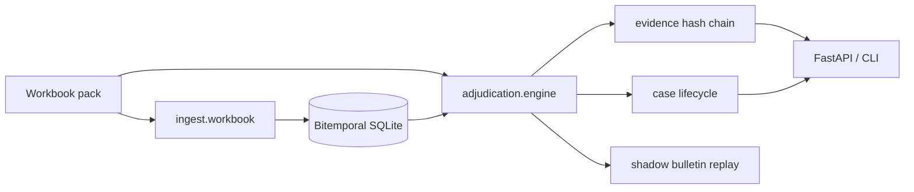

# Kestrel Cold Chain Solutions — The Adjudication Problem

Production-oriented case study submission by **Zulfiqar Ali Ahmed**.

## Executive summary

Kestrel’s failure mode is not “the model is not smart enough.” Reviewers cannot assemble **as-of** product identity, stability allowance, SOP revision, and carrier contract in one place — and cannot reproduce that basis years later (AUD-2603). This repo implements an **evidence-centred, bitemporal adjudication platform**:

- Deterministic as-of engine (closures may auto-complete; product-fate dispositions require human sign-off — Dr Rao).
- SQLite **bitemporal** reference store (valid-time + transaction-time).
- **Hash-chained, tenant-isolated evidence bundles** with 7-year retention metadata; full basis retrieval measured in **&lt;1 ms** locally for EXC-107133.
- Case lifecycle + regulatory-deadline priority queue (INC-2502 storm safety).
- Shadow replay for calibration bulletin TT-CB-114 (Dr Rao gate).
- FastAPI surface, Docker, Makefile, GitHub Actions CI.

**First customer position:** Aurastat (`T-AURA`). See [`docs/01-where-you-land.md`](docs/01-where-you-land.md).

## Quickstart

```bash
python3 -m venv .venv && source .venv/bin/activate
pip install -e ".[dev]"

# Load the real workbook into the bitemporal store
kestrel ingest --reload

# Adjudicate the brief's hero case + persist evidence bundle
kestrel adjudicate --event EXC-107133

# Board commitment 3 — full basis + latency
kestrel basis --event EXC-107133 --tenant T-KAVERI --out examples/basis_EXC-107133.json

# Dr Rao gate — bulletin shadow diff
kestrel shadow-bulletin --out examples/shadow_bulletin_diff.json

# SOP as-at AUD-2603 date
kestrel as-of-sop --tenant T-AURA --date 2025-08-14

# Tests
pytest tests prototype/tests -q

# API
kestrel serve --host 127.0.0.1 --port 8080
```

Or: `make install && make demo && make test`.

## Architecture



Package layout: `src/kestrel_sentinel/` — `domain/`, `resolution/`, `adjudication/`, `evidence/`, `ingest/`, `store/`, `lifecycle/`, `shadow/`, `api/`, `cli.py`.

The earlier `prototype/` package remains as the original engine surface; production code lives under `src/kestrel_sentinel/` (engine logic ported, not abandoned).

## Requirement → implementation traceability

| Where-You-Land req | Implementation | Test |
|---|---|---|
| R1 Evidence assembly | `resolution/*`, `adjudication/engine.py`, evidence `inputs` | golden EXC-107133 |
| R2 Auto-close non-actionable only | engine AUTO_CLOSE path; lifecycle `TRIAGED_NON_ACTIONABLE` | prototype invariants |
| R3 No auto-sign product fate | `requires_human_signature`; lifecycle `sign()` | `test_lifecycle_*` |
| R4 Full basis ≤1h / 7y | `evidence.store.produce_full_basis`, retention metadata | `test_retrieval_latency_under_hour` + `examples/retrieval_latency.txt` |
| R5 Bitemporal as-at | `store/bitemporal.py` `as_of` / `sop_in_force` | `test_aura_sop_as_of_audit_date` |
| R6 Regulatory clock ≠ disposition | `resolution/regulatory.py`; case `reg_deadline_utc` | queue ordering test |
| R7 Tenant isolation (Cl.22) | evidence get requires matching tenant | `test_tenant_isolation_meridian_clause` |
| R8 Deterministic versioned logic | `rule_pack_version` + `ref_snapshot_id` on every bundle | `test_replay_determinism` |
| R9 Cost ceiling | deterministic path; no LLM on hot path | design note |
| R10 First tenant 90d + Rao gate | Aura-first docs; `shadow-bulletin` CLI | `test_shadow_bulletin_*` |

## Sample outputs (committed)

| File | What |
|---|---|
| [`examples/evidence_bundle_EXC-107133.json`](examples/evidence_bundle_EXC-107133.json) | Immutable evidence bundle |
| [`examples/basis_EXC-107133.json`](examples/basis_EXC-107133.json) | Full basis retrieval response |
| [`examples/retrieval_latency.txt`](examples/retrieval_latency.txt) | Measured latency |
| [`examples/shadow_bulletin_diff.json`](examples/shadow_bulletin_diff.json) | TT-CB-114 shadow diffs (sampled) |
| [`examples/adjudication_results_sample.csv`](examples/adjudication_results_sample.csv) | 25-row CLI sample |

## Navigation

| Path | Contents |
|---|---|
| [`docs/01-where-you-land.md`](docs/01-where-you-land.md) | Requirements, non-goals, rollout, board pushback |
| [`docs/02-design.md`](docs/02-design.md) | Architecture matching what was built |
| [`docs/diagrams/`](docs/diagrams/) | Mermaid diagrams |
| [`prototype/`](prototype/) | Original focused engine + 15 tests |
| [`src/kestrel_sentinel/`](src/kestrel_sentinel/) | Production package |
| [`working-log/LOG.md`](working-log/LOG.md) | Honest discard log |
| [`data/`](data/) | Brief + pack (**inputs only — do not modify**) |

## Time spent

Focused working day plus a production hardening pass (bitemporal store, evidence chain, lifecycle, shadow, API, CI).
