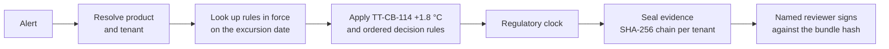

# Kestrel Sentinel: excursion adjudication

[](https://github.com/Zulfiqar7862/kestrel-adjudication-case-study/actions/workflows/ci.yml)


A deterministic engine that takes a cold-chain temperature alert and returns a recommended disposition, a
regulator deadline and a sealed, tamper-evident evidence bundle that a named reviewer signs.

Case-study submission for Kestrel Cold Chain Solutions, "The Adjudication Problem", by **Zulfiqar Ali Ahmed**.

> **Two branches.** [`main`](https://github.com/Zulfiqar7862/kestrel-adjudication-case-study/tree/main) is the
> submission exactly as the brief asks: `README.md` + one-file `kestrel.py` + `data/`.
> **`production`** (this branch) is the same behaviour packaged the way a team would ship it: modules, tests,
> CI, Docker and docs. The engine's output for all 420 alerts is byte-identical across both.

---

## Contents

- [The problem](#the-problem)
- [Quick start](#quick-start)
- [How it works](#how-it-works)
- [Results on the data pack](#results-on-the-data-pack)
- [Project structure](#project-structure)
- [CLI](#cli)
- [HTTP API and dashboard](#http-api-and-dashboard)
- [Testing and quality](#testing-and-quality)
- [Docker](#docker)
- [Configuration](#configuration)
- [Design decisions](#design-decisions)
- [Known limits](#known-limits)
- [Reviewer's 10-minute tour](#reviewers-10-minute-tour)
- [Documentation](#documentation)

## The problem

For each of 420 alerts someone must answer: was the medicine harmed, what do we do with it, and do we owe a
regulator a notification by a deadline? The answer depends on facts that were true **on the excursion date**:
the product's stability study, the customer's SOP revision, the carrier contract, and logger firmware bulletins.
Reviewers spend most of their time finding those facts, not deciding.

So this system puts evidence first. It assembles the as-of facts, applies written rules, seals everything it used,
and leaves product-fate decisions to a named human.

## Quick start

Requires Python 3.10+.

```bash
git clone -b production https://github.com/Zulfiqar7862/kestrel-adjudication-case-study.git
cd kestrel-adjudication-case-study
python -m venv .venv && source .venv/bin/activate
make install            # pip install -e ".[api,dev]"
make test               # 48 tests
kestrel run-all         # adjudicate all 420 alerts
make serve              # open http://127.0.0.1:8080/ui
```

No `make`? Use `pip install -e ".[api,dev]"`, `pytest` and `kestrel serve`.

## How it works



1. **As-of lookups.** A bitemporal SQLite store answers "which SOP applied on that date, as we knew it when we
   decided?"
2. **Rules, not a model.** `decision_rules.py` is an ordered list of 16 small named rules. The first one that
   gives a verdict wins, and each adds a plain-English line to the rationale. Same input, same output.
3. **Evidence.** Every input is written into one JSON bundle with a content hash linked to the previous bundle
   for that tenant. Editing any old bundle is detectable, and one tenant can never read another's.
4. **Human sign-off.** Only non-actionable alerts close automatically. Release, quarantine and destroy wait for
   a reviewer, whose signature is refused if the evidence changed after they looked.

Details: [docs/architecture.md](docs/architecture.md) and [docs/decision-rules.md](docs/decision-rules.md).

## Results on the data pack

`kestrel run-all` on the 420 alerts:

| Outcome | Meaning | Count |
|---|---|---|
| `AUTO_CLOSE` | Non-actionable, closed with an auditable basis | 224 |
| `ESCALATED_TO_SENIOR_QA` | Identity or data unclear, needs a senior reviewer | 80 |
| `RELEASE_WITH_NOTE` | Within allowance, release with a note | 54 |
| `QUARANTINE_PENDING_LAB` | Hold for a lab test | 31 |
| `DESTROY` | Breach beyond any allowance | 31 |

The brief's hero case `EXC-107133` comes out as `RELEASE_WITH_NOTE`, with the SOP overlap flagged.

## Project structure

```text
.
├── src/kestrel/
│   ├── config.py            settings and KESTREL_* env overrides
│   ├── domain.py            enums and dataclasses
│   ├── exceptions.py        error hierarchy mapped to HTTP codes
│   ├── utils.py             shared parsing helpers
│   ├── ingest.py            workbook → SQLite
│   ├── storage/             bitemporal store, hash-chained evidence
│   ├── rules/               identity, as-of, stability, regulatory clock
│   ├── decision_rules.py    named thresholds + ordered disposition rules
│   ├── engine.py            one adjudication, pure and deterministic
│   ├── lifecycle.py         case state machine, deadline-ordered queue
│   ├── shadow.py            replay a rule change and diff outcomes
│   ├── service.py           facade used by CLI and API
│   ├── api/                 FastAPI app + reviewer dashboard (static/index.html)
│   └── cli.py               `kestrel` command
├── tests/                   48 tests (unit, golden cases, API, invariants)
├── docs/                    architecture, rules, API, operations, case-study write-up
├── data/                    case-study inputs (unchanged)
├── Dockerfile · Makefile · pyproject.toml · .github/workflows/ci.yml
```

The engine needs only `openpyxl`. FastAPI is imported lazily, so the CLI and tests run without it.

## CLI

```bash
kestrel adjudicate --event EXC-107133                 # one alert, with rationale
kestrel run-all --out results.csv                     # all alerts
kestrel basis --event EXC-107133 --tenant T-KAVERI    # full evidence basis
kestrel verify --tenant T-KAVERI                      # check the hash chain
kestrel as-of-sop --tenant T-AURA --date 2025-08-14   # SOP in force that day
kestrel shadow-bulletin                               # TT-CB-114 before/after diff
kestrel queue --limit 10                              # cases by regulatory deadline
kestrel agreement                                     # vs historical decisions
kestrel health                                        # on-call signals
kestrel serve                                         # HTTP API + dashboard
```

`python -m kestrel <command>` works too. Run `kestrel --help` for every flag.

## HTTP API and dashboard

`kestrel serve` starts FastAPI on port 8080:

- `/ui` is the reviewer dashboard: search a case, check the facts, seal evidence, verify, sign.
- `/docs` is the interactive OpenAPI page.

```bash
curl -s -X POST localhost:8080/adjudicate -H 'content-type: application/json' \
  -d '{"event_id":"EXC-107133"}'
```

Full endpoint list and error codes: [docs/api.md](docs/api.md).

## Testing and quality

```bash
make test     # pytest, 48 tests
make lint     # ruff check + ruff format --check
make cov      # coverage report
```

| Suite | What it proves |
|---|---|
| `test_decision_rules.py` | each rule, with values on both sides of every threshold |
| `test_golden.py` | known cases such as EXC-107133 give the expected outcome |
| `test_as_of.py` | the SOP in force on an audit date |
| `test_evidence.py` | hash chain, tamper detection, tenant isolation |
| `test_lifecycle.py` | signing, stale-hash refusal, reopen as a new revision |
| `test_invariants.py` | auto-close never needs a signature; fate outcomes always do |
| `test_determinism.py` | replaying a bundle reproduces the decision |
| `test_api.py` | endpoints and their 4xx codes |
| `test_shadow.py`, `test_ops.py`, `test_identity.py` | bulletin replay, health report, identity resolution |

CI runs lint and tests on Python 3.10 to 3.13, then builds the Docker image and calls the running container.

## Docker

```bash
docker build -t kestrel-sentinel .
docker run --rm -p 8080:8080 -v kestrel-data:/var/lib/kestrel kestrel-sentinel
```

Runs as a non-root user with a health check on `/health`. State lives in `/var/lib/kestrel`.

## Configuration

All optional. Copy `.env.example` or export:

| Variable | Default |
|---|---|
| `KESTREL_DATA_PACK` | `data/KCCS_Sentinel_Reference_Data_Pack.xlsx` |
| `KESTREL_DB_PATH` | `<tmp>/kestrel-adjudication/kestrel.sqlite` |
| `KESTREL_EVIDENCE_DIR` | `<tmp>/kestrel-adjudication/evidence` |
| `KESTREL_LOG_LEVEL` | `INFO` |
| `KESTREL_API_HOST` / `KESTREL_API_PORT` | `127.0.0.1` / `8080` |

## Design decisions

| Decision | Why |
|---|---|
| No LLM on the decision path | Virent bans external model APIs; the January pilot cited studies that don't exist; decisions must be versioned and replayable; cost ceiling of USD 0.06 per screened alert |
| Bitemporal store | The inspector asks what was true *then*, and what we knew when we decided |
| Hash-chained evidence per tenant | Seven-year reproducibility (AUD-2603) and MSA clause 22 tenant isolation |
| Auto-close closures only | Dr Rao: "automate closures, not decisions" |
| Separate regulatory clock | 14 late filings sat behind alert storms; the deadline drives queue order |
| Ordered named rules | Each rule is testable on its own, and a reviewer can read why |
| Start with one tenant (Aurastat) | The board minute asks for "one and certain" |

The full reasoning, requirement traceability and board pushback are in
[docs/case-study.md](docs/case-study.md).

## Known limits

- "Next business day" deadlines are approximated as 24 hours, and Brazil's five calendar days are counted in UTC.
  A per-market holiday calendar is the next step.
- SQLite and local JSON files are the prototype store. Production would use Postgres and object storage with
  object lock.
- The dashboard has no login; sign-off takes a typed name. Production needs SSO and e-signature (21 CFR Part 11).

## Reviewer's 10-minute tour

1. **2 min.** Read [How it works](#how-it-works), then the rule table in
   [docs/decision-rules.md](docs/decision-rules.md).
2. **3 min.** Open `src/kestrel/decision_rules.py`. Each `rule_*` function is a few lines with a docstring saying
   why it exists. `decide()` at the bottom is the whole decision loop.
3. **2 min.** Run `kestrel adjudicate --event EXC-107133` and read the rationale lines.
4. **3 min.** `make serve`, open `/ui`, search `EXC-107133`, seal evidence, verify the chain, and try signing
   with a blank name (refused) and then a real one.

## Documentation

| Doc | Contents |
|---|---|
| [architecture.md](docs/architecture.md) | flow, package layout, data model, case states, `kestrel.py` section map |
| [decision-rules.md](docs/decision-rules.md) | rule order, thresholds, how to add a rule safely |
| [api.md](docs/api.md) | every endpoint, body and error code |
| [operations.md](docs/operations.md) | configuration, on-call signals, release process, CI |
| [case-study.md](docs/case-study.md) | the full submission write-up: requirements, design, evidence, working log |
