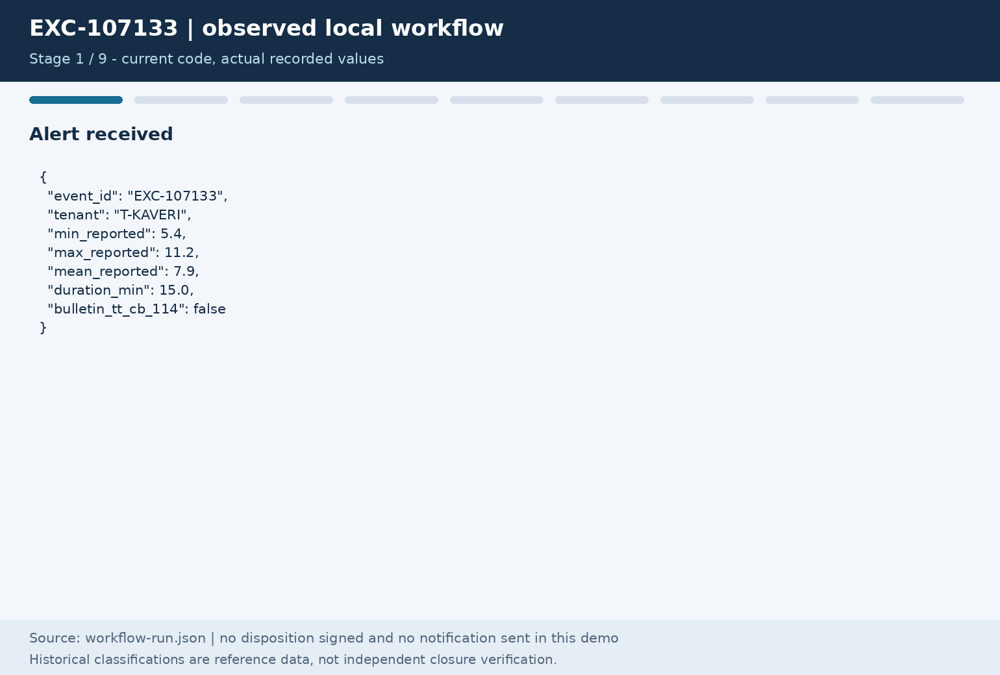

# Kestrel adjudication case study

A local Python prototype for assembling evidence behind temperature-excursion reviews.

These specific defects were addressed; overall safety and production readiness remain unvalidated.

## The problem in five lines

1. Medicines travel within labelled temperature limits.
2. An out-of-range alert does not, by itself, establish product damage or release authority.
3. Reviewers need product, study, site SOP, carrier and measurement evidence.
4. Regulatory notification is a separate obligation from deciding the medicine's fate.
5. The evidence and reasoning must remain retrievable after the decision.

[Original problem and brief page citations](docs/01-problem.md).

## What this does — and does not do

**Does:** read the supplied workbook; assemble reference evidence; run explicit ordered
rules; preserve uncertainty; create review cases and hashed evidence; replay saved
inputs; keep notification obligations in a separate SQLite lane.

**Does not:** validate clinical safety, independently verify duplicate/load claims,
retrieve complete SOP/study documents, authenticate human signers, enforce all
production tenant boundaries, or send/file regulator notifications. No live model
or nine-system production integration runs in the default path.

This branch is unmerged. Do not deploy it as a production decision system.

## Quickstart

From the repository root, with Python 3.10 or newer:

```bash
python3 -m venv .venv
. .venv/bin/activate
python -m pip install -e ".[api,dev]"
python -m pytest
kestrel adjudicate --event EXC-107133
```

The last command returns `ESCALATED_TO_SENIOR_QA`, not a release decision.
For the local dashboard: `kestrel serve`, then open `http://127.0.0.1:8080/ui`.
Notification API routes deny access unless explicit credential/tenant grants are configured.
[API and storage boundaries](docs/04-system-design.md#api-surface).

## One example: EXC-107133

- Supplied summaries: minimum **5.4 °C**, maximum **11.2 °C**, duration **15 minutes**.
- The GTIN matches a tenant master row; that is not independent identity verification.
- Storage text parses to inclusive **2–8 °C**; “protect from light” is retained, not verified.
- Cited **STB-3584** fails study applicability checks. Master allowance prose is not substituted.
- SOP **SOP-KAV-9392** has overlapping revisions; **Rev 03** is metadata, not governing authority.
- `rule_stability_authority` decides **QA escalation**. The case is `AWAITING_REVIEWER`.
- Its independent notification record remains **UNKNOWN**, with no invented legal deadline.



[Actual run JSON used for every GIF value](docs/images/workflow-run.json) ·
[Full workflow and signing limitations](docs/05-workflow.md).
No disposition was signed and no notification was sent for this animation.

## Current sample results

Re-executed on the unchanged 420-alert workbook; not production accuracy or clinical ground truth.

| Recommendation / separate counter | Count |
|---|---:|
| AUTO_CLOSE | 0 |
| ESCALATED_TO_SENIOR_QA | 383 |
| HISTORICAL_CLOSURE_CANDIDATE_UNVERIFIED | 37 |
| Release-with-note / quarantine / destroy | 0 / 0 / 0 |
| Independently verified closures | 0 |
| Notification PENDING (conservative historical Y) | 28 |
| Notification UNKNOWN | 392 |

93 formerly historical candidates now require identity QA. Historical classifications
remain reference data. Historical candidates still need human review. PENDING is not verified legal
reportability; UNKNOWN is not “not reportable”. All sample legal deadlines remain
null/UNKNOWN without controlled applicability/calendar evidence.
[Executed checks, unchanged outcomes and historical reports](docs/06-testing-and-validation.md).

## Read the design

1. [Problem and source evidence](docs/01-problem.md)
2. [HLD: components and boundaries](docs/02-hld.md)
3. [LLD: modules, tables and state machines](docs/03-lld.md)
4. [System design: flow, tenancy, API, failures and scaling](docs/04-system-design.md)
5. [Workflow: review, sign/reopen and notifications](docs/05-workflow.md)
6. [Testing and validation](docs/06-testing-and-validation.md)
7. [Limitations and roadmap](docs/07-limitations-and-roadmap.md)

## Limitations to read first

Typed identity evidence now blocks negative/conflicting alias merges. The supplied
alias observations lack tenant ownership, so they remain candidates, not release
identity. [Identity validation and all changed cases](docs/validation/identity-evidence-review/report.md).
Study discovery, site-annexure resolution, verified batch history and precedent import
are unfinished. Numeric rules and signing paths are not clinically validated.
Most API routes lack production authentication. Evidence files/SQLite are not a
proven WORM archive or highly available deployment. File/index mismatches now
block evidence retrieval, signing and replay, but SQLite plus local files is not
an independent anchor: someone able to rewrite both can still forge evidence.
[Integrity regression results](docs/validation/evidence-chain-review/report.md).
Delivery retry/receipt records
are unverified claims; no worker, legal filing adapter or pager is supplied.

[Detailed limitations and inspection concerns](docs/07-limitations-and-roadmap.md) ·
[Documentation corrections and source SHA-256 check](docs/validation/documentation-review/report.md).
