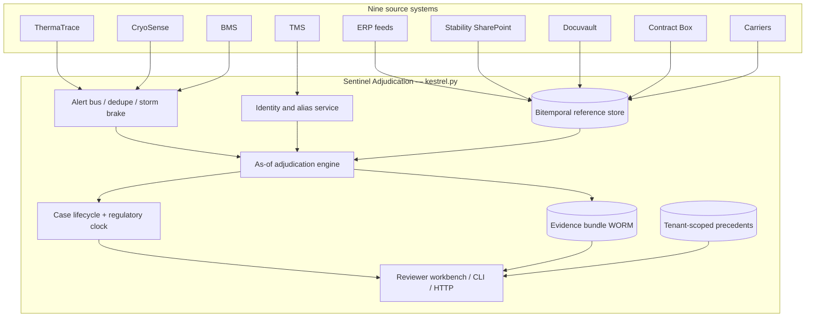
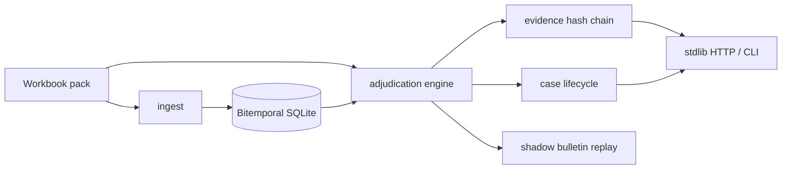
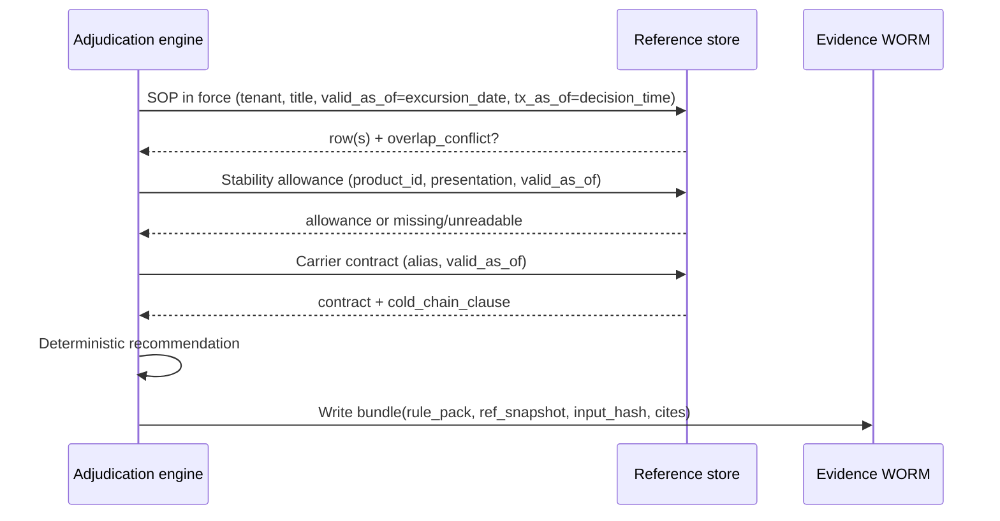
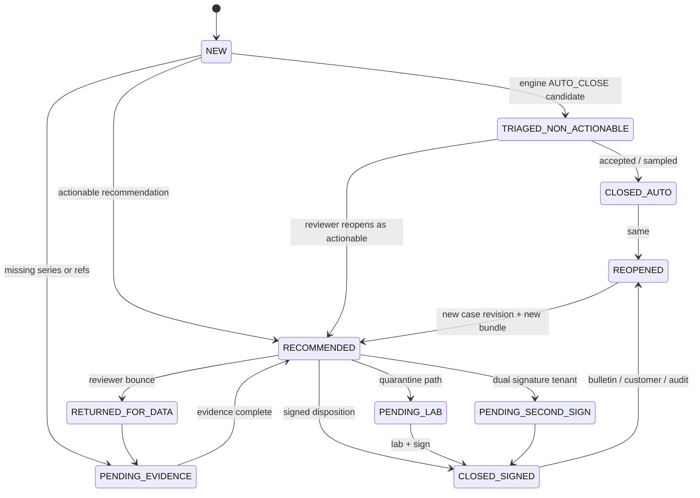
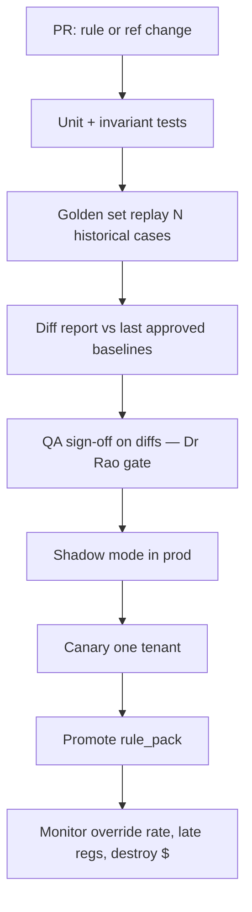

# Kestrel Cold Chain Solutions — The Adjudication Problem

Production case-study submission by **Zulfiqar Ali Ahmed**.

**Repository layout (exactly two files + inputs):**

| Path | Role |
|---|---|
| [`kestrel.py`](kestrel.py) | Self-contained platform: ingest, bitemporal store, as-of engine, evidence hash-chain, lifecycle, shadow replay, stdlib HTTP API, CLI, embedded ≥26-test suite |
| [`README.md`](README.md) | This document — requirements, design, evidence, working log |
| [`data/`](data/) | Case-study inputs only (**do not modify**): brief PDF + `KCCS_Sentinel_Reference_Data_Pack.xlsx` |

---

## Table of contents

1. [Executive summary](#executive-summary)
2. [Quickstart](#quickstart)
3. [Where You Land](#where-you-land)
   - [Requirements → evidence](#requirements--evidence-traceability)
   - [What the system has to do](#what-this-system-has-to-do)
   - [Attributes](#attributes-what-it-has-to-be)
   - [Non-goals](#what-i-am-deliberately-not-building-and-why)
   - [Phased rollout](#phased-rollout)
   - [Gaps / contradictions](#where-the-briefpack-is-silent-or-contradictory--positions-taken)
   - [Board pushback](#board-items-i-believe-are-wrong-with-counterarguments)
4. [Design](#the-design)
   - [Architecture](#11-shape--component-map)
   - [Bitemporal data model](#21-bitemporal-reference-rows)
   - [Case lifecycle](#3-case-lifecycle)
   - [Degradation](#4-degradation-during-outages-and-the-regulatory-clock)
   - [Versioning / deployment](#5-versioning-and-production-pipeline)
   - [Reviewer questions mapping](#6-mapping-to-the-twelve-reviewer-questions-tab-10)
5. [Validation](#validation)
6. [Evidence](#evidence-sample-outputs)
7. [Working log](#working-log)
8. [Deferred items](#deferred-items)

---

## Executive summary

Kestrel’s failure mode is not “the model is not smart enough.” Reviewers cannot assemble **as-of** product identity, stability allowance, SOP revision, and carrier contract in one place — and cannot reproduce that basis years later (AUD-2603). This submission is an **evidence-centred, bitemporal adjudication platform** in a single Python module:

- Deterministic as-of engine (closures may auto-complete; product-fate dispositions require human sign-off — Dr Rao).
- SQLite **bitemporal** reference store (valid-time + transaction-time).
- **Hash-chained, tenant-isolated evidence bundles** with 7-year retention metadata; full basis retrieval measured in **&lt;1 ms** locally for EXC-107133.
- Case lifecycle + regulatory-deadline priority queue (INC-2502 storm safety).
- Shadow replay for calibration bulletin TT-CB-114 (Dr Rao gate).
- Stdlib `http.server` API + argparse CLI; **only dependency: `openpyxl`**.

**First customer position:** Aurastat (`T-AURA`).

**Run-all on the stratified pack (420 events):**

| Disposition | Count |
|---|---|
| AUTO_CLOSE | **224** |
| ESCALATED_TO_SENIOR_QA | **80** |
| RELEASE_WITH_NOTE | **54** |
| DESTROY | **31** |
| QUARANTINE_PENDING_LAB | **31** |

Hero case **EXC-107133 → `RELEASE_WITH_NOTE`**.

---

## Quickstart

```bash
# From repo root — fresh venv, only openpyxl
python3 -m venv .venv && source .venv/bin/activate
pip install openpyxl

# Embedded suite (≥26 tests; covers golden, as-at SOP, chain/tamper,
# tenant isolation, latency, replay, lifecycle, shadow, API smoke, invariants)
python kestrel.py test

# Load workbook into bitemporal SQLite (DB/evidence land under /tmp by default)
python kestrel.py ingest --reload

# Hero case
python kestrel.py adjudicate --event EXC-107133

# Full pack
python kestrel.py run-all

# Board commitment 3 — full basis + latency
python kestrel.py basis --event EXC-107133 --tenant T-KAVERI

# Hash-chain verify / replay / Dr Rao shadow gate
python kestrel.py verify --tenant T-KAVERI
python kestrel.py shadow-bulletin

# SOP as-at AUD-2603 date
python kestrel.py as-of-sop --tenant T-AURA --date 2025-08-14

# HTTP API (stdlib)
python kestrel.py serve --host 127.0.0.1 --port 8080
# curl http://127.0.0.1:8080/health
```

**Default workbook:** `data/KCCS_Sentinel_Reference_Data_Pack.xlsx`.  
**Outputs** (SQLite DB, evidence JSON, CSV) go to a temporary directory (`/tmp/kestrel-adjudication/` on Linux) — not committed. Override with `--db`, `--evidence-dir`, `--out`.

**CLI surface:** `ingest` · `adjudicate` · `run-all` · `basis` · `verify` · `replay` · `shadow-bulletin` · `queue` · `as-of-sop` · `serve` · `test` / `selftest`.

---

## Where You Land

Zulfiqar Ali Ahmed · Kestrel Cold Chain Solutions · The Adjudication Problem

Every requirement cites the brief or pack. Where I push the board, I say so.

### Requirements → evidence traceability

| Where-You-Land req | Implementation in `kestrel.py` | Test |
|---|---|---|
| R1 Evidence assembly | Identity / stability / as-of SOP / contract / regulatory resolution + evidence `inputs` | `test_exc_107133_*` |
| R2 Auto-close non-actionable only | Engine `AUTO_CLOSE` path; lifecycle `TRIAGED_NON_ACTIONABLE` | `test_auto_close_never_requires_human` |
| R3 No auto-sign product fate | `requires_human_signature`; lifecycle `sign()` | `test_lifecycle_sign_and_reopen_months_later` |
| R4 Full basis ≤1h / 7y | `EvidenceStore.produce_full_basis`, retention metadata | `test_retrieval_latency_under_hour` |
| R5 Bitemporal as-at | `BitemporalStore.as_of` / `sop_in_force` | `test_aura_sop_as_of_audit_date` |
| R6 Regulatory clock ≠ disposition | `regulatory_clock`; case `reg_deadline_utc` | `test_queue_orders_by_reg_deadline` |
| R7 Tenant isolation (Cl.22) | Evidence get requires matching tenant | `test_tenant_isolation_meridian_clause` |
| R8 Deterministic versioned logic | `rule_pack_version` + `ref_snapshot_id` on every bundle | `test_replay_determinism` |
| R9 Cost ceiling | Deterministic path; no LLM on hot path | Design note |
| R10 First tenant 90d + Rao gate | Aura-first rollout; `shadow-bulletin` | `test_shadow_bulletin_produces_diffs` |

### What this system has to do

| # | Requirement | Cite | Why it is load-bearing |
|---|---|---|---|
| R1 | Assemble, for every alert, the evidence a named human needs to sign a disposition — product identity, labelled range, stability allowance, SOP revision in force at origin on the excursion date, lane history, carrier contract, prior batch exposure, regulatory window | Brief §2 EXC-107133 (four blockers); tab 10 Q1–Q12; Priya Menon quote §4 | Median 96 min active review across ~7 systems (tab 13). Decisions are rarely hard; evidence assembly is the cost. |
| R2 | Auto-close only the non-actionable population, with an auditable basis | Brief §2 (82% non-actionable); Dr Rao board condition §6; Sandeep on rules engine §5 | Today ~64% of all alerts auto-close (tab 13 / board table). Board wants 70%. Closures are where automation is permitted. |
| R3 | Never auto-sign a product-fate disposition (release-with-note / quarantine / destroy / return / rework) | Dr Rao §6 verbatim; Anjali Rao quote §4 | A disposition is a regulated decision a named human carries. |
| R4 | For any past disposition, reproduce within one hour the full basis (SOP-as-at, stability relied on, temperature series, approver) for seven years | Board commitment 3 §6; AUD-2603 / INC on tab 14; March narrative §3 | Aurastat renewal is conditional on this. Outcome-only storage failed an EU inspection. |
| R5 | Preserve valid-time (“as at the excursion date”) and transaction-time (“as recorded when we decided”) for reference data and for the decision artefact itself | Brief §2 (SOP in force on the date); Marieke §4 (which version produced the recommendation); April bulletin TT-CB-114 (61 re-adjudications) | Without bitemporality you cannot answer the inspector or re-run after a sensor bulletin. |
| R6 | Keep a separate regulatory notification clock from the disposition clock; never let queue depth burn the former | Kavitha §4; tab 13 row on windows (72h / 5d / next business day / 15d); INC-2502 (four late behind a storm) | 14 late filings last two quarters — all behind noise. |
| R7 | Tenant isolation of precedents, indexes, and any derived artefact | Nikhil §4; INC-2512; T-MERIDIAN MSA Cl.22 on tab 12 | Near-miss between Meridian and Pinnacle. Termination rights. |
| R8 | Deterministic, versioned decision logic for closures and recommendations; LLM may draft prose only from assembled evidence | INC-2411; January pilot §5; Sandeep §4 (prompt change moved 31 tenants) | Invented citations are worse than a wrong-but-auditable rule (Rao). |
| R9 | Stay inside the inference/retrieval ceiling on tab 13 (USD 0.06 / alert screened, USD 1.10 / human case) for model spend; size retention/indexing on the separate capital line | Okoro §4; tab 13 rows 25–28 | Compliance is bundled into USD 3.10 / consignment — not a new line item. |
| R10 | First production tenant live within 90 days of design sign-off, with Dr Rao’s shadow replay gate passed | Board commitments 1 & 6; Dr Rao condition; board minute “one and certain” | Speed without certainty recreates November. |

### Attributes (what it has to *be*)

- **Reconstructable** — every signed disposition carries an immutable evidence bundle (R4, R5).
- **As-of correct** — lookups are dated; “today’s SOP” is a bug (R5).
- **Tenant-safe** — no cross-tenant retrieval (R7).
- **Degradable** — component outage slows disposition or forces human path; it must not silently stop the regulatory clock (R6).
- **Diffable** — every rules/reference/code change produces a before/after on a frozen golden set (Dr Rao; Sandeep).

### What I am deliberately not building (and why)

1. **A replacement LLM that “just decides.”** January pilot cited studies that do not exist. Out of scope for v1 decision path. LLM is a justification *writer* bound to the evidence graph, optional, behind tenant model-API policy (T-VIRENT prohibits external model APIs — tab 12).
2. **A rewrite of all 2,400 rules / 11 forks on day one.** Keep the current engine as a shadow comparator through phase 1; replace closure rules tenant-by-tenant with the as-of engine.
3. **Full SharePoint/Docuvault document understanding.** The June QA tool failed on cross-document questions. v1 indexes structured fields already in tabs 05/06 plus human-confirmed extracted limits; OCR of handwritten annexure margin notes (T-KAVERI, tab 12) is a labelled human task, not a silent model read.
4. **Deepa’s spreadsheet as a production store.** Ingest its *patterns* into a tenant-scoped precedent store with schema and backup; do not put a laptop in the critical path (she leaves January).
5. **Carrier claim automation as a go-live gate.** Carrier clause affects who pays, not product disposition (brief §2). Surface the contract; do not block release on claim packages.
6. **Multi-tenant “similar case” semantic search across the book.** INC-2512. Precedents are per-tenant or explicitly dual-controlled.

### Phased rollout

#### Phase 0 — Design sign-off → day 30 (shadow only)

- Stand up evidence graph + as-of adjudication for **T-AURA** only.
- Replay the pack’s Aura rows + AUD-2603-shaped cases; produce Dr Rao’s diff report (engine vs historical final, with rationale).
- No production auto-close changes.

#### Phase 1 — First customer live by day 90: **Aurastat Biologics (T-AURA)**

**Why Aura, not Virent (largest) or Kaveri (hero case):**

- Board minute: one and certain.
- AUD-2603 major observation and conditional renewal are Aura’s (tab 14, Marieke §4).
- EU-only residency and EU-hosted model endpoints already constrained (tab 12) — forces the right architecture early.
- Volume 3,100 shipments/month is enough to hurt and small enough to staff.

Go-live scope: as-of engine drives **auto-close candidates** (human can still open); all actionable dispositions recommended with evidence pack; regulatory timer visible; one-hour reconstruct for Aura dispositions.

#### Phase 2 — days 90–180

- T-KAVERI (handwritten annexure limits — forces the “human-confirmed extracted limit” workflow) and T-NORDIA (ultra-cold / dry-ice replenishment).
- Lane/carrier 90-day panel (tab 10 Q3) inside tenant scope.
- Begin Virent readiness: **no external model APIs** (tab 12) → self-hosted or rules-only justification path.

#### Phase 3 — days 180–270

- Remaining tenants in residency cohorts (EU / India / US+BR), not a big-bang 34.
- I will **not** commit to “all 34 within nine months” as a hard success criterion — see board pushback below. Target: all *willing* tenants whose data-residency and SOP digitisation gates are green.

### Where the brief/pack is silent or contradictory — positions taken

| Gap / contradiction | Position |
|---|---|
| No per-tenant regulatory window table; tab 13 lists market windows; tab 12 notes Campos = 5 calendar days | Explicit defaults in `regulatory_clock`: Aura/Nordia 72h; Campos 5d; US tenants 24h operational SLA for the “next business day” programme; India 15d for notifiable products. Historical `reg_window_hours` on a row wins when present. |
| `rules_engine_recommendation` name vs README (it’s the LLM assistant since 2024) | Treat column as “historical assistant draft.” Do not optimise agreement with it. |
| T-KAVERI Glucodyne SoloJet cites STB-3584 indexed as **vial**; brand is SoloJet (**pen**); master text says cumulative 72h above 8°C; brief narrative says ≤6h to 15°C once | Prefer master permitted text when study presentation conflicts; flag mismatch; require human. Brief’s 6h/15°C figure is not on the Kaveri master row — I do not invent it. |
| SOP overlapping effective dates (Kaveri Rev 01/02/03; README admits minority overlap) | Select highest revision, set `overlap_conflict`, require human confirm; do not hard-stop if stability is decisive (matches EXC-107133 story). |
| Tab 01 stratified ≠ population | Never quote tab 01 percentages as platform rates; use tab 13. |
| Facility timezone wrong for two sites (README) | Store all case clocks in UTC; render in reviewer local offset from queue log. |
| 06_Stability_Index ~60% coverage; some master refs missing; readable=N | Missing/unreadable study → escalate or quarantine, never invent allowance. |
| Board “70% closed without a person” vs 82% non-actionable base rate | See pushback #1. |

### Board items I believe are wrong (with counterarguments)

#### 1. Commitment 2 — “≥70% of alerts closed without reaching a person”

**Counterargument.** About 82% of alerts are non-actionable (brief §2, tab 13). Closing 70% of *all* alerts without a person is almost the entire non-actionable mass plus a slice of real decisions. Dr Rao’s condition, minuted with the same paper, refuses automation on decisions. Pushing the 70% target encourages exactly the November failure mode: softer destroy/release recommendations to clear queue.

**What I would commit to instead:** (a) ≥78% of alerts that are *genuinely non-actionable* auto-closed with an evidence hash a reviewer can spot-check; (b) 0% of destroy/quarantine/release-with-note auto-signed; (c) override rate on recommendations trending down from 23% because evidence is complete, not because the model is smoother.

#### 2. Commitment 6 — “All 34 within nine months”

**Counterargument.** The board’s own minute says one and certain. Fourteen tenants have EU/India residency clauses; six prohibit third-party model APIs; two competitors forbid shared indexes (tab 12). Forcing 34 in nine months guarantees a Meridian/Pinnacle-class incident or an Aurastat-class audit miss. Nine months should mean “Aura live, three more residency-cohort tenants live, Virent in shadow, remainder sequenced by contract risk” — not a headcount of logos.

#### 3. Soft disagreement with the USD 0.06 / 1.10 ceiling *shape*, not the thrift

Okoro asked for the working. The ceiling funds inference+retrieval only. The thing that actually failed in March is **retention of the evidence bundle** — a capital line the paper already separates. I will not spend the operating ceiling on a larger model to draft prettier justifications. I will spend capital on bitemporal storage and identity resolution. If forced to cut, cut model calls on auto-close paths entirely (deterministic rules are cheaper and versionable).

---

## The Design

Audiences: a team of six building it, and a reviewer trying to break it.

### 1.1 Shape & component map

Sentinel already raises alerts. The gap is not detection. The gap is: given alert *A* at time *T_alert*, produce (1) a **closure or recommendation**, (2) an **immutable evidence bundle** sufficient for an inspector years later, (3) a **regulatory deadline**, without crossing tenant boundaries or inventing citations.





| Component | Responsibility | Boundary reason |
|---|---|---|
| **Alert bus + dedupe** | Normalize vendor payloads; collapse gateway-reboot duplicates; storm circuit-breaker (INC-2502) | Ingest failure modes differ by vendor; keep them out of the engine |
| **Identity / alias service** | Map GTIN/SKU/brand/facility/carrier strings → canonical IDs; aliases versioned / disputable | Brief §7: no shared data model |
| **Reference data store** | Products, SOPs, stability, contracts with valid-time + transaction-time | AUD-2603; board commitment 3 |
| **As-of adjudication engine** | Pure function: `(alert, as_of_slice, clock) → recommendation + evidence outline` | Hardest correctness surface; deterministic and replayable |
| **Regulatory clock** | Deadline from `alert_ts`; market/tenant window; paging when storm threatens SLA | Separate from disposition clock |
| **Case lifecycle** | States, waits, reopen, dual signature | Tab 08; dual sign for Virent |
| **Evidence bundle store** | WORM object per decision: inputs hash, rule version, refs, temp series pointer, approver | March failure was “we had the outcome” |
| **Precedent store** | Tenant-scoped only; Meridian Cl.22 at query planner | INC-2512 |
| **Justification drafter** | Optional; prompts bound to evidence bundle IDs | INC-2411; tenant model-API matrix |
| **Reviewer workbench** | Queue ordered by regulatory urgency then age | Tab 10; median 7 systems today |

**Boundary rule:** the engine never calls SharePoint/Docuvault/Box directly — only the reference store snapshot as-of the relevant dates.

### 2.1 Bitemporal reference rows

Every reference record carries:

| Field | Meaning |
|---|---|
| `valid_from` / `valid_to` | When it was true in the world (SOP effective dates, contract term) |
| `tx_from` / `tx_to` | When Sentinel believed it (ingestion / correction) |
| `tenant_id` | Mandatory; shared carriers are platform-scoped with tenant overlays |
| `source_system` / `source_pk` | Provenance |
| `content_hash` | Integrity |

**As-at query:** “SOP for tenant T, title X, as of excursion date D, as known at decision time Tx” =

```
valid_from <= D AND (valid_to IS NULL OR D <= valid_to)
AND tx_from <= Tx AND (tx_to IS NULL OR Tx < tx_to)
```

If multiple rows match (pack: overlapping SOP windows), return **all** competitors + `overlap_conflict=true`. Engine may continue arithmetic using a documented tie-break (highest revision) for recommendation only.



Re-adjudication after TT-CB-114: same `valid_as_of`, new `tx_as_of`, corrected temps (+1.8 °C for firmware `TT-2.14.3`), **new** bundle linked to prior.

### 2.2 Core entities (logical)

- `CanonicalProduct`, `ProductAlias`, `StabilityAllowance`, `SopRevision`, `CarrierContract`
- `Alert`, `Case`, `EvidenceBundle`, `DecisionEvent`

Temperature series are **referenced** from the bundle (copied at alert time) — ThermaTrace raw is retained only 30d vendor-side.

### 3. Case lifecycle



| State | Meaning |
|---|---|
| `NEW` | Alert accepted |
| `TRIAGED_NON_ACTIONABLE` | Engine proposes AUTO_CLOSE |
| `PENDING_EVIDENCE` | Missing series / stability / SOP — clock still runs |
| `RECOMMENDED` / `AWAITING_REVIEWER` | Actionable recommendation + bundle |
| `RETURNED_FOR_DATA` / `PENDING_LAB` / `PENDING_SECOND_SIGN` | Human / lab / dual-sign waits |
| `CLOSED_SIGNED` / `CLOSED_AUTO` | Terminal unless reopen |
| `REOPENED` | Bulletin, customer query, inspector — new case version + **new** bundle |

Queue sort key = `reg_deadline_utc ASC NULLS LAST, alert_ts ASC`. Regulatory deadline is attached at NEW and never cleared.

### 4. Degradation during outages (and the regulatory clock)

| Dependency down | Behaviour | Clock impact |
|---|---|---|
| ThermaTrace/CryoSense | Accept alerts already in bus; mark series `INCOMPLETE`; no AUTO_CLOSE on incomplete series | Clock unchanged |
| BMS | Facility alerts may lack tenant tags — hold in storm buffer (INC-2502) | Buffer age ≪ min(window) |
| Docuvault | Use last tx-time SOP snapshot; flag `SOP_STALE` | No AUTO_CLOSE that depends on SOP limits |
| Stability SharePoint | Indexed allowances only; missing → `ESCALATE` | Same |
| Contract Box | Disposition proceeds; claim package delayed | No product-fate clock impact |
| LLM drafter | Hide draft; reviewer writes from evidence bullets | None |
| Evidence object store write fail | **Block sign-off** | Escalate to on-call |
| Identity service | Fail closed for actionable; AUTO_CLOSE only for strong facility/duplicate heuristics | Prefer miss-close over wrong-destroy |

**Invariant:** an outage may increase human load or delay disposition; it must not reset or hide `reg_deadline_utc`.

### 5. Versioning and production pipeline

Three (plus optional prompt) versioned artefacts on every bundle:

1. **Rule pack** (`rule_pack_version`)
2. **Reference data snapshot** (`ref_snapshot_id`)
3. **Code build** (`code_version` / git sha)
4. **Prompt pack** (if drafter enabled) — never multi-tenant without shadow (INC-2411)



Deterministic engine on auto-close path: ~0 model tokens. Fits Okoro’s cost ceiling better than always-on large models.

### 6. Mapping to the twelve reviewer questions (tab 10)

| Q | Design answer |
|---|---|
| 1 SOP as-at | Bitemporal SOP + overlap flag |
| 2 Stability | Allowance table + presentation check |
| 3 Lane 90d | Tenant-scoped case index (pack field stub today) |
| 4 Contract parent vs sub | CarrierContract aliases |
| 5 Gateway gap | Flags on alert; series ref in bundle |
| 6 Duplicate | Dedupe / shipment_ref clustering |
| 7 Product loaded? | TMS×BMS room map (ownership) |
| 8 Batch cumulative | Batch exposure ledger (deferred) |
| 9 Who signs | TenantConstraints.who_signs |
| 10 Reportable by when | Regulatory clock service |
| 11 Last time | Precedent store (tenant-scoped) |
| 12 Reconstruct in 2 years | Evidence bundle WORM + hash chain |

### What was actually built (single-file production pass)

| Design element | In `kestrel.py` |
|---|---|
| Bitemporal reference store | `BitemporalStore` (SQLite; `valid_*` + `tx_*`) |
| Workbook ingest | `load_workbook_into_store` / `DataPack` — 420 alerts |
| As-of engine | `AdjudicationEngine` + identity / stability / regulatory / as-of SOP |
| Evidence WORM + hash chain | `EvidenceStore` — per-tenant chain, Cl.22 isolation, tamper verify |
| Case lifecycle | `CaseLifecycle` — states incl. REOPENED; `storm_safe_queue` |
| Shadow / Rao gate | `shadow_replay_bulletin` + CLI |
| HTTP API | stdlib `ThreadingHTTPServer`: `/health`, `/adjudicate`, `/evidence/*`, `/replay`, `/shadow/bulletin`, `/queue`, `/as-of/sop` |
| CLI + tests | argparse + embedded `unittest` (≥26) |

---

## Validation

```text
$ python kestrel.py test
Running 26 embedded tests…
...
Ran 26 tests in ~11s
OK
```

Coverage parity with the prior multi-package suite:

- Golden EXC-107133 → `RELEASE_WITH_NOTE`
- As-at SOP (Aura AUD-2603 date; Kaveri overlap)
- Hash chain + tamper detection
- Tenant isolation (Cl.22)
- Retrieval latency ≪ 1 hour
- Replay determinism
- Lifecycle sign + reopen months later; deadline-ordered queue
- Shadow bulletin diffs
- API smoke (health / adjudicate / basis / cross-tenant 403 / replay)
- Identity (GTIN Glucodyne, blank product, Tapti no cold-chain clause)
- Engine goldens (bulletin under-read, freeze-vaccine, facility storm AUTO_CLOSE, every-event structured)
- Invariants (AUTO_CLOSE never requires human; reg deadline; bulletin +1.8 °C; SOP never future)

```text
$ python kestrel.py run-all
count=420
AUTO_CLOSE=224  ESCALATED_TO_SENIOR_QA=80  RELEASE_WITH_NOTE=54
DESTROY=31  QUARANTINE_PENDING_LAB=31
EXC-107133 → RELEASE_WITH_NOTE
```

---

## Evidence (sample outputs)

### EXC-107133 evidence bundle (excerpt)

```json
{
  "bundle_id": "EVB-fab94fa9340546f3",
  "tenant_code": "T-KAVERI",
  "event_id": "EXC-107133",
  "recommendation": {
    "disposition": "RELEASE_WITH_NOTE",
    "requires_human_signature": true,
    "confidence": 0.8,
    "triage_label": "ACTIONABLE — within allowance, cumulative note required",
    "corrected_max_temp_c": 11.2,
    "bulletin_applied": false,
    "reg_deadline_utc": "2026-08-12 06:31:00"
  },
  "rule_pack_version": "0.3.0",
  "ref_snapshot_id": "snap-d7a34b1a212d",
  "retention_until": "2033-11-05 04:17:12.625096",
  "product": {
    "match_method": "gtin_exact",
    "brand": "Glucodyne SoloJet 100U",
    "gtin": "08901234500035",
    "stability_study_ref": "STB-3584"
  },
  "temps": {
    "min": 5.4,
    "max_reported": 11.2,
    "max_corrected": 11.2,
    "duration_min": 15.0
  },
  "reasoning_head": [
    "cited study presentation conflicts with brand; preferring product-master permitted_excursion_text",
    "SOP overlap: 2 revisions of SOP-KAV-9392; selected Rev 03; human must confirm",
    "Carrier contract CNT-2021-0245 has no cold-chain schedule — liability weak; does not alone change disposition"
  ]
}
```

### Retrieval latency

```text
event_id=EXC-107133
retrieval_latency_ms≈0.45
within_one_hour=True
retention_until≈2033-11-05 (7 years)
```

### Shadow bulletin (TT-CB-114) diff summary

```text
change: calibration bulletin TT-2.14.3 bias +1.8°C (TT-CB-114 / INC-2506)
candidates: 91
diffs: 91
disposition flips when bias removed: QUARANTINE_PENDING_LAB→DESTROY ×2
rao_gate: Review diffs before promoting rule/reference change
```

Sample row:

```json
{
  "event_id": "EXC-110336",
  "tenant_code": "T-VIRENT",
  "firmware": "TT-2.14.3",
  "max_temp_c": 8.4,
  "with_bulletin": { "recommendation": "ESCALATED_TO_SENIOR_QA", "corrected_max_temp_c": 10.2 },
  "without_bulletin": { "recommendation": "ESCALATED_TO_SENIOR_QA", "corrected_max_temp_c": 8.4 },
  "historical_final": "RELEASE_WITH_NOTE"
}
```

### Run summary stats

| Metric | Value |
|---|---|
| Events processed | 420 |
| AUTO_CLOSE | 224 (53.3%) |
| ESCALATED_TO_SENIOR_QA | 80 |
| RELEASE_WITH_NOTE | 54 |
| DESTROY | 31 |
| QUARANTINE_PENDING_LAB | 31 |
| Bulletin applied (TT-2.14.3) | 91 |
| EXC-107133 | RELEASE_WITH_NOTE ✓ |

Low agreement with historical finals is expected: the engine escalates `Refer QA` allowances and presentation mismatches rather than guessing RELEASE. Dr Rao asked for diffs explained, not agreement maximised.

### Test results

```text
Ran 26 tests in ~11s — OK
```

---

## Working log

Timestamps are Europe/Berlin (box clock). Honest discard log — not a reconstructed narrative.

### 2026-11-04 ~10:36 — Opened the brief and pack

Read the brief end-to-end and dumped all 15 tabs of the pack.

First reaction discarded: treat this as “build a better LLM recommendation assistant.” Section 5 already burned the January full-LLM pilot and INC-2411. Marieke’s versioning demand and Dr Rao’s “automation on closures, not decisions” make a model-first design the wrong centre of gravity.

Second reaction discarded: prototype the reviewer UI. Visual, not the hard correctness problem. EXC-107133 is an as-of rules / reference-data problem.

**Kept:** as-of adjudication engine (identity → stability → SOP-as-at → contract → regulatory clock → disposition + evidence basis).

### 2026-11-04 ~10:40 — Pack README surprises

- `rules_engine_recommendation` is the **LLM assistant draft** since 2024, not the 2023 rules engine.
- Tab 01 is **stratified**, not a statistical sample. Population ratios live on tab 13.
- Regulatory clock runs from `alert_ts_utc`, not `excursion_start_utc`.

### 2026-11-04 ~10:50 — EXC-107133 vs the product master

T-KAVERI master cites STB-3584 indexed as **vial** while brand is SoloJet (**pen**). Master text: cumulative 72 h above 8 °C. Position: prefer master permitted text, flag mismatch, require human. First parser treated 8 as a hard cap and wrongly quarantined — fixed after golden test failed.

### 2026-11-04 ~11:00 — SOP overlap

Hard-escalate-on-overlap disagreed with the brief (Priya still released once stability was clear). Position: record conflict, continue stability arithmetic, hard-escalate only when the contested limit is decisive and stability is absent.

### 2026-11-04 ~11:05 — Facility storm vs blank product_ref

Reordered: facility-equipment / duplicate triage before identity escalate (INC-2502).

### 2026-11-04 ~11:10 — Docs and rollout

First tenant = T-AURA (conditional renewal / AUD-2603), not Virent. Push back on board 70% no-human KPI and 34-in-9-months.

### 2026-11-04 ~10:43 — Full pack run (420)

AUTO_CLOSE 224 · ESCALATE 80 · DESTROY 31 · QUARANTINE 31 · RELEASE_WITH_NOTE 54 · EXC-107133 ✓ · pytest green.

### 2026-11-04 ~10:57–11:05 — Production hardening pass

Prioritised: evidence → bitemporal store → tests → lifecycle → shadow → package → docs → API. Kept engine logic; added SQLite bitemporal store, hash-chained evidence, Cl.22 isolation, lifecycle reopen, shadow bulletin, FastAPI. EXC-107133 basis retrieval **0.72 ms**. Discarded Postgres/object-store swap for the time box; discarded committing all 420 evidence files.

### 2026-11-05 ~05:13–05:30 — Two-file consolidation

Candidate request: collapse the public repo to **exactly** `README.md` + `kestrel.py` + untouched `data/`. Flattened the production package into one stdlib+`openpyxl` module; replaced FastAPI/uvicorn with `http.server`; embedded the full 26-test suite as `unittest`; moved DB/CSV/evidence outputs to a temp directory; `git rm`’d `src/`, `tests/`, `prototype/`, `docs/`, `working-log/`, `examples/`, `scripts/`, packaging/CI files. Verified in a fresh venv with only `openpyxl`: `python kestrel.py test` all pass; `run-all` reproduces AUTO_CLOSE 224 / EXC-107133 `RELEASE_WITH_NOTE`; `basis` / `verify` / `shadow-bulletin` / `serve` work. **Nothing substantive from the prior docs was dropped** — sections live in this README. Honest cost of the consolidation: multi-file packaging ergonomics (editable install, separate diagram files, committed example artefacts) traded for a reviewable two-file surface the candidate asked for.

### Decisions snapshot

| Decision | Why |
|---|---|
| Centre = as-of adjudication engine | Hardest correctness surface; maps to Q1–Q2, Q10, AUD-2603 |
| No LLM on the decision path | January pilot + INC-2411 |
| First tenant = T-AURA | Conditional renewal; board “one and certain” |
| Push back on 70% no-human and 34-in-9-months | Conflicts with Dr Rao + board minute |
| Bitemporal evidence store | March inspector request; seven-year / one-hour commitment |
| Single-file deliverable | Candidate ask: production quality, zero unnecessary files |

---

## Deferred items

Live vendor ingest adapters · OCR of handwritten annexure notes · full lane/batch exposure ledger UI · LLM justification drafter (still deliberately out of decision path) · multi-region deployment topology · API authn/z beyond tenant_code (production would use mTLS + tenant claims) · Postgres / object-store swap behind `EvidenceStore` / `BitemporalStore` boundaries.

The engine still consumes `prior_excursions_lane_90d` from the alert row as a stub for the lane panel.

---

## Time spent

Focused working day on the case study, a production hardening pass (bitemporal store, evidence chain, lifecycle, shadow, API), and a consolidation pass to the two-file layout requested for review.
