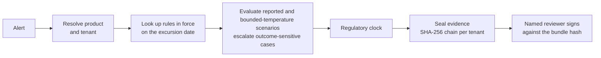

# Kestrel Sentinel: excursion adjudication

[](https://github.com/Zulfiqar7862/kestrel-adjudication-case-study/actions/workflows/ci.yml)


A deterministic engine that takes a cold-chain temperature alert and returns a recommended disposition, a
regulator deadline and a sealed, tamper-evident evidence bundle that a named reviewer signs.

Case-study submission for Kestrel Cold Chain Solutions, "The Adjudication Problem", by **Zulfiqar Ali Ahmed**.

> **Branch context.** [`main`](https://github.com/Zulfiqar7862/kestrel-adjudication-case-study/tree/main) is the
> earlier compact submission: `README.md` + one-file `kestrel.py` + `data/`. This was a packaging choice, not a requirement in the brief.
> **`fix/correctness-review`** is an unmerged correction branch; `production` is unchanged. This remains a modular prototype with specific correctness fixes, tests, CI, Docker and docs.
>
> These specific defects were addressed; overall safety and production readiness remain unvalidated.
> Outcomes now differ from `main`; this is not a validated production deployment.

---

## Contents

- [The problem](#the-problem)
- [Quick start](#quick-start)
- [How it works](#how-it-works)
- [Results on the data pack](#results-on-the-data-pack)
- [Project structure](#project-structure)
- [CLI](#cli)
- [HTTP API and dashboard](#http-api-and-dashboard)
- [Testing and quality](#testing-and-quality)
- [Docker](#docker)
- [Configuration](#configuration)
- [Design decisions](#design-decisions)
- [Known limits](#known-limits)
- [Reviewer's 10-minute tour](#reviewers-10-minute-tour)
- [Documentation](#documentation)

## The problem

The workbook is a deliberately stratified sample of 420 alerts, not production volume (~11,400 alerts/month).
For each alert someone must answer: was the medicine harmed, what do we do with it, and do we owe a
regulator a notification by a deadline? The answer depends on facts that were true **on the excursion date**:
the product's stability study, the customer's SOP revision, the carrier contract, and logger firmware bulletins.
Reviewers spend most of their time finding those facts, not deciding.

So this system puts evidence first. It assembles the as-of facts, applies written rules, seals everything it used,
and leaves product-fate decisions to a named human.

## Quick start

Requires Python 3.10+.

```bash
git clone -b fix/correctness-review https://github.com/Zulfiqar7862/kestrel-adjudication-case-study.git
cd kestrel-adjudication-case-study
python -m venv .venv && source .venv/bin/activate
make install            # pip install -e ".[api,dev]"
make test               # 190 tests
kestrel run-all         # adjudicate all 420 alerts
make serve              # open http://127.0.0.1:8080/ui
```

No `make`? Use `pip install -e ".[api,dev]"`, `pytest` and `kestrel serve`.

## How it works



1. **As-of lookups.** SQLite supports valid/transaction-time queries. The live engine uses dated in-memory
   workbook rows, not a transaction-time store slice; replay uses the references sealed in its bundle.
2. **Rules, not a model.** `decision_rules.py` is an ordered list of 20 named rules plus a fallback. The first one that
   gives a verdict wins, and each adds a plain-English line to the rationale. Same input, same output.
3. **Evidence.** Every input is written into one JSON bundle with a content hash linked to the previous bundle
   for that tenant. Stored content/link edits can be detected. Evidence reads require the matching tenant; this alone does not enforce clause 22 over every derived artefact.
4. **Human sign-off.** Only AUTO_CLOSE is marked as not requiring a signature; fate recommendations wait for a named reviewer and a mandatory viewed hash. Signing verifies the actual bundle, rejects stale/tampered evidence, and appends a signature bundle. Authentication and mandated dual signature remain unfinished.

Details: [docs/code-walkthrough.md](docs/code-walkthrough.md), [docs/architecture.md](docs/architecture.md) and [docs/decision-rules.md](docs/decision-rules.md).

## Results on the data pack

`kestrel run-all` on the 420-alert stratified evidence sample (not a platform auto-close KPI), rerun 7 Nov 2026 (CET):

| Outcome | Meaning | Count |
|---|---|---|
| `AUTO_CLOSE` | No closures emitted; independently verified closure count is also zero | 0 |
| `HISTORICAL_CLOSURE_CANDIDATE_UNVERIFIED` | Unresolved historical reference; human review in PENDING_EVIDENCE | 130 |
| `ESCALATED_TO_SENIOR_QA` | Identity, data or uncertainty needs senior review | 290 |
| `RELEASE_WITH_NOTE` | Prototype recommendation; human review required | 0 |
| `QUARANTINE_PENDING_LAB` | Hold for a lab test | 0 |
| `DESTROY` | Prototype severe-breach recommendation | 0 |

EXC-107133 now returns ESCALATED_TO_SENIOR_QA: the cited study does not establish product/presentation/type applicability, and the governing SOP/site annexure is unresolved. Product-master prose is not a substitute. No batch ledger was invented; cumulative exposure assessment is unresolved without verified history.

Shadow: 91 firmware candidates and 91 scenario/evidence diffs, **0 disposition flips**. Historical-final agreement: 4/200 (2%); assistant-draft agreement: 0/420 (0%). These are sample comparisons, not safety/production-accuracy claims.

Before (0.4.2): **130/290/0/0/0** in AUTO_CLOSE/QA/note/quarantine/destroy order. After (0.4.3): **0/290/0/0/0**, plus **130 unverified historical candidates** (93 duplicate, 37 facility/no-product). All 130 changed to unresolved review; no closure-count target was used. `closure_counts` separately reports verified AUTO_CLOSE **0**, historical candidates **130**, and other unverified AUTO_CLOSE **0**. No independent duplicate/load verification artifact was found or invented. [Executed report, failing/passing tests and every changed event](docs/validation/historical-candidates-review/report.md).

The [0.4.2 storage-limit report and 86-case table](docs/validation/storage-limits-review/report.md) and [0.4.1 correctness report](docs/validation/correctness-review/report.md) are retained as historical snapshots, not current counts.

## Project structure

```text
.
├── src/kestrel/
│   ├── config.py            settings and KESTREL_* env overrides
│   ├── domain.py            enums and dataclasses
│   ├── exceptions.py        error hierarchy mapped to HTTP codes
│   ├── utils.py             shared parsing helpers
│   ├── ingest.py            workbook → SQLite
│   ├── storage/             bitemporal store, hash-chained evidence
│   ├── rules/               identity, as-of, stability, regulatory clock
│   ├── decision_rules.py    named thresholds + ordered disposition rules
│   ├── engine.py            one adjudication, pure and deterministic
│   ├── lifecycle.py         case state machine, deadline-ordered queue
│   ├── shadow.py            replay a rule change and diff outcomes
│   ├── service.py           facade used by CLI and API
│   ├── api/                 FastAPI app + reviewer dashboard (static/index.html)
│   └── cli.py               `kestrel` command
├── tests/                   190 tests (unit, golden cases, API, invariants)
├── docs/                    architecture, rules, API, operations, case-study write-up
├── data/                    case-study inputs (unchanged)
├── Dockerfile · Makefile · pyproject.toml · .github/workflows/ci.yml
```

The engine needs only `openpyxl`. FastAPI is imported lazily, so the CLI and tests run without it.

## CLI

```bash
kestrel adjudicate --event EXC-107133                 # one alert, with rationale
kestrel run-all --out results.csv                     # all alerts
kestrel basis --event EXC-107133 --tenant T-KAVERI    # full evidence basis
kestrel verify --tenant T-KAVERI                      # check the hash chain
kestrel as-of-sop --tenant T-AURA --date 2025-08-14   # SOP in force that day
kestrel shadow-bulletin                               # TT-CB-114 before/after diff
kestrel queue --limit 10                              # cases by regulatory deadline
kestrel agreement                                     # vs historical decisions
kestrel health                                        # on-call signals
kestrel serve                                         # HTTP API + dashboard
```

`python -m kestrel <command>` works too. Run `kestrel --help` for every flag.

## HTTP API and dashboard

`kestrel serve` starts FastAPI on port 8080:

- `/ui` distinguishes verified closures from unverified historical candidates, shows their historical reference, and suppresses final signing for the unresolved candidate category. Search a case, inspect facts, seal evidence and request review.
- `/docs` is the interactive OpenAPI page.

```bash
curl -s -X POST localhost:8080/adjudicate -H 'content-type: application/json' \
  -d '{"event_id":"EXC-107133"}'
```

Full endpoint list and error codes: [docs/api.md](docs/api.md).

## Testing and quality

```bash
make test     # pytest, 190 tests
make lint     # ruff check + ruff format --check
make cov      # coverage report
```

| Suite | What it proves |
|---|---|
| `test_decision_rules.py` | selected rule-order and threshold boundary cases; not exhaustive clinical or interaction coverage |
| `test_golden.py` | known cases such as EXC-107133 give the expected outcome |
| `test_as_of.py` | the SOP in force on an audit date |
| `test_evidence.py` | hash chain, tamper detection, tenant isolation |
| `test_lifecycle.py` | signing, stale-hash refusal, reopen as a new revision |
| `test_invariants.py` | auto-close never needs a signature; fate outcomes always do |
| `test_determinism.py` | replaying a bundle reproduces the decision |
| `test_api.py` | endpoints and their 4xx codes |
| `test_historical_candidates.py` | historical labels cannot authorize closure; API/schema, rendered UI counts, evidence, lifecycle, CLI and metrics distinguish review candidates |
| `test_shadow.py`, `test_ops.py`, `test_identity.py` | bulletin replay, health report, identity resolution |

CI runs lint and tests on Python 3.10 to 3.13, then builds the Docker image and calls the running container.

## Docker

```bash
docker build -t kestrel-sentinel .
docker run --rm -p 8080:8080 -v kestrel-data:/var/lib/kestrel kestrel-sentinel
```

Runs as a non-root user with a health check on `/health`. State lives in `/var/lib/kestrel`.

## Configuration

All optional. Copy `.env.example` or export:

| Variable | Default |
|---|---|
| `KESTREL_DATA_PACK` | `data/KCCS_Sentinel_Reference_Data_Pack.xlsx` |
| `KESTREL_DB_PATH` | `<tmp>/kestrel-adjudication/kestrel.sqlite` |
| `KESTREL_EVIDENCE_DIR` | `<tmp>/kestrel-adjudication/evidence` |
| `KESTREL_LOG_LEVEL` | `INFO` |
| `KESTREL_API_HOST` / `KESTREL_API_PORT` | `127.0.0.1` / `8080` |

## Design decisions

| Decision | Why |
|---|---|
| No LLM on the decision path | Virent bans external model APIs; the January pilot cited studies that don't exist; decisions must be versioned and replayable; cost ceiling of USD 0.06 per screened alert |
| Bitemporal store | The inspector asks what was true *then*, and what we knew when we decided |
| Hash-chained evidence per tenant | Detect edits to stored bundles; seven-year archival completeness and clause 22 controls over all derived data remain production requirements |
| Historical classification is not closure authority | Unverified candidates stay in human review; no verified closure adapter is invented |
| Separate regulatory clock | 14 late filings sat behind alert storms; the deadline drives queue order |
| Ordered named rules | Each rule is testable on its own, and a reviewer can read why |
| Propose Aurastat first | Candidate risk-based choice; board asks for "one and certain", not a named tenant |

The full reasoning, requirement traceability and board pushback are in
[docs/case-study.md](docs/case-study.md).

## Known limits

- Notification obligations now have an independent durable queue (`kestrel notifications --tenant T`, `/notifications`). Signing, closing, storms or assembler failure cannot suppress it. No approved tenant/product/market calendar is supplied: legal deadlines remain UNRESOLVED; historical windows are reference only. Controlled calendar arithmetic is not legal-policy validation. No filing-delivery verification adapter is supplied.
- SQLite and local JSON files are the prototype store. Production would use Postgres and object storage with
  object lock.
- Missing/invalid **required measurements** and **unresolved storage text** are separate QA reasons. Explicit one-sided limits require only their corresponding extremum; mean never substitutes. Strictness/inclusivity is preserved, and no lower bound is invented. Additional restrictions are retained separately, not independently verified.
- Carrier resolution prefers unique exact legal entity, then exact alias, then unique substring; ambiguity is recorded, never resolved by name length.
- All 130 prior historical AUTO_CLOSEs now require human review as `HISTORICAL_CLOSURE_CANDIDATE_UNVERIFIED`; raw triage is reference data only. Other coded numeric AUTO_CLOSE paths remain unverified prototype heuristics (zero sample emissions), never silently counted as independently verified closures.
- SOP bodies/site annexures are absent: no release or allowance-based closure is authorised from index pointers. Cumulative lifetime allowances require verified batch history, unavailable here.
- The dashboard has no login; sign-off takes a typed name. Production needs SSO and e-signature (21 CFR Part 11).

- TT-CB-114 compares endpoint scenarios on supplied summaries (min/max/mean), not every possible raw series. Firmware-only applicability lacks device/date calibration.
- Shortened expiry is missing; RELEASE_WITH_NOTE is not equivalent. ESCALATED_TO_SENIOR_QA is a queue/review state still represented in the disposition enum; RELEASE/RETURN/REWORK have no emitting rule.
- No raw series/source-document archive, batch-exposure ledger, live storm admission/collapse/fairness, independent pager, or seven-year object-lock/restore guarantee. Aliases lack tenant provenance; matches are tenant-filtered candidates, not verified identity authority.
- Signing appends a hash-linked artifact but local file/SQLite writes are not a cross-resource atomic transaction or authenticated e-signature.
- No model API calls does not prove total retrieval/retention/residency/staffing cost.

## Reviewer's 10-minute tour

1. **2 min.** Read [How it works](#how-it-works), then the rule table in
   [docs/decision-rules.md](docs/decision-rules.md).
2. **3 min.** Open `src/kestrel/decision_rules.py`. Each `rule_*` function is a few lines with a docstring saying
   why it exists. `decide()` at the bottom is the whole decision loop.
3. **2 min.** Run `kestrel adjudicate --event EXC-107133` and read the rationale lines.
4. **3 min.** `make serve`, open `/ui`, search `EXC-107133`, seal evidence, verify the chain, and try signing
   with a blank name (refused) and then a real one.

For the full execution path, follow [one alert through the code](docs/code-walkthrough.md).

## Documentation

| Doc | Contents |
|---|---|
| [code-walkthrough.md](docs/code-walkthrough.md) | one real alert followed through every module, with the reasons behind each design choice |
| [architecture.md](docs/architecture.md) | flow, package layout, data model, case states, `kestrel.py` section map |
| [decision-rules.md](docs/decision-rules.md) | rule order, thresholds, how to add a rule safely |
| [api.md](docs/api.md) | every endpoint, body and error code |
| [operations.md](docs/operations.md) | configuration, on-call signals, release process, CI |
| [case-study.md](docs/case-study.md) | the full submission write-up: requirements, design, evidence, working log |
