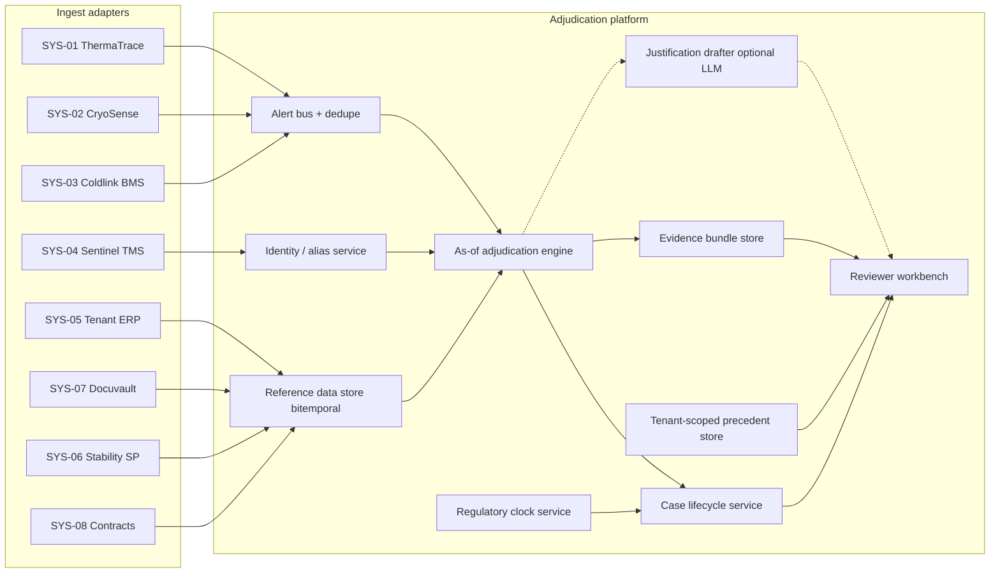
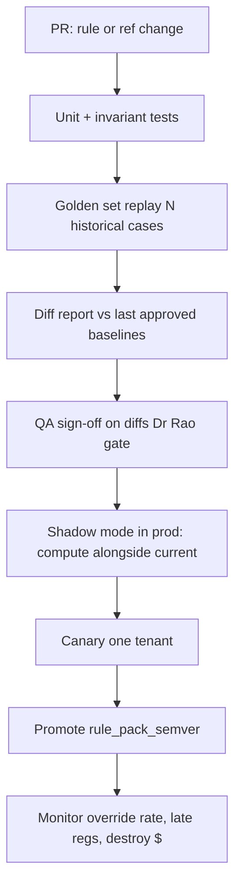

# The Design

Zulfiqar Ali Ahmed · Sentinel Adjudication Platform

Audiences: a team of six building it, and a reviewer trying to break it.

Related diagrams: [`diagrams/architecture.md`](diagrams/architecture.md), [`diagrams/case-lifecycle.md`](diagrams/case-lifecycle.md), [`diagrams/as-of-query.md`](diagrams/as-of-query.md).

---

## 1. Shape of the thing (HLD)

### 1.1 Problem restated as a system

Sentinel already raises alerts. The gap is not detection. The gap is: given alert *A* at time *T_alert*, produce (1) a **closure or recommendation**, (2) an **immutable evidence bundle** sufficient for an inspector years later, (3) a **regulatory deadline**, without crossing tenant boundaries or inventing citations.

### 1.2 Component map



| Component | Responsibility | Boundary reason |
|---|---|---|
| **Alert bus + dedupe** | Normalize vendor payloads; collapse gateway-reboot duplicates (CryoSense known issue, tab 11); storm circuit-breaker (INC-2502) | Ingest failure modes differ by vendor; keep them out of the engine |
| **Identity / alias service** | Map GTIN/SKU/brand/facility/carrier strings → canonical IDs; aliases are first-class, versioned, disputable (tab 07 “Disputed by TMS owner”) | Brief §7: no shared data model; mapping lives in heads today |
| **Reference data store** | Products, SOPs, stability, contracts with valid-time + transaction-time | AUD-2603; board commitment 3 |
| **As-of adjudication engine** | Pure function: `(alert, as_of_slice, clock) → recommendation + evidence outline` | Hardest correctness surface; must be deterministic and replayable |
| **Regulatory clock** | Deadline from `alert_ts`; market/tenant window; paging when storm threatens SLA | Separate from disposition clock (tab 13 / Kavitha) |
| **Case lifecycle** | States, waits, reopen, dual signature | Tab 08 actions; dual sign for Virent (tab 12) |
| **Evidence bundle store** | WORM object per decision: inputs hash, rule version, refs, temp series pointer, approver | March failure was “we had the outcome” |
| **Precedent store** | Tenant-scoped only; Meridian Cl.22 enforced at query planner | INC-2512 |
| **Justification drafter** | Optional; prompts bound to evidence bundle IDs; never retrieves raw competitor text | INC-2411; tenant model-API matrix |
| **Reviewer workbench** | Queue ordered by regulatory urgency then age; shows evidence, not seven systems | Tab 10; median 7 systems today |

### 1.3 What crosses boundaries

- **Alert → Engine:** canonical alert DTO + correlation ids only.
- **Engine → Case:** recommendation enum, confidence, evidence outline ids, reg deadline.
- **Case → Evidence store:** on every state transition that a human or system “says,” append an event; never update in place.
- **Workbench → Precedent:** query carries `tenant_id`; store rejects missing tenant; cross-tenant joins do not exist.
- **Drafter → LLM provider:** redacted evidence summary; batch identifiers only if tenant permits; Aura = EU endpoint; Virent = no external call.

---

## 2. Data model (LLD)

### 2.1 Bitemporal reference rows

Every reference record carries:

| Field | Meaning |
|---|---|
| `valid_from` / `valid_to` | When it was true in the world (SOP effective dates, contract term) |
| `tx_from` / `tx_to` | When Sentinel believed it (ingestion / correction) |
| `tenant_id` | Mandatory; shared carriers are platform-scoped with tenant overlays |
| `source_system` / `source_pk` | Provenance |
| `content_hash` | Integrity |

**As-at query:** “SOP for tenant T, title X, facility F, as of excursion date D, as known at decision time Tx” =

```
valid_from <= D AND (valid_to IS NULL OR D <= valid_to)
AND tx_from <= Tx AND (tx_to IS NULL OR Tx < tx_to)
```

If multiple rows match (pack: overlapping SOP windows), return **all** competitors + `overlap_conflict=true`. UI blocks one-click accept until the reviewer picks. Engine may continue arithmetic using a documented tie-break (highest revision) for recommendation only.

Full bitemporal diagram: [`diagrams/as-of-query.md`](diagrams/as-of-query.md).

### 2.2 Core entities (logical)

- `CanonicalProduct(tenant_id, product_id, gtin?, sku?, brand?, inn?, presentation, storage_range, …)`
- `ProductAlias(tenant_id, raw_string, product_id, confidence, confirmed_by, disputed)`
- `StabilityAllowance(product_id, study_ref, presentation, valid_from/to, max_temp_c?, max_hours?, cumulative, absolute_cap_c?, readable, extracted_by)`
- `SopRevision(doc_id, rev, tenant_id, valid_from/to, facilities[], limits_locator, scan_flags)`
- `CarrierContract(contract_id, legal_entity, aliases[], valid_from/to, cold_chain_clause, claim_window_days, parent_contract_id?)`
- `Alert(event_id, alert_ts_utc, excursion_start/end, logger_fw, temps, flags, tenant_id, shipment_ref, raw_product_ref, …)`
- `Case(case_id, alert_id, state, reg_deadline_utc, assignee, …)`
- `EvidenceBundle(bundle_id, case_id, rule_pack_version, code_version, as_of_dates, input_hash, object_uri)`
- `DecisionEvent(case_id, at_utc, actor, from_state, to_state, recommendation, final_disposition?, bundle_id)`

### 2.3 Temperature series

Keep raw series (or vendor buckets) **referenced** from the bundle, not pasted into Postgres. ThermaTrace raw retained only 30d (tab 11) → **copy into our object store at alert time**. April bulletin re-adjudication is impossible without this.

---

## 3. Case lifecycle

See [`diagrams/case-lifecycle.md`](diagrams/case-lifecycle.md).

| State | Meaning | Wait / exit |
|---|---|---|
| `NEW` | Alert accepted | Auto → triage |
| `TRIAGED_NON_ACTIONABLE` | Engine proposes AUTO_CLOSE | Spot-check sample; else `CLOSED_AUTO` |
| `PENDING_EVIDENCE` | Missing series / stability / SOP | Wait with SLA; clock still runs |
| `RECOMMENDED` | Actionable recommendation + bundle draft | Awaiting human |
| `RETURNED_FOR_DATA` | Reviewer bounced (tab 08) | Back to evidence |
| `PENDING_LAB` | Quarantine path | Lab result wait; **reg notify may still be due** — release-with-note + retrospective flag is a first-class alternative (override EXC-110553) |
| `PENDING_SECOND_SIGN` | Virent dual QA etc. | Second actor |
| `CLOSED_SIGNED` | Disposition signed | Terminal unless reopen |
| `CLOSED_AUTO` | Auto-closed | Terminal unless reopen |
| `REOPENED` | Bulletin, customer query, inspector | New case version linked to prior bundle; months later supported |

**Reopen months later (April bulletin / EXC-107133 customer query):** create `CaseRevision` with `reason=BULLETIN|CUSTOMER_QUERY|AUDIT`, re-run engine with `tx_as_of=now` but `valid_as_of=original_excursion_date`, and **new** bundle. Never mutate the original bundle. Original invoices/claims get compensating events (INC-2506: nine invoices withdrawn).

**Waiting logic:** every wait records `waiting_on` and `reg_deadline_utc`. Queue sort key = `reg_deadline_utc ASC NULLS LAST, alert_ts ASC`. Storm mode (see §4) sheds non-actionable before actionable.

---

## 4. Degradation during outages (and the regulatory clock)

| Dependency down | Behaviour | Clock impact |
|---|---|---|
| ThermaTrace/CryoSense | Accept alerts already in bus; mark series `INCOMPLETE`; no AUTO_CLOSE on incomplete series | Clock unchanged; page regulatory onerous tenants first |
| BMS | Facility alerts may lack tenant tags (tab 11) — hold in storm buffer; do not flood queue (INC-2502 lesson) | Buffer has hard age limit << min(window) |
| Docuvault | Use last tx-time snapshot of SOP index; flag `SOP_STALE` | Recommendations allowed with flag; no AUTO_CLOSE that depends on SOP limits |
| Stability SharePoint | Use indexed allowances only; missing → `ESCALATE` | Same |
| Contract Box | Disposition proceeds; claim package delayed | No clock impact on product fate |
| LLM drafter | Hide draft; reviewer writes from evidence bullets | No clock impact |
| Evidence object store write fail | **Block sign-off** (cannot create unauditable decisions) | Escalate to on-call; manual paper path is SOP-owned emergency only |
| Identity service | Fail closed for actionable; AUTO_CLOSE only for duplicates/facility with strong heuristics | Prefer miss-close over wrong-destroy |

**Invariant:** an outage may increase human load or delay disposition; it must not reset or hide `reg_deadline_utc`. Missed notifications are P1 pages, not queue statistics.

---

## 5. Versioning and production pipeline

### 5.1 Three versioned artefacts

1. **Rule pack** (`rule_pack_semver`) — deterministic engine logic + parsed allowance schemas.
2. **Reference data snapshot** (`ref_snapshot_id`) — identity, SOP, stability, contracts as-of tx time.
3. **Code build** (`git_sha`) — adapters, API, UI.
4. **Prompt pack** (if drafter enabled) — separate semver; tenant allow-list; **never** ship a prompt change multi-tenant without shadow (INC-2411).

Every `EvidenceBundle` stores all four.

### 5.2 Pipeline



- **Golden set:** start from pack strata (24 overrides, 61 bulletin cases, EXC-107133, late notifications) plus ongoing sampling of signed cases. Stored as `(event_id, expected_disposition?, must_cite_fields, forbidden_citations)`.
- **Shadow mode:** new pack computes in parallel for 14 days; disagreements open review tasks; no customer-facing change.
- **Rule-version replay:** given `bundle_id`, re-execute the exact `rule_pack_semver` + `ref_snapshot_id` offline. This is how we sleep at 03:00.
- **Prompt changes:** banned from the hot path for closures; drafter prompts require the same golden+shadow gate and **tenant fan-out is opt-in** (default off).

### 5.3 Cost shape (quiet Sunday test)

Deterministic engine on auto-close path: ~0 model tokens. Drafter only on human-queue cases. Embedding/precedent retrieval tenant-scoped, batch off-peak. Fits Okoro’s “quiet Sunday” constraint better than always-on large models (tab 13 price list: prefer Provider A small / EU, or self-hosted for Virent).

---

## 6. Mapping to the twelve reviewer questions (tab 10)

| Q | Design answer |
|---|---|
| 1 SOP as-at | Bitemporal SOP + overlap UI |
| 2 Stability | Allowance table + presentation check |
| 3 Lane 90d | Tenant-scoped case index by lane/carrier/asset |
| 4 Contract parent vs sub | CarrierContract aliases + governing_law |
| 5 Gateway gap | Flags on alert; raw series in object store |
| 6 Duplicate | Dedupe service + shipment_ref clustering |
| 7 Product loaded? | TMS×BMS room map (explicit ownership) |
| 8 Batch cumulative | Batch exposure ledger |
| 9 Who signs | TenantConstraints.who_signs |
| 10 Reportable by when | Regulatory clock service |
| 11 Last time | Precedent store (tenant-scoped) |
| 12 Reconstruct in 2 years | Evidence bundle WORM |

---

## 7. Prototype scope vs production

The prototype implements the **as-of adjudication engine** + pack loaders + identity/SOP/stability/regulatory slices + CLI replay. Stubs: live ingest, workbench, WORM store, LLM drafter, batch ledger, full alias governance UI. That split is intentional — see `docs/01-where-you-land.md` and `prototype/README.md`.

---

## 8. What was actually built (production pass, 2026-11-04)

This section updates the design to match the code in `src/kestrel_sentinel/`.

| Design element | Code |
|---|---|
| Bitemporal reference store | `store/bitemporal.py` (SQLite; `valid_*` + `tx_*`) |
| Workbook ingest adapter | `ingest/workbook.py` → products, SOPs, stability, contracts, aliases, tenants, 420 alerts |
| As-of engine | `adjudication/engine.py` (ported from prototype) + `resolution/*` |
| Evidence WORM + hash chain | `evidence/store.py` — content-addressed JSON under `.data/evidence/<tenant>/`, indexed in SQLite |
| Tenant isolation | `EvidenceStore.get(..., tenant_code=)` raises `PermissionError` on cross-tenant (Meridian Cl.22) |
| Case lifecycle | `lifecycle/machine.py` — states incl. REOPENED; `storm_safe_queue` by `reg_deadline_utc` |
| Shadow / Rao gate | `shadow/replay.py` + `kestrel shadow-bulletin` |
| HTTP API | `api/app.py` (FastAPI): `/adjudicate`, `/evidence/*`, `/replay`, `/shadow/bulletin`, `/queue`, `/as-of/sop` |
| CLI | `kestrel` entry point (`cli.py`) |
| Packaging / CI | `pyproject.toml`, `Dockerfile`, `Makefile`, `.github/workflows/ci.yml` |

**Deferred (documented, not blocking the evidence/audit story):** live vendor ingest adapters, OCR of handwritten annexure notes, full lane/batch exposure ledger UI, LLM justification drafter, multi-region deployment topology. The engine still consumes `prior_excursions_lane_90d` from the alert row as a stub for the lane panel.
