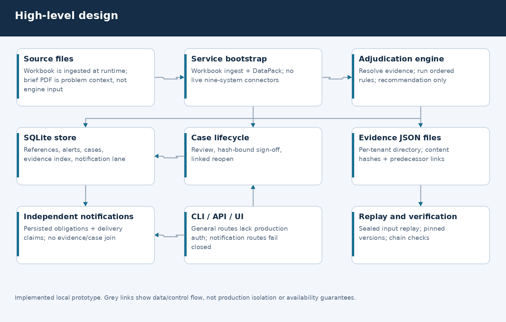
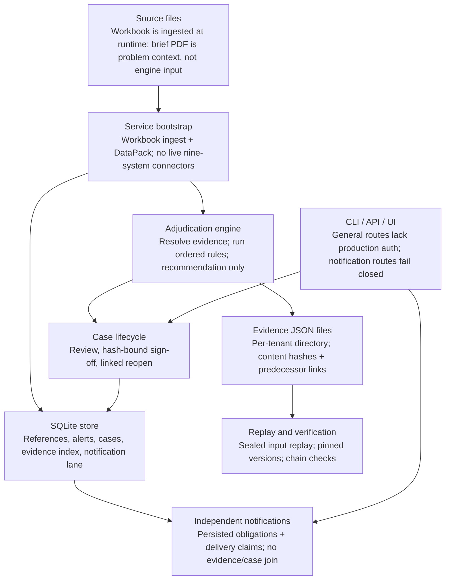

# 02 · High-level design

These specific defects were addressed; overall safety and production readiness remain unvalidated.

## Implemented shape

One local Python application exposes CLI commands and an optional FastAPI/UI.
`AdjudicationService` coordinates a workbook-backed `DataPack`, deterministic
engine, SQLite, local evidence JSON, case lifecycle and an independent notification
lane. These are modules, not separately deployed microservices.

Editable source: [Mermaid](diagrams/hld.mmd), [layout](diagrams/diagrams.json), [renderer](diagrams/render_visuals.py).

Diagram source (Mermaid)

## Boundaries

- **Source boundary:** supplied workbook rows and index pointers are evidence claims,
  not verified documents or raw telemetry. The PDF explains the problem only.
- **Recommendation boundary:** the engine resolves references and walks explicit
  rules. A recommendation is not an authorised release/destruction instruction.
- **Review boundary:** historical closure text becomes an unverified review
  candidate, not proof of duplicate/no-load eligibility.
- **Persistence boundary:** SQLite stores alerts, reference intervals, cases and
  indexes; JSON files store sealed calculation inputs. File/index writes are not a
  transactional distributed archive.
- **Independent obligation boundary:** notification reads never join case/evidence
  state. Standalone notification HTTP and pre-bootstrap CLI reads work without
  evidence assembly. They record work, not legal filings.
- **Security boundary:** only the notification HTTP lane currently has explicit
  credential/tenant grants. Other routes are not a production tenant wall.

## Deliberately not claimed

No clinical model, approved legal calendar registry, automated verified closure
adapter, operational nine-system integration, authenticated two-person sign-off,
production residency enforcement, WORM deployment or HA service is established.
[System design and documented-only scaling](04-system-design.md).
