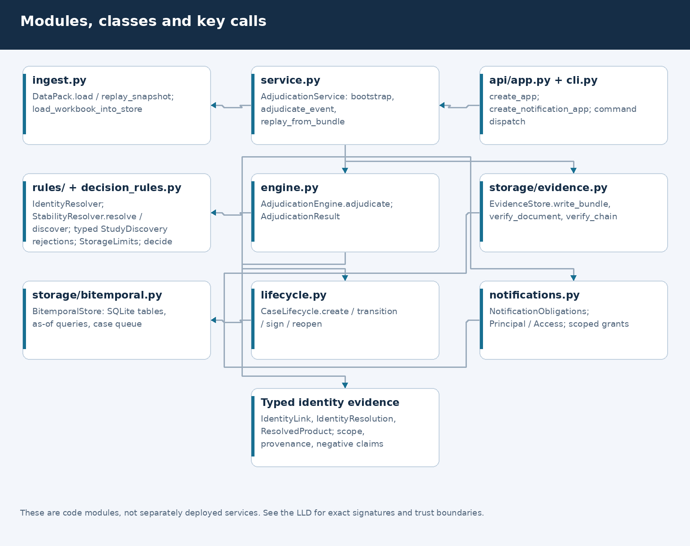
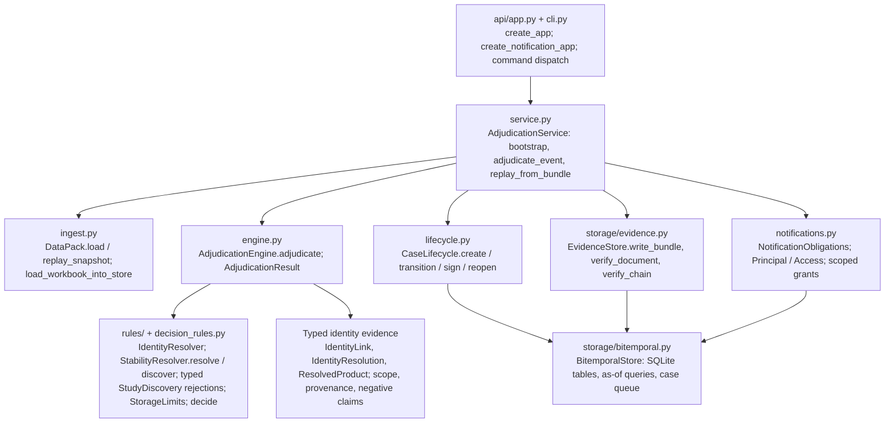
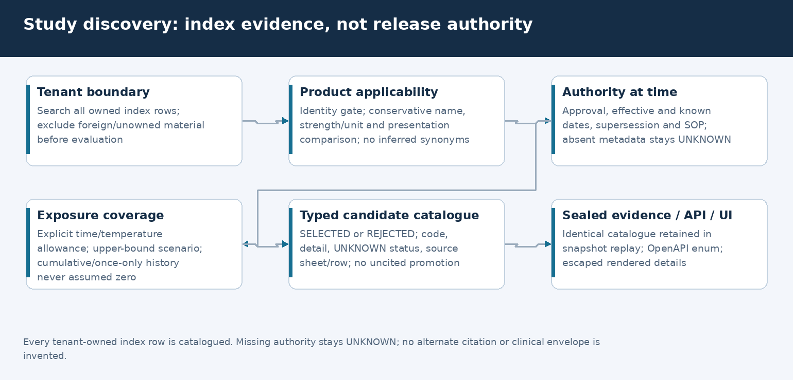
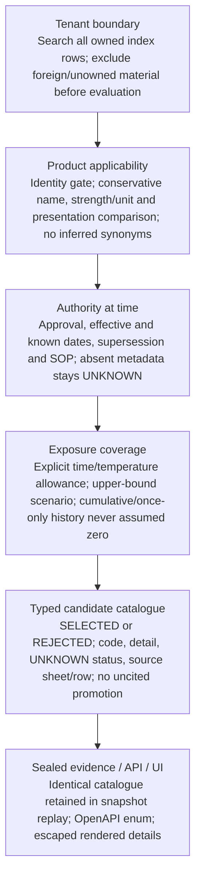
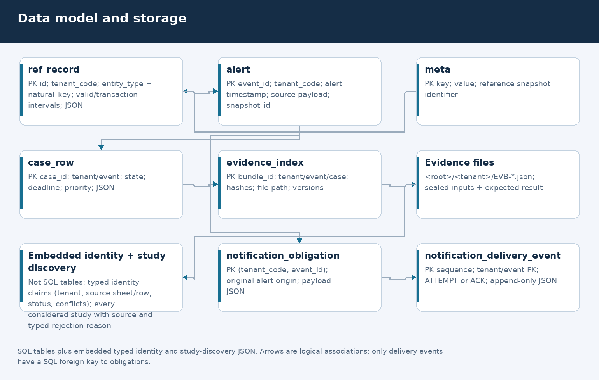
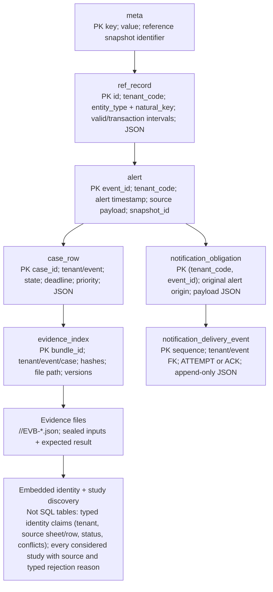
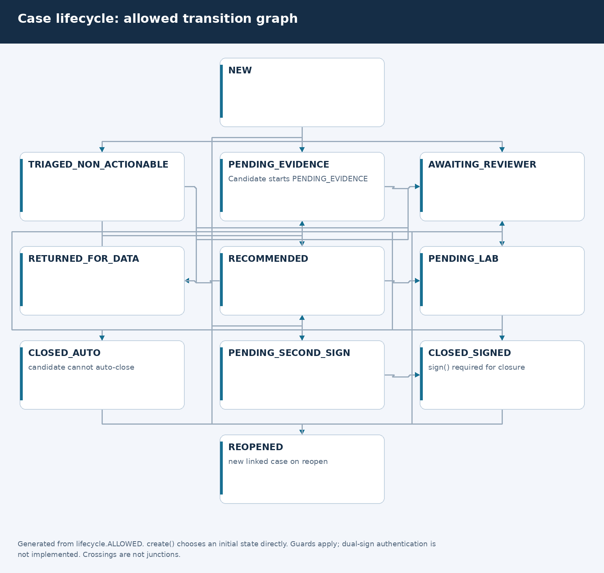
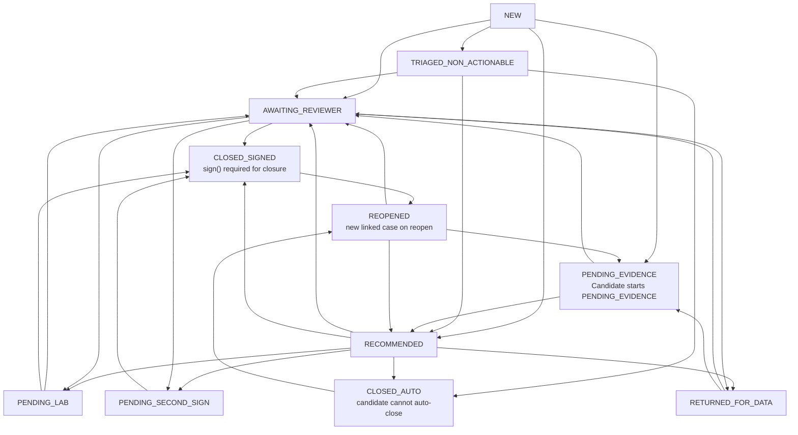
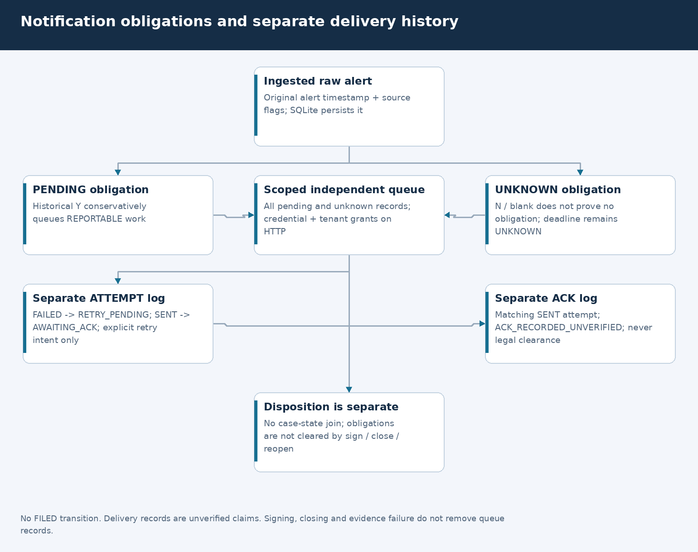
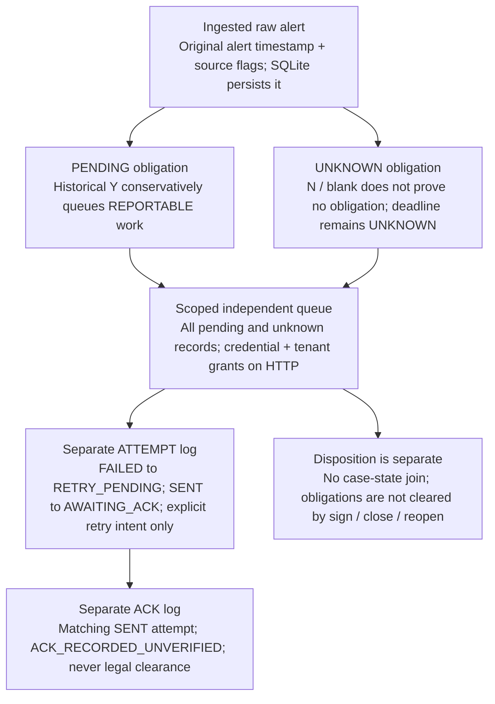

# 03 · Low-level design

## Modules and calls

Paths below are under `src/kestrel/`; they are code references, not deployed services.

| Module / class | Important calls / types | Actual responsibility |
|---|---|---|
| `ingest.DataPack` | `load`, `event_by_id`, `replay_snapshot` | In-memory workbook rows and tenant-scoped replay references plus shared registries |
| `service.AdjudicationService` | `bootstrap`, `adjudicate_event`, `adjudicate_all`, `_persist`, `replay_from_bundle` | Orchestration, cases, evidence and comparisons |
| `engine.AdjudicationEngine` | `adjudicate`, `_decide`; `AdjudicationResult` | Assemble facts and evaluate reported/uncertainty scenarios |
| `rules.identity.IdentityResolver` | `resolve_product`, `resolve_carrier`, `resolve_facility`; `IdentityLink`, `IdentityResolution`, `ResolvedProduct` | Typed tenant/contract claims, source positions, negative/conflict blocking; substring carrier matches remain candidates |
| `rules.as_of` | `TemperatureBound`, `StorageLimits`, `parse_storage_limits`, `sop_in_force` | Explicit bound semantics; effective-date SOP metadata and overlaps |
| `rules.stability.StabilityResolver` | `resolve`, `discover`; `StabilityPosition`, `StudyDiscovery` | Parse cited context, then catalogue all tenant index rows with typed rejections; no master/alternate substitution |
| `decision_rules` | `ExcursionFacts`, `Verdict`, `DECISION_RULES`, `decide` | First verdict wins; then release-authority/historical post-gates |
| `rules.regulatory` | `RegulatoryClock`, `NotificationRule`, `regulatory_clock` | Explicit UNKNOWN applicability; controlled-input calendar arithmetic, not a legal registry |
| `storage.bitemporal.BitemporalStore` | `as_of`, `save_case`, `queue`, `index_evidence` | SQLite reference intervals, alerts, cases and evidence index |
| `storage.evidence.EvidenceStore` | `write_bundle`, `get`, `verify_document`, `verify_chain` | Canonical core hashes, JSON files, predecessor links and explicit verification |
| `lifecycle.CaseLifecycle` | `create`, `transition`, `sign`, `reopen` | State guards, supplied-hash checks, sign-off artifact and linked case revision |
| `notifications` | `NotificationObligations`, `NotificationAccess`, `NotificationPrincipal` | Durable independent work and delivery claims; scoped HTTP grants |
| `api.app`, `cli` | `create_app`, `create_notification_app`; command dispatch | HTTP/UI and local operator interfaces |

Editable source: [Mermaid](diagrams/lld.mmd), [layout](diagrams/diagrams.json), [renderer](diagrams/render_visuals.py).

Diagram source (Mermaid)

## Typed identity contract

`IdentityLink` carries `kind` (EXACT_GTIN, EXACT_SKU, ALIAS, LEGAL_ENTITY,
FACILITY), requesting `tenant_code`, actual `source_tenant_code`, `source_sheet`,
physical `source_row`, `verification_status`, `confirmed_by/on`, `conflict_note`,
left/right values and explicit scope basis; legal claims carry `contract_id`.
Unknown provenance/confirmation is null, not manufactured. `sheet_rows(...,
include_source=True)` preserves physical worksheet positions across blank rows.

A unique tenant GTIN/SKU row is `RESOLVED_SOURCE_ASSERTED`, not independently
verified truth. Brand/INN/fuzzy text remains candidate-only. An alias path must be
explicitly tenant-owned, Y, confirmed by/on no later than the decision date,
source-positioned, uncaveated and free of conflicting strength/presentation
claims. Relevant negative edges block alternate positive paths. Incompatible
explicit units require review; no clinical unit equivalence is invented.
Tenant-owned negative claims conflicting with an exact master key also block it.
Unowned observations are never silently assigned ownership or used to merge;
their notes remain candidate evidence. A direct master-key lookup does not
traverse unrelated unowned alias observations.

`ResolvedProduct.status/reasons/identity_links` and `IdentityResolution` distinguish
resolved source assertions from UNRESOLVED, CONFLICT, AMBIGUOUS and CANDIDATE
states. Unresolved product identity overrides provisional historical classification
with QA (`typed_identity_unresolved_gate`); history is retained. Release/closure
recommendations and release signing cannot promote unverified product aliases.
`release_identity_eligible` is only an identity gate, never clinical release authority.
Carrier matching is separate contract evidence, not a new clinical disposition rule.

Carrier lookup preserves exact legal entity then exact contract alias priority;
ambiguity is never broken by row order. Unique substrings are unverified candidates.
Explicit foreign-tenant contracts/aliases are excluded. Every carrier link names
its actual contract; parent-group relationships are not legal-entity merges.
Facility lookup is tenant-scoped and ambiguity-safe, but **UNUSED_NOT_AUTHORITY_INPUT**
in engine/SOP selection. This avoids manufacturing tenant/site ownership from a
shared registry. It cannot silently choose a site annexure.

The same assessment is returned by adjudication/event API models, rendered in the
UI identity panel and sealed at `inputs.resolution.identity`. API OpenAPI models
include typed link provenance. Candidate rows stay reference data.

## Study discovery contract

`rules.study_discovery` defines `StudyDiscovery`, `StudyCandidate`, `StudyRejection`
and `StudyRejectionCode`. `StabilityResolver.discover` examines **every tenant-owned
index row in physical source order**, not only the cited reference. Foreign and
unowned rows are excluded before evaluation; a missing citation is explicitly
`CITED_STUDY_OUTSIDE_TENANT_SCOPE` (absent or foreign, without revealing foreign
content). Direct evaluation also rejects/redacts `WRONG_TENANT` inputs.

Each candidate retains its study reference, sheet/row, indexed text/type,
citation flag, SELECTED/REJECTED state and all detected typed reasons. An UNKNOWN
reason means missing evidence, not proof the study failed. Strength/unit signatures
must match literally; no conversions, product synonyms or alternate mappings are
inferred. Uncited candidates remain `UNCITED_MAPPING_UNKNOWN`; duplicate citations
are rejected rather than first-row-wins. Contradictory vial/pen/PFS text is rejected.

Selection requires explicit applicability, readable numeric allowance, event
coverage, prior exposure where required, study authority at the requested time
and governing SOP authority. `resolve` remains a contextual cited-text parser, not
an authority API. The engine uses discovery to mark study authority unresolved
when no admissible selection exists. It keeps the cited ref separately; it is
never presented as a selected authority just because it exists.

The source workbook supplies **no approval/effective/known/supersession metadata**
for stability studies, no verified batch history, and no governing SOP body.
Consequently no study is selected in this sample. Optional `approval_status`,
`effective_from/to`, `known_from`, `superseded` inputs exercise a conservative
source-assertion contract only in synthetic tests; no such data is backfilled.
Effective intervals are compared inclusively; missing endpoints stay UNKNOWN
rather than assuming indefinite validity. These are not authenticated approvals.
The alert date is a knowledge-date *request*, not a claim of historical visibility.

Coverage uses the upper-bound scenario for affected firmware; a cumulative
"above 8 C" threshold is not treated as a tested maximum. Unknown lower envelopes,
unreadable/prohibition-only prose, absent duration, prior-history gaps and
SOP conflicts remain explicit blockers. No clinical outcome or new temperature
allowance is inferred from tested-duration/outcome prose or a report filename.

`AdjudicationResult.study_discovery` equals sealed
`inputs.resolution.stability.discovery` and `inputs.expected_result.study_discovery`.
The typed event/adjudication responses and OpenAPI expose the catalogue and enum;
the UI renders selected ref, rejected candidates, provenance and escaped reasons.

Study discovery diagram source

Editable [Mermaid](diagrams/study-discovery.mmd),
[layout](diagrams/diagrams.json), and [executed review](validation/study-discovery-review/report.md).

## Data model

JSON payloads retain fields that are not first-class columns. These are the actual
tables, not a proposed clinical ontology:

| Table | Key / important columns | Notes |
|---|---|---|
| `meta` | PK `key`; `value` | Reference snapshot metadata |
| `ref_record` | PK `id`; `entity_type`, nullable tenant, `natural_key`, `payload_json`, `valid_from/to`, `tx_from/to`, `content_hash`, `source_system`, `snapshot_id` | Interval-capable reference store; not proof all engine paths use knowledge-time queries |
| `alert` | PK `event_id`; tenant, payload, alert time, snapshot | Event IDs are globally keyed in this prototype |
| `case_row` | PK `case_id`; event, tenant, state, payload, deadline, priority, updated time | Most associations are logical, not SQL foreign keys |
| `evidence_index` | PK `bundle_id`; tenant/event/case, hashes, path, retention and versions | File bytes are stored outside SQLite |
| `notification_obligation` | Composite PK `(tenant_code,event_id)`; payload | Original alert origin, PENDING/UNKNOWN work; not a case-state projection |
| `notification_delivery_event` | PK integer `sequence`; tenant/event FK, `kind`, JSON | Only ATTEMPT/ACK; append-only UPDATE/DELETE triggers |

The delivery table's composite foreign key targets the obligation table. There
are no general SQL foreign keys from cases to alerts or evidence to cases.
Identity links are embedded derived evidence JSON, not a new authoritative mapping
table. No SQL schema migration or independent verification registry was added.

Editable source: [Mermaid](diagrams/data-model.mmd), [layout](diagrams/diagrams.json), [renderer](diagrams/render_visuals.py).

Diagram source (Mermaid)

## Case states and operations

`create()` selects an initial state directly: a historical candidate becomes
PENDING_EVIDENCE; an actionable recommendation becomes AWAITING_REVIEWER;
AUTO_CLOSE becomes TRIAGED_NON_ACTIONABLE, not automatically CLOSED_AUTO.
A linked reopened case starts REOPENED.

`transition()` checks `ALLOWED`; direct CLOSED_SIGNED transitions are refused.
Unverified candidates cannot transition to CLOSED_AUTO. `sign()` rejects blank
names, candidate-as-final disposition, stale/tampered hashes and invalid current
states. Release signing also refuses missing/unresolved typed product identity
(including legacy bundles without that assessment). It appends a SIGNED evidence artifact and updates the case. It does not
authenticate that name, prove the reviewer actually viewed the artifact, enforce
clinical/SOP clearance or implement a real two-person authorisation process.

`reopen()` marks the prior case REOPENED and creates a linked case carrying the
clock/reportability and prior evidence reference. It does not independently
retrieve new evidence, re-run the engine or settle notification work.

Editable source: [Mermaid](diagrams/case-lifecycle.mmd), [layout](diagrams/diagrams.json), [renderer](diagrams/render_visuals.py).

Diagram source (Mermaid)

### Complete `ALLOWED` transition table

| From | Allowed target states (guards still apply) |
|---|---|
| `NEW` | `AWAITING_REVIEWER`, `PENDING_EVIDENCE`, `RECOMMENDED`, `TRIAGED_NON_ACTIONABLE` |
| `TRIAGED_NON_ACTIONABLE` | `AWAITING_REVIEWER`, `CLOSED_AUTO`, `RECOMMENDED` |
| `PENDING_EVIDENCE` | `AWAITING_REVIEWER`, `RECOMMENDED` |
| `RECOMMENDED` | `AWAITING_REVIEWER`, `CLOSED_AUTO`, `CLOSED_SIGNED`, `PENDING_LAB`, `PENDING_SECOND_SIGN`, `RETURNED_FOR_DATA` |
| `AWAITING_REVIEWER` | `CLOSED_SIGNED`, `PENDING_LAB`, `PENDING_SECOND_SIGN`, `RETURNED_FOR_DATA` |
| `RETURNED_FOR_DATA` | `AWAITING_REVIEWER`, `PENDING_EVIDENCE` |
| `PENDING_LAB` | `AWAITING_REVIEWER`, `CLOSED_SIGNED` |
| `PENDING_SECOND_SIGN` | `CLOSED_SIGNED` |
| `CLOSED_AUTO` | `REOPENED` |
| `CLOSED_SIGNED` | `REOPENED` |
| `REOPENED` | `AWAITING_REVIEWER`, `PENDING_EVIDENCE`, `RECOMMENDED` |

## Notification state and delivery state are different

Obligations are PENDING from historical Y (conservatively REPORTABLE), otherwise
UNKNOWN. They remain in the queue. No FILED/NOT_REPORTABLE resolution operation
is supplied. Unknown reportability is represented as null with an UNKNOWN status.

Delivery status is derived from a separate log: no attempt -> NOT_ATTEMPTED;
FAILED -> RETRY_PENDING; SENT -> AWAITING_ACK; a matching receipt reference ->
ACK_RECORDED_UNVERIFIED. A receipt must reference this tenant/event's SENT attempt;
repeated identical acknowledgement is idempotent, conflicting references fail.
None of this proves actual delivery or filing, or changes the obligation state.

Editable source: [Mermaid](diagrams/notification-lifecycle.mmd), [layout](diagrams/diagrams.json), [renderer](diagrams/render_visuals.py).

Diagram source (Mermaid)

[Rule order and end-to-end workflow](05-workflow.md) · [Failure boundaries](04-system-design.md).

Explicit UNKNOWN/PENDING/other unrecognised alias verification labels, or blank
confirmer names, cannot authorize identity. Source-confirmed names/dates and a
recognised affirmative status are still claims, not authenticated verification.
Where no status label is supplied, Y plus the other required source confirmation
fields establishes only a confirmed source assertion.
