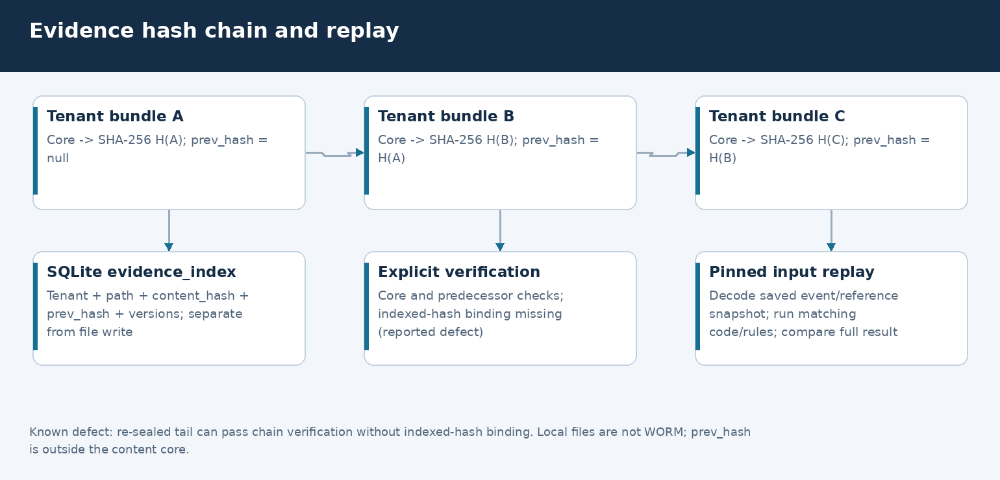
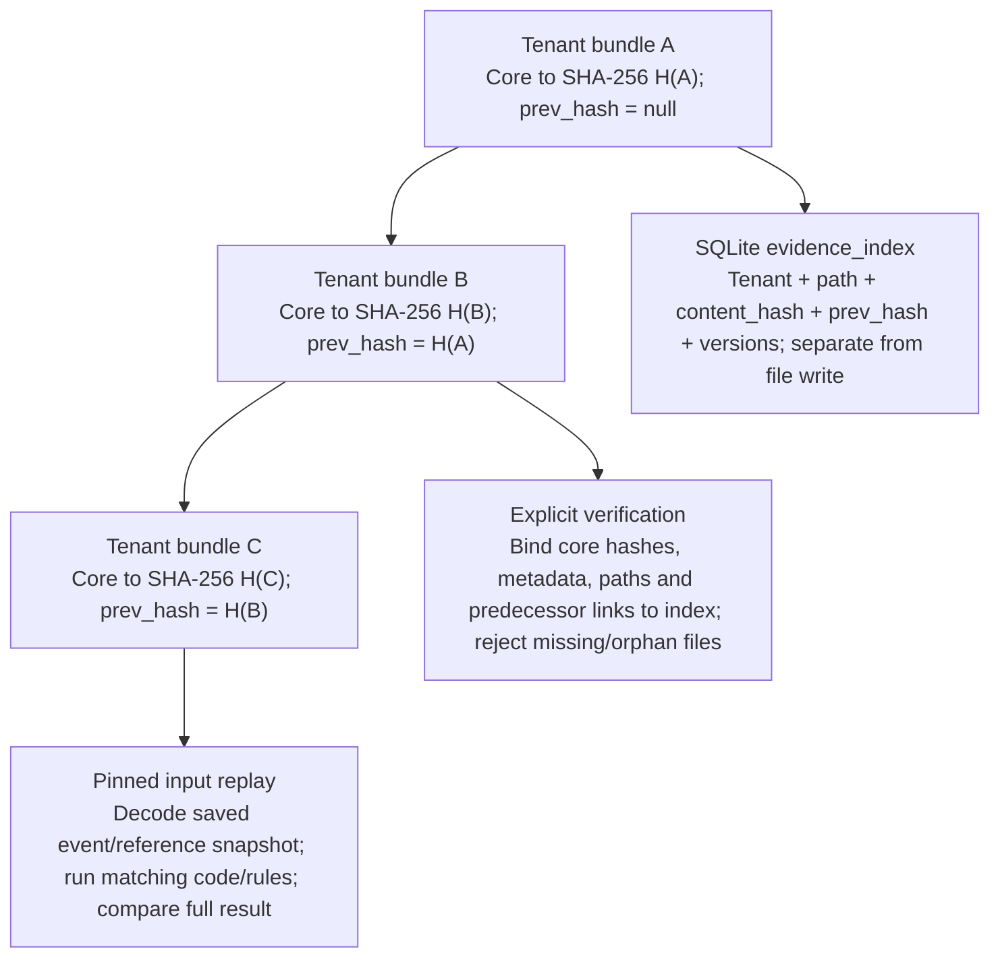

# 04 · System design and operational boundaries

These specific defects were addressed; overall safety and production readiness remain unvalidated.

## Data flow and interfaces

1. Bootstrap ingests workbook rows into SQLite and loads a current `DataPack`.
2. The engine resolves references and measurements, then returns a recommendation
   and trace. It is not an LLM decision path.
3. The service writes an evidence JSON and its SQLite index, then creates a case
   linked to that evidence. It does not automatically sign the case.
4. The independent notification lane reads ingested alerts, not assembled bundles.
   Its queue cannot be filtered away by signed/closed cases.
5. Explicit replay decodes saved event/reference inputs, uses matching code/rule
   versions and compares the entire calculated result.

## Storage, as-of time and tenancy

**Implemented:** SQLite reference records have valid-time and transaction-time
intervals. The main engine still uses the loaded current workbook `DataPack`;
SOP/contracts apply excursion-date metadata filters. This is not universal
knowledge-time or “what was known before the alert” reconstruction. Sealed replay
reproduces captured inputs, not a complete historical source archive.

Product matching uses a tenant master pool. Evidence get requires a tenant and
rejects a differently scoped bundle. Replay snapshots retain tenant-owned
product/SOP/study/policy rows plus shared source registries and relevant alias
edges, including negative claims and physical sheet/row provenance. Explicit
foreign-tenant aliases/contracts are excluded. Tenantless alias observations are
candidate-only, even when their source cells say Y and contain a QA name/date.
Typed negative/conflicting links block product merges, and unresolved product
identity routes to QA while preserving historical classification. See the
[typed contract](03-lld.md#typed-identity-contract) and
[executed identity review](validation/identity-evidence-review/report.md).

Carrier claims are tied to a contract, not a parent-company graph. Facility
resolution is explicitly unused by engine/SOP selection: the shared registry
lacks tenant ownership and cannot establish a governing site annexure. Carrier
uncertainty is exposed as identity evidence; it is not invented as a clinical
product-fate rule. Product release signing requires eligible typed product
identity, not merely a high fuzzy confidence score.

**Not implemented:** complete API authentication/authorisation, enforced residency
cells, tenant encryption keys, production cross-tenant namespace isolation or an
approved precedent index. A tenant query parameter is not caller authentication.
Global event IDs and caller-supplied tenant directory names require deployment
review; untrusted tenants must not be given direct privileged filesystem access.

## Evidence hash chain

The canonical SHA-256 core includes the inputs, recommendation, reasoning,
versions and sign-off metadata. It excludes `prev_hash`, `bundle_id` and file path.
Each next JSON carries the previous content hash. `verify_document` recomputes
the core for self-consistency only. `verify_chain()` additionally binds every
file's hash, identifiers, tenant, versions and predecessor to SQLite metadata and
the preceding indexed hash. It checks expected tenant/bundle paths and inventories
tenant JSON files so missing files and unindexed files fail closed.

`get()` uses this same whole-tenant reconciliation and returns the document parsed
during verification, not a second unverified read. Basis, signing and replay all
use `get()`. Any integrity failure blocks these reads for the tenant, even when
an unrelated bundle is damaged. HTTP consumers return 409 with specific reasons;
`POST /evidence/verify` returns a diagnostic `ok: false` report. CLI `verify` prints
the same report and exits 1 on failure (0 for an untouched valid chain).

Editable source: [Mermaid](diagrams/evidence-chain.mmd), [layout](diagrams/diagrams.json), [renderer](diagrams/render_visuals.py).

Diagram source (Mermaid)

**Executed fix:** regression tests now reject re-sealed tails and middle records,
missing/replaced/swapped files, file/index metadata or link mismatches, unindexed
files and cross-tenant placement. Signing also rejects a valid-looking child of a
corrupted ancestor. [Failing/passing evidence](validation/evidence-chain-review/report.md).
The [earlier probe](validation/documentation-review/integrity-probe.json) records
behaviour before this fix, not the current verifier.

**Limitations:** local SQLite plus files is not an independent anchor. Someone who
can consistently rewrite both can still forge evidence, or remove matching index
rows and files together without an externally recorded head/count. Local JSON and
SQLite are not WORM. File/index writes and verification are not a cross-store
transaction; concurrent writers, crash recovery, external anchoring, signer
identity and seven-year recoverability remain unvalidated. Full-tenant reads are
linear in stored evidence and may block on an unrelated integrity failure.
Original raw sensor series and governing PDF bytes are not fully archived.

## Notification lane

`NotificationObligations` persists ingested alerts independently of engine/case
assembly. Existing obligations survive restart. An attempted destructive reload
of an already-ingested service DB is refused. Queue reads retain both pending and
unknown records; a signature, case closure, acknowledgement or storm cannot clear
them. Original alert origin and historical window references are preserved.

There is no approved applicability/calendar registry installed. Numeric windows
and country guesses never become legal deadlines. Controlled arithmetic accepts
explicit tenant/product/market, rule/source/approval references, coverage and
required calendar inputs; ambiguous DST cutoffs, missing holidays or coverage
remain unresolved. These input checks are not legal-policy approval.

A standalone FastAPI factory and the local pre-bootstrap `notifications` CLI
command can read existing SQLite without a workbook/assembler. Retry timestamps
are recorded intent, not scheduled jobs. No live transport, verified receipt,
legal filing completion or regulatory pager exists.

## API surface

Run `kestrel serve` for localhost development. `/docs` contains generated OpenAPI;
`/ui` is the review dashboard. Do not expose the general API as a production service.

| Interface | Current purpose / boundary |
|---|---|
| GET `/health` | Basic service/version check, not proof of legal clock health |
| POST `/adjudicate` | Event recommendation; optional persistence |
| GET `/events`, `/events/{id}` | Cached sample list and detail for UI; no production user auth |
| GET `/evidence/{bundle}` with tenant | Tenant-match check, not proof caller owns that tenant |
| POST `/evidence/basis`, `/evidence/verify`, `/replay` | Evidence basis, explicit tenant-chain verification, pinned-input replay |
| GET `/cases/{id}`, POST `/cases/{id}/sign`, `/reopen` | Case operations; name/hash checks are not authenticated human authority |
| GET `/queue`, `/as-of/sop` | Case ordering and indexed effective-date SOP lookup |
| GET `/shadow/bulletin`, `/ops/agreement`, `/ops/health-report` | Prototype scenario/comparison/monitoring reports; no real paging |
| GET `/notifications?tenant_code=T` | Credential plus tenant read grant required |
| POST `/notifications/{tenant}/{event}/attempts` | Tenant write grant; FAILED/SENT, reference, optional timezone-explicit retry time |
| POST `/notifications/{tenant}/{event}/acknowledgements` | Tenant write grant; matching SENT attempt and receipt reference |

Both HTTP factories use the same `NotificationAccess` credential-digest grant
adapter. No configured adapter/valid bearer credential means 401; foreign tenant
or read-only updates mean 403. Bodies cannot override trusted actor/tenant scope.
The default CLI-served app has no provisioned grants, so notification routes deny.
The UI link alone is not a login. The public health response omits all-tenant
notification counts; authorised queue reads provide scoped records. Local
CLI/DB methods are privileged operator tools, not remote authentication boundaries.
No production SSO, credential rotation or revocation deployment is provided.

## Failure and recovery matrix

| Failure | Implemented behaviour | Still required / documented-only |
|---|---|---|
| Missing required extrema / unclear storage | Distinct QA guards; no safety inferred from absence | Raw-series/device validation |
| Study mismatch / governing annexure absent / overlap | Unresolved evidence; release-authority gate | Controlled source acquisition and site resolution tasks |
| Evidence assembly down | Independent existing SQLite notification reads still work | HA intake, lag detection and live paging |
| Notification transport fails | Can append FAILED claim/retry intent | Actual transport worker, retry execution and verified receipts |
| Process restarts | SQLite notification state and delivery log persist | Backup restore, replicated availability and disaster recovery |
| Evidence edited | Explicit verification/replay/signing can reject changed hashes | WORM, authenticated integrity roots and controlled admin access |
| File/index write interrupted or concurrent writers | No transactional cross-store guarantee | Atomic publication, concurrency protocol and repair tooling |
| Source record changes | No general dependency-driven invalidation/reopen | Dependency index, affected-case tasks and approved re-review |
| Regulatory applicability unknown | UNKNOWN, null deadline, open queue record | Qualified regulatory resolution; cannot promise deadlines are met |

## Scaling: design-only, not benchmarked

The brief's production volumes are context, not a reproduced load test. Before
scaling, design tenant-authorised intake partitions, bounded queues/fairness,
idempotent workers, transactional evidence publication, durable object storage,
raw/document retention and independent clock workers/pagers. Evaluate residency,
restore and failure tests first. PostgreSQL/queue/WORM services are possible design
choices, not installed components or verified capacity figures in this repository.
