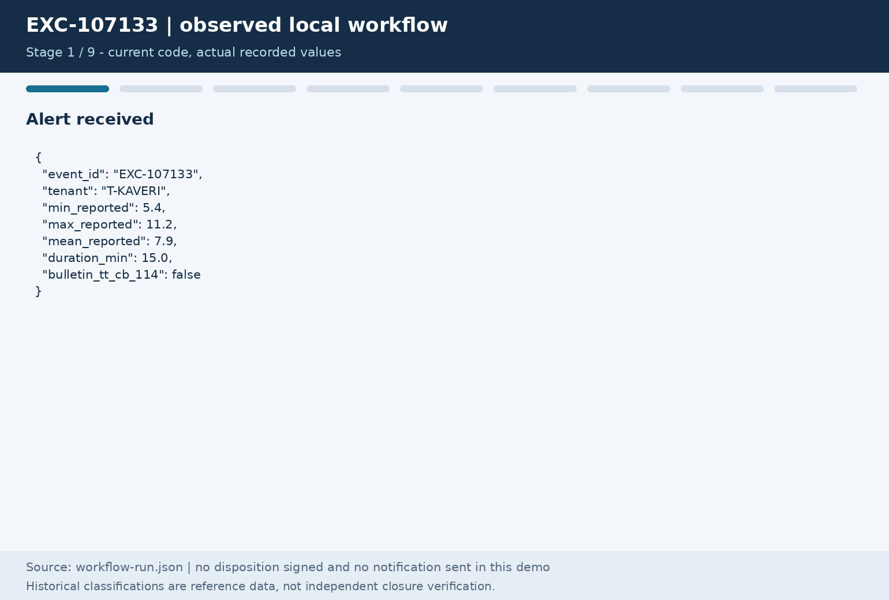
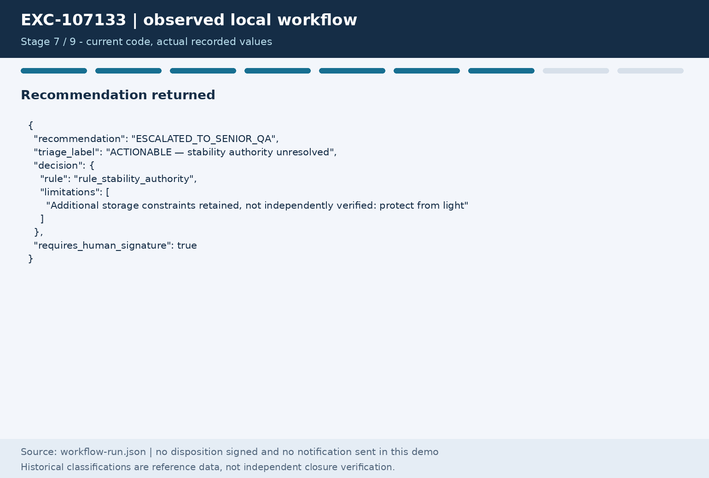
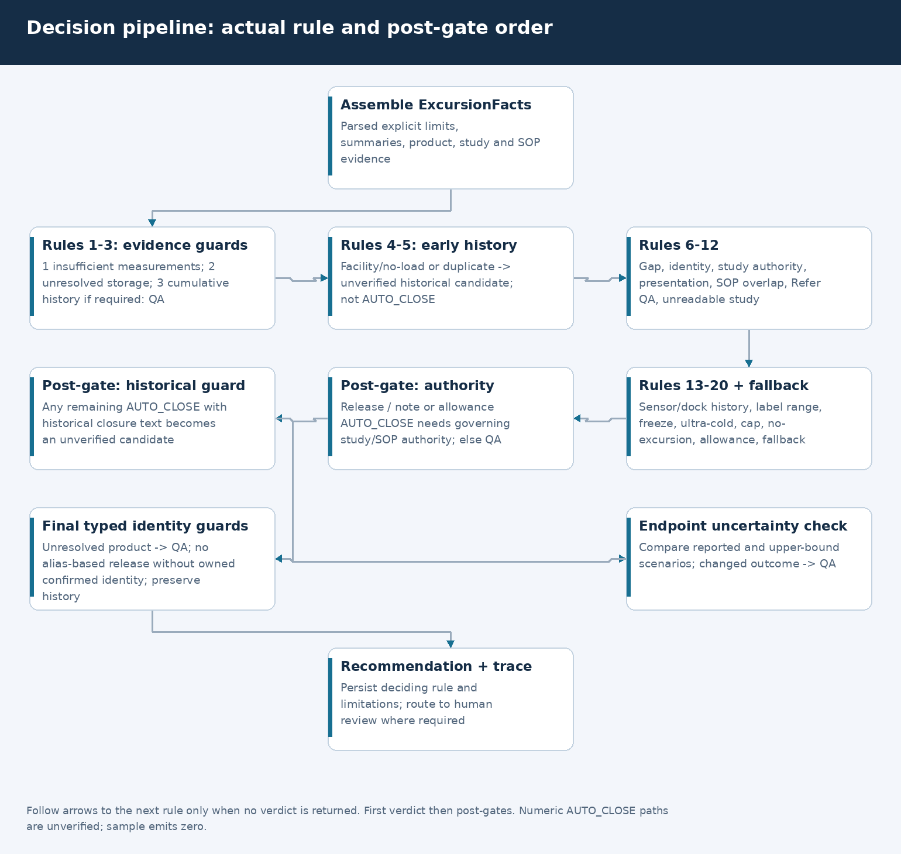

# 05 · Workflow: alert, review, sign/reopen and notifications

## EXC-107133: observed, not staged output

The nine frames use [this saved run JSON](images/workflow-run.json). They are a
local execution, not a reviewer video, production elapsed-time measurement or
completed filing. The animation does not sign or send anything.

| Stage | Actual observation |
|---|---|
| Input | T-KAVERI, GTIN 08901234500035; min 5.4 °C, max 11.2 °C, duration 15 min |
| Product | `gtin_exact`, brand Glucodyne SoloJet 100U; SKU is null in this master row |
| Label | Inclusive 2–8 °C; protect-from-light constraint retained but not verified |
| Study | STB-3584 has unresolved product/presentation/type applicability; no master fallback |
| SOP | SOP-KAV-9392, candidate Rev 03, overlap with Rev 02; Annexure 2 authority unresolved |
| Carrier | CNT-2021-0245, Tapti Express Cargo; no cold-chain clause in indexed metadata |
| Decision | `rule_stability_authority` -> ESCALATED_TO_SENIOR_QA |
| Persistence | Hashed evidence, matching replay and case AWAITING_REVIEWER |
| Separate obligation | UNKNOWN applicability/deadline, null legal deadline, NOT_ATTEMPTED delivery |

 Current behaviour does not
force the historical RELEASE_WITH_NOTE and does not discover an alternative study
with clinical release authority.

## Exact decision order

`decide()` walks `DECISION_RULES` until the first non-None verdict. If no rule
returns one, `rule_no_parseable_allowance` supplies the fallback. Historical
facility/duplicate candidates occur before several later authority rules; they
are unresolved review states, not verified closures or released medicine.

Editable source: [Mermaid](diagrams/decision-pipeline.mmd), [layout](diagrams/diagrams.json), [renderer](diagrams/render_visuals.py).

```mermaid
flowchart TB
    Facts["Assemble ExcursionFacts<br/>Parsed explicit limits, summaries, product, study and SOP evidence"]
    Guard["Rules 1-3: evidence guards<br/>1 insufficient measurements; 2 unresolved storage; 3 cumulative history if required: QA"]
    History["Rules 4-5: early history<br/>Facility/no-load or duplicate to unverified historical candidate; not AUTO_CLOSE"]
    Resolve["Rules 6-12<br/>Gap, identity, study authority, presentation, SOP overlap, Refer QA, unreadable study"]
    Arithmetic["Rules 13-20 + fallback<br/>Sensor/dock history, label range, freeze, ultra-cold, cap, no-excursion, allowance, fallback"]
    Authority["Post-gate: authority<br/>Release / note or allowance AUTO_CLOSE needs governing study/SOP authority; else QA"]
    Intercept["Post-gate: historical guard<br/>Any remaining AUTO_CLOSE with historical closure text becomes an unverified candidate"]
    Result["Recommendation + trace<br/>Persist deciding rule and limitations; route to human review where required"]
    Uncertainty["Endpoint uncertainty check<br/>Compare reported and upper-bound scenarios; changed outcome to QA"]
    Identity["Final typed identity guards<br/>Unresolved product to QA; no alias-based release without owned confirmed identity; preserve history"]
    Facts --> Guard
    Guard --> History
    History --> Resolve
    Resolve --> Arithmetic
    Arithmetic --> Authority
    Authority --> Intercept
    Intercept --> Uncertainty
    Uncertainty --> Identity
    Identity --> Result
```

Diagram source (Mermaid)

| Order | Function | Current check / limitation |
|---|---|---|
| 1 | `rule_insufficient_temperature` | Missing required / invalid / reversed extrema -> QA; means do not substitute. |
| 2 | `rule_unresolved_storage` | Unparseable/unclear storage instructions -> QA; distinct from missing measurements. |
| 3 | `rule_cumulative_history_unresolved` | When cumulative assessment is needed, absent verified batch/history -> QA. |
| 4 | `rule_facility_equipment_event` | Historical facility/no-load text -> unverified human-review candidate. |
| 5 | `rule_duplicate_alert` | Historical duplicate text -> unverified human-review candidate. |
| 6 | `rule_gateway_gap` | Gateway/interpolation heuristic; provisional result still meets post-gates. |
| 7 | `rule_unresolved_identity` | Weak/ambiguous product identity -> QA. |
| 8 | `rule_stability_authority` | Out-of-range study authority unresolved -> QA. |
| 9 | `rule_presentation_mismatch` | Presentation mismatch -> QA. |
| 10 | `rule_sop_overlap` | Record SOP overlap in trace; final release-authority gate applies. |
| 11 | `rule_allowance_refer_qa` | Allowance says Refer QA -> QA. |
| 12 | `rule_unreadable_stability` | Cited unreadable study -> quarantine proposal (not authority to implement it). |
| 13 | `rule_sensor_artefact` | Sensor-artefact historical label -> unverified candidate if pattern matches. |
| 14 | `rule_dock_door` | Dock-door historical label -> unverified candidate if pattern matches. |
| 15 | `rule_within_label_range` | Supplied extrema satisfy parsed limits -> prototype AUTO_CLOSE proposal. |
| 16 | `rule_freeze_damage` | Freeze-damage heuristic -> destroy proposal; unvalidated clinical rule. |
| 17 | `rule_ultra_cold` | Ultra-cold heuristic -> note/destroy proposal; authority gate can override release. |
| 18 | `rule_qualified_temperature_cap` | Qualified cap without duration/authority -> QA. |
| 19 | `rule_no_excursion_permitted` | No-excursion allowance heuristic -> lab/destroy proposal. |
| 20 | `rule_stability_allowance` | Single-event allowance comparison; cumulative unresolved rechecked. |

After that walk:

1. **Release-authority gate:** RELEASE/RELEASE_WITH_NOTE and allowance-based
   AUTO_CLOSE need established SOP/study authority. Unresolved authority/overlap
   changes those proposals to QA. It does not universally gate every numeric fate
   or in-range/gap AUTO_CLOSE path.
2. **Historical closure guard:** any remaining AUTO_CLOSE with recognised
   historical closure text is intercepted as HISTORICAL_CLOSURE_CANDIDATE_UNVERIFIED.
3. The trace records the deciding rule and limitations. Additional restrictions
   such as “protect from light” are retained, not independently verified.

No current input adapter supplies independently verified closure eligibility.
The sample emits no numeric AUTO_CLOSEs, but those code paths still exist and
remain unvalidated prototypes. Missing evidence is not a safe-temperature result.

## Review, sign and reopen

A candidate stays PENDING_EVIDENCE; actionable QA cases await a reviewer. Reviewers
must obtain missing evidence outside this prototype. A sign call requires a name,
permitted current state and the supplied hash of an intact indexed artifact;
it writes a new SIGNED artifact and CLOSED_SIGNED case metadata. This checks hash
binding, not actual human identity, viewing, dual authorisation or clinical/SOP
clearance. Do not use a passing sign call as proof that release is authorised.

Reopen changes the old case state and creates a linked revision preserving the
clock/reportability and old evidence reference. A new evidence assessment is
separate work; reopen is not automatic source invalidation or re-adjudication.
[Complete state graph and transition table](03-lld.md#case-states-and-operations).

## Independent notification workflow

The obligation begins from ingested raw alert data, not from a disposition.
Historical Y conservatively creates pending work; all other unverified flags stay
UNKNOWN. Calendar/applicability uncertainty never defaults to not-reportable.
Signing, closing, reopening and evidence failure do not remove these records.

An authorised adapter/operator may record FAILED/SENT attempts and explicit retry
intent. A receipt reference for a matching SENT attempt remains unverified and
cannot clear a pending obligation. No sending, scheduled retry worker, verified
filing completion or legal deadline registry is demonstrated.
[Notification state model](03-lld.md#notification-state-and-delivery-state-are-different).

## Typed identity review gate

The numbered clinical rule order is unchanged. Final identity gates now prevent
unresolved products from inheriting a provisional historical closure category;
they route to QA, preserve the previous rule in `prior_rule` and retain the original
historical classification. Negative/weak aliases do not supply product stability
or label authority. The UI identity panel shows status, reasons, source row,
confirmation claims and conflicts; source assertions are not clinical clearance.
Facility resolution is explicitly unused for governing site/SOP selection.
