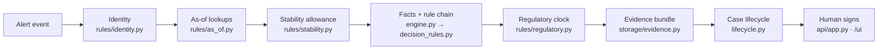
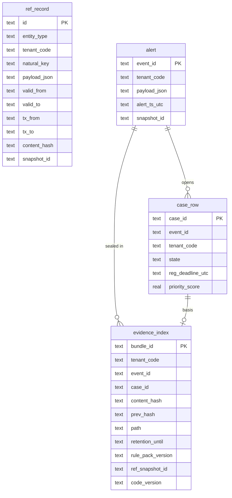
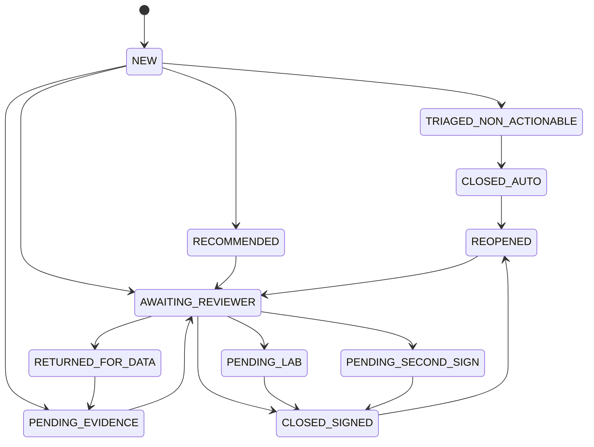

# Architecture

Kestrel Sentinel takes one temperature alert and answers three questions with evidence: was the product harmed,
what should happen to it, and is there a regulator deadline. Everything on the decision path is deterministic
Python. There is no model call, no randomness, and no network I/O.

## Request flow



1. **Identity.** Resolve the product from GTIN, SKU or brand text, with a confidence score.
2. **As-of lookups.** Find the SOP revision, carrier contract using effective dates. Bulletin applicability is currently firmware-only, without device/date verification. The engine reads DataPack, not the store transaction-time slice.
3. **Stability.** Require a unique tenant-scoped cited excursion study, product/presentation alignment and readable allowance. No master-text substitution. Missing applicability is unresolved.
4. **Decide.** Evaluate reported and upper-bound TT-CB-114 scenarios on min/max/mean summaries; preserve observations and escalate if dispositions differ. Each scenario runs the ordered rule
   chain. The first rule that returns a verdict wins. See [decision-rules.md](decision-rules.md).
5. **Regulatory clock.** Compute the notification deadline separately from the disposition.
6. **Seal.** Store every input in a SHA-256 hash-chained bundle, one chain per tenant.
7. **Sign.** Product-fate outcomes wait for a named reviewer, who signs against the exact bundle hash they saw.

## Package layout

```text
src/kestrel/
├── config.py            Settings and KESTREL_* environment overrides
├── logging_setup.py     Structured JSON logging
├── exceptions.py        KestrelError hierarchy (NotFound, TenantIsolation, StaleEvidence, ...)
├── domain.py            Enums and dataclasses (CaseState, Disposition, ...)
├── utils.py             Shared helpers: utc_now, parse_date, sheet_rows, to_float
├── ingest.py            Workbook → in-memory DataPack → SQLite store
├── storage/
│   ├── bitemporal.py    Valid-time + transaction-time reference store
│   └── evidence.py      Hash-chained, tenant-isolated evidence bundles
├── rules/
│   ├── identity.py      Product and carrier-contract resolution
│   ├── as_of.py         SOP in force on a date, storage-range parsing
│   ├── stability.py     Permitted-excursion text → structured allowance
│   └── regulatory.py    Market notification deadlines
├── decision_rules.py    Named thresholds + ordered disposition rules
├── engine.py            Orchestrates one adjudication (pure, no I/O)
├── lifecycle.py         Case state machine and deadline-ordered queue
├── shadow.py            Replays a rule change (TT-CB-114) and diffs outcomes
├── service.py           Facade used by the CLI and the API
├── api/
│   ├── app.py           FastAPI app (lazy imports) and uvicorn server
│   └── static/index.html  Reviewer dashboard served at /ui
└── cli.py               `kestrel` command (one handler per sub-command)
```

Dependencies point one way: `cli` and `api` → `service` → `engine` → `rules` and `decision_rules` → `domain`.
The engine never imports FastAPI, so the engine, CLI and tests need only `openpyxl`.

## Data model

SQLite tables (from `storage/bitemporal.py`):



The bundle body itself is a JSON file on disk (`path`); the index row carries its hashes and versions.

* **Bitemporal rows.** `valid_from`/`valid_to` say when a fact was true in the world. `tx_from`/`tx_to` say when we
  learned it. "Which SOP applied on 14 Aug 2025, as we knew it on the day we decided?" is one query.
* **Hash chain.** Each bundle stores `prev_hash` and its own `content_hash`. Editing stored content or links can be detected, and `kestrel verify --tenant T` reports where.
* **Tenant isolation.** Bundles are read by `(bundle_id, tenant_code)`. A mismatch raises
  `PermissionError` (HTTP 403). This is not complete clause 22 control over aliases, models, indexes or all derived artefacts.

## Case lifecycle



This shows the main paths; the full allowed-transition table is `ALLOWED` in `lifecycle.py`, and any other
move raises an error. Auto-closes land in `TRIAGED_NON_ACTIONABLE`; product-fate verdicts land in
`AWAITING_REVIEWER` and close only when a named reviewer signs against the matching bundle hash.

Reopen marks the prior case REOPENED and creates a linked revision, carrying its deadline and reportability. Prior signature fields and append-only evidence remain. It does not assume a notification was filed.

## From `kestrel.py` sections to modules

| `main` branch section | `production` module |
|---|---|
| CONFIG | `config.py` |
| LOGGING | `logging_setup.py` |
| EXCEPTIONS | `exceptions.py` |
| DOMAIN | `domain.py` |
| PACK / INGEST | `ingest.py` |
| REPOSITORY | `storage/bitemporal.py`, `storage/evidence.py` |
| RESOLUTION | `rules/*.py` |
| ENGINE | `engine.py` + `decision_rules.py` |
| LIFECYCLE | `lifecycle.py` |
| SHADOW | `shadow.py` |
| SERVICES | `service.py` |
| API | `api/app.py`, `api/static/index.html` |
| CLI / TESTS | `cli.py`, `tests/` |

The original modularisation preserved behaviour; subsequent reviewer fixes intentionally change outcomes. No current equivalence with main is claimed.

## Replay and signing contracts

`_persist` seals a typed event and tenant-filtered DataPack reference snapshot, plus the complete expected result. Replay verifies the bundle, restores date/datetime types, refuses mismatched code/rule versions and compares the complete result including rationale/evidence; the current workbook/engine are not consulted. Old bundles without replay inputs fail explicitly. Version labels are not a historical executable archive.

Signing requires a nonblank name and viewed hash, verifies actual stored evidence (not a caller's asserted hash), and appends a new signed bundle linked to the original hash with case id, signer, time, final disposition and reason. The original stays UNSIGNED as an immutable pre-sign snapshot; latest basis returns the SIGNED artifact. Generic transition cannot close a case as CLOSED_SIGNED. No SSO, role/dual-sign enforcement or atomic file+DB transaction is claimed.

Shared carrier/facility source registries are captured for replay; products, SOPs, stability and tenant constraints are tenant-filtered. Workbook aliases have no tenant ownership: only locally reachable observations are captured, and their trust/provenance remains unresolved.

## Scope limits

The 420 rows are a stratified evidence sample, not ~11,400/month production traffic. Hash chains/retention dates do not prove raw-series/source-document capture or seven-year durability. Queue sorting is not storm admission, collapse, fairness or independent notification. Batch exposure and shortened-expiry workflow are missing; escalation is review routing, not product fate.


## Correctness-review gates (0.4.2)

These specific defects were addressed; overall safety and production readiness remain unvalidated.

`parse_storage_limits` in `rules/as_of.py` returns explicit `TemperatureBound` objects (kind/value/inclusive), a `StorageLimits.bound_type`, retained constraints, or an unresolved reason. Two-sided numeric ranges are inclusive; “below” is strict; ≤ is inclusive. Bare CRT/LN2 descriptions and nominal values do not create governing numerical bounds. Unknown clauses remain unresolved. The legacy numeric wrapper is not used for engine evaluation because it loses strictness.

`decision_rules.decide` separates invalid/missing required measurements from unresolved storage instructions. An upper-only limit requires max; a lower-only limit requires min; both limits require both extrema. Mean is not a replacement. Supplied nonfinite/reversed extrema remain invalid. Historical triage cannot bypass these gates. Additional restrictions (do not freeze, protect from light, dry ice permitted, excursion-study reference) are preserved independently; this numeric check does not verify compliance or invent freeze limits.

Carrier resolution and cumulative-history gates from 0.4.1 remain. SOP bodies/site annexures are unavailable, so release/allowance closure remains blocked on unresolved authority. Rule/code 0.4.2 distinguishes the new parsing/provenance semantics. `evidence.decision` records the deciding rule and limitations; all sample AUTO_CLOSEs are unverified historical duplicate/facility classification, not independent duplicate/load verification. `CaseLifecycle.create` puts such proposals in TRIAGED_NON_ACTIONABLE, not a final product-release state.

See [executed validation and the full inventory](validation/storage-limits-review/report.md).

New one-sided instructions require an explicit Celsius unit; “Below 25” without a unit stays unresolved. Existing explicit unitless two-sided workbook shorthands retain their field-specific Celsius convention, not a general cross-document unit inference. A comma pair is recognised only in the explicit FROZEN tuple form, not ambiguous decimal-comma text.
