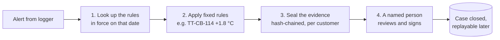
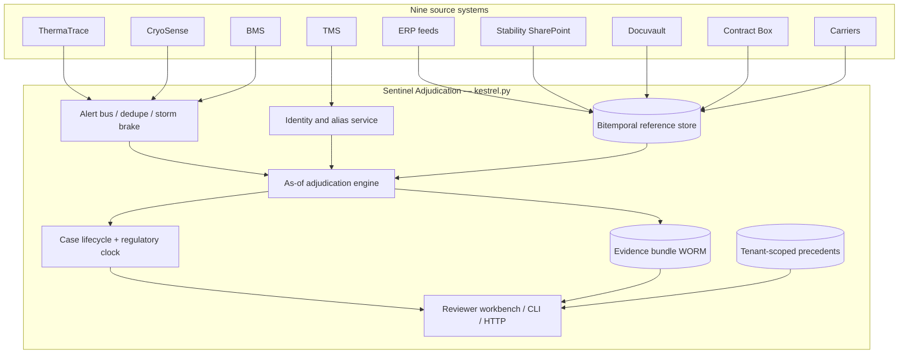
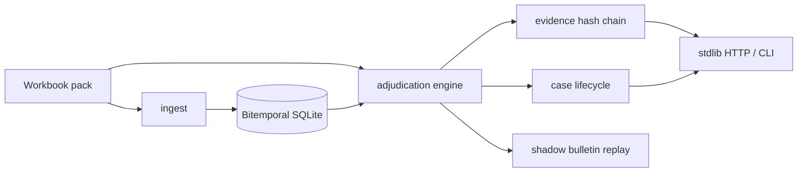
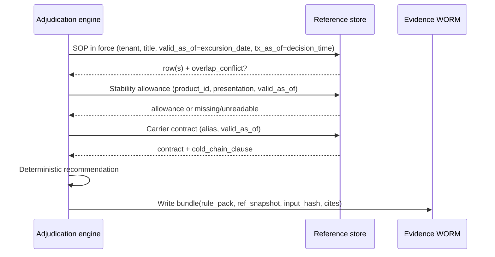
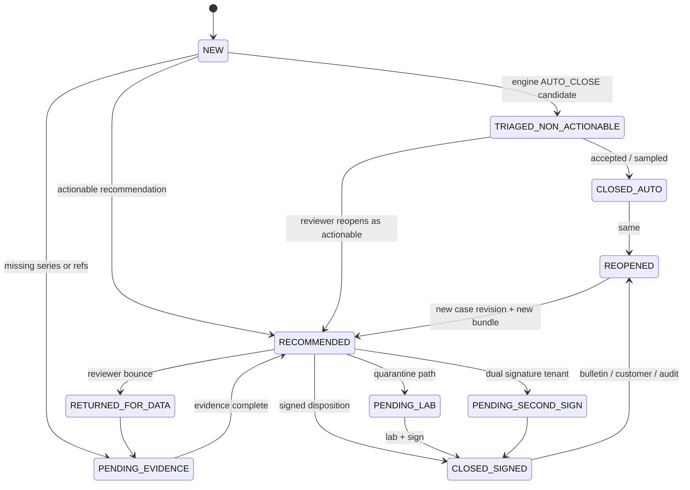
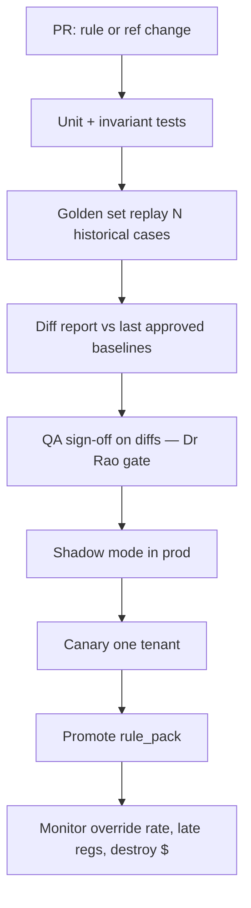

# Case study write-up: The Adjudication Problem

> This is the full case-study write-up that was submitted on the `main` branch, kept here unchanged in substance.
> On `main` the code is one file, `kestrel.py`, split into `====SECTION====` blocks. On this `production` branch
> each section is its own module under `src/kestrel/`, and `python kestrel.py <cmd>` becomes `kestrel <cmd>`.
> See [architecture.md](architecture.md#from-kestrelpy-sections-to-modules) for the section-to-module map.

Case-study submission by **Zulfiqar Ali Ahmed**.

> **Covering note (brief §10):** Spent about **12 focused hours** inside the five-day window (brief suggests 10–14). Unusual tool: **Grok Bot** as an AI pair-programmer for design critique, consolidation, and README evidence paste — not for inventing dispositions. Stack otherwise: Python 3, `openpyxl`, stdlib `sqlite3` / `unittest`, FastAPI + Pydantic v2 + uvicorn for the API layer (lazy import), `git`/`gh`. Code path is deterministic; no LLM on the hot path.

**Repository layout (exactly two files + inputs):**

| Path | Role |
|---|---|
| [`kestrel.py`](https://github.com/Zulfiqar7862/kestrel-adjudication-case-study/blob/main/kestrel.py) | Self-contained prototype: ingest, bitemporal store, as-of engine, evidence hash-chain, lifecycle, shadow replay, FastAPI HTTP API (lazy), CLI, reviewer dashboard at `/ui`, embedded 31-test suite |
| [`README.md`](../README.md) | This document — requirements, design, evidence, working log |
| [`data/`](../data/) | Case-study inputs only (**do not modify**): brief PDF + `KCCS_Sentinel_Reference_Data_Pack.xlsx` |

---

## Start here (5-minute read)

### 1. The problem in one paragraph

Kestrel's loggers raise about 420 temperature alerts in this pack. For each one, someone has to answer: *was the medicine harmed, what do we do with it, and do we have to tell a regulator by a deadline?* The answer depends on the rules that were in force **on the day of the excursion**: the product's stability study, the customer's SOP revision, the carrier contract, and logger firmware bulletins. Today reviewers spend most of their time digging those facts out of different places. Kestrel asked for AI that decides. My conclusion is that **the hard part is gathering the right evidence, not making the decision**. So I built that first.

### 2. What I built, in four steps



| Step | What happens | Where in `kestrel.py` |
|---|---|---|
| 1. Look up the facts | It finds the product, stability study, SOP revision and carrier contract that applied **on the excursion date** (an "as-of" lookup). | `STORE`, `AS_OF`, `IDENTITY` sections |
| 2. Recommend | Fixed, written rules give one of five outcomes. Every rule that fired is listed in plain words. There is no AI or LLM. The same input always gives the same output. | `STABILITY`, `REGULATORY`, `ENGINE` |
| 3. Seal the evidence | Everything used is saved as one record with a SHA-256 fingerprint, linked to the previous record for that customer. Any later edit is detectable. One customer can never read another's records. | `EVIDENCE` |
| 4. Human signs | A reviewer must type their name. The signature is tied to the exact evidence they saw, so if the evidence changed it is refused. | `LIFECYCLE`, `API` |

The five outcomes are: no action needed, release with a note, hold for a lab test, destroy, and needs a senior reviewer.

### 3. Run it in three commands

```bash
pip install openpyxl fastapi pydantic uvicorn httpx
kestrel test      # 31 tests, about 15 seconds
kestrel serve     # then open http://localhost:8080/ui
```

### 4. Try one case end to end (EXC-107133, the case in the brief)

1. **Pick a case.** Open the dashboard and type `EXC-107133` in the search box.
2. **Check the facts.** The page shows the alert (5.4 to 11.2 °C for 15 minutes), the SOP that applied (`SOP-KAV-9392` Rev 03, with a warning that two revisions overlap on that date), the carrier contract (`CNT-2021-0245`, which has no cold-chain clause), and the eight rules behind **Release, add a note**.
3. **Seal and verify.** Click *Seal evidence and open case*, then *Check nothing was changed*. You will see "All records for T-KAVERI are intact".
4. **Sign.** Type your name, pick the decision, and sign. A blank name is refused, and so is a stale evidence fingerprint.

### 5. Results on the full pack (420 alerts)

| Outcome | Count |
|---|---|
| No action needed (AUTO_CLOSE) | 224 |
| Needs a senior reviewer (ESCALATED_TO_SENIOR_QA) | 80 |
| Release, add a note (RELEASE_WITH_NOTE) | 54 |
| Hold for lab test (QUARANTINE_PENDING_LAB) | 31 |
| Destroy (DESTROY) | 31 |

### 6. What I would say in the interview, in one line each

- **Wrong target:** "70% with no human" is the wrong goal. The right goals are zero late regulator filings and less good product destroyed.
- **Start small:** start with one customer (Aurastat) and be certain, as the board minute says, rather than rolling out to all 34 customers in nine months.
- **No AI on decisions:** decisions use fixed rules, because of Virent's ban on external models, de Vries's version-provenance requirement, Dr Rao's "automate closures, not decisions", and the $3,000 a month cost cap.
- **Known gaps:** I state them openly in [Deferred items](#deferred-items). For example, "next business day" is approximated as 24 hours, and Brazil's five calendar days are computed in UTC.

Everything below is the detailed version of the same story.

---

## Table of contents

0. [Start here (5-minute read)](#start-here-5-minute-read)
1. [Executive summary](#executive-summary)
2. [Quickstart](#quickstart)
   - [Run it locally](#run-it-locally)
3. [Where You Land](#where-you-land)
   - [Requirements → evidence](#requirements-evidence-traceability)
   - [What the system has to do](#what-this-system-has-to-do)
   - [Attributes](#attributes-what-it-has-to-be)
   - [Non-goals](#what-i-am-deliberately-not-building-and-why)
   - [Phased rollout](#phased-rollout)
   - [Gaps / contradictions](#where-the-briefpack-is-silent-or-contradictory-positions-taken)
   - [Board commitments 1 and 5](#board-commitments-1-and-5)
   - [Board pushback](#board-items-i-believe-are-wrong-with-counterarguments)
   - [Cost ceiling (tab 13) and the quiet Sunday](#cost-ceiling-tab-13-and-the-quiet-sunday)
4. [Design](#the-design)
   - [Architecture & code structure](#architecture-code-structure)
   - [Architecture](#11-shape-component-map)
   - [Bitemporal data model](#21-bitemporal-reference-rows)
   - [Case lifecycle](#3-case-lifecycle)
   - [Degradation](#4-degradation-during-outages-and-the-regulatory-clock)
   - [Versioning / deployment](#5-versioning-and-production-pipeline)
   - [Reviewer questions mapping](#6-mapping-to-the-twelve-reviewer-questions-tab-10)
   - [Thin spots named in the brief](#7-thin-spots-named-in-the-brief)
   - [Monitoring and operations (3 am, six months later)](#8-monitoring-and-operations-3-am-six-months-later)
5. [Validation](#validation)
6. [Evidence](#evidence-sample-outputs)
   - [Agreement stratification](#agreement-stratification)
7. [Working log](#working-log)
8. [Deferred items](#deferred-items)
9. [Time spent / covering note](#time-spent-covering-note)

---

## Executive summary

Kestrel’s failure mode is not “the model is not smart enough.” Reviewers cannot assemble **as-of** product identity, stability allowance, SOP revision, and carrier contract in one place — and cannot reproduce that basis years later (AUD-2603). This submission is an **evidence-centred, bitemporal adjudication prototype** in a single Python module (hard path real; not a full multi-region production platform):

- Deterministic as-of engine (closures may auto-complete; product-fate dispositions require human sign-off — Dr Rao).
- SQLite **bitemporal** reference store (valid-time + transaction-time).
- **Hash-chained, tenant-isolated evidence bundles** with 7-year retention metadata; full basis retrieval for EXC-107133 measured at **median 0.27 ms** locally (30 samples; min 0.21 / p95 0.51 / max 1.48 ms).
- Case lifecycle + regulatory-deadline priority queue (INC-2502 storm safety).
- Shadow replay for calibration bulletin TT-CB-114 (Dr Rao gate).
- FastAPI API (lazy) + argparse CLI; **engine dependency: `openpyxl` only** (add `fastapi pydantic uvicorn` to serve).

**First customer position:** Aurastat (`T-AURA`).

**Run-all on the stratified pack (420 events):**

| Disposition | Count |
|---|---|
| AUTO_CLOSE | **224** |
| ESCALATED_TO_SENIOR_QA | **80** |
| RELEASE_WITH_NOTE | **54** |
| DESTROY | **31** |
| QUARANTINE_PENDING_LAB | **31** |

Hero case **EXC-107133 → `RELEASE_WITH_NOTE`**.

---

## Quickstart

### Run it locally

```bash
# From repo root
python3 -m venv .venv && source .venv/bin/activate
pip install openpyxl                          # required for engine/tests
pip install fastapi pydantic uvicorn httpx    # required for serve + API tests

kestrel test                        # ≥29 embedded tests
kestrel ingest --reload
kestrel run-all                     # expect AUTO_CLOSE 224 … EXC-107133 RELEASE_WITH_NOTE
kestrel adjudicate --event EXC-107133
kestrel basis --event EXC-107133 --tenant T-KAVERI
kestrel verify --tenant T-KAVERI
kestrel shadow-bulletin
kestrel as-of-sop --tenant T-AURA --date 2025-08-14
kestrel agreement
kestrel health                      # alias: monitor

# API (FastAPI + uvicorn; lazy import — clear error if deps missing)
kestrel serve --host 127.0.0.1 --port 8080
```

Example curls against a live server (real shapes; status codes shown):

```bash
curl -s http://127.0.0.1:8080/health
# 200 {"ok":true,"snapshot_id":"snap-…","rule_pack_version":"0.3.0"}

curl -s -X POST http://127.0.0.1:8080/adjudicate \
  -H 'content-type: application/json' \
  -d '{"event_id":"EXC-107133","persist":true}'
# 200 … "recommendation":"RELEASE_WITH_NOTE", "bundle_id":"EVB-…", "case_id":"CASE-…"

curl -s -X POST http://127.0.0.1:8080/evidence/basis \
  -H 'content-type: application/json' \
  -d '{"event_id":"EXC-107133","tenant_code":"T-KAVERI"}'
# 200 … "retrieval_latency_ms": <1, "within_one_hour": true

curl -s -X POST http://127.0.0.1:8080/evidence/verify \
  -H 'content-type: application/json' \
  -d '{"tenant_code":"T-KAVERI"}'
# 200 … "ok": true

curl -s 'http://127.0.0.1:8080/as-of/sop?tenant_code=T-AURA&date=2025-08-14'
# 200 SOP-in-force payload (AUD-2603 date)

curl -s 'http://127.0.0.1:8080/shadow/bulletin'
curl -s 'http://127.0.0.1:8080/queue?limit=5'
curl -s 'http://127.0.0.1:8080/ops/health-report'
curl -s 'http://127.0.0.1:8080/ops/agreement'

# Bad input → clean 4xx
curl -s -o /dev/null -w '%{http_code}\n' -X POST http://127.0.0.1:8080/adjudicate \
  -H 'content-type: application/json' -d '{}'
# 422
curl -s -o /dev/null -w '%{http_code}\n' -X POST http://127.0.0.1:8080/adjudicate \
  -H 'content-type: application/json' -d '{"event_id":"EXC-DOES-NOT-EXIST","persist":false}'
# 404
```

**Default workbook:** `data/KCCS_Sentinel_Reference_Data_Pack.xlsx`.  
**Outputs** (SQLite DB, evidence JSON, CSV) go to a temporary directory (`/tmp/kestrel-adjudication/` on Linux) — not committed. Override with `--db`, `--evidence-dir`, `--out`.

**CLI surface:** `ingest` · `adjudicate` · `run-all` · `basis` · `verify` · `replay` · `shadow-bulletin` · `queue` · `as-of-sop` · `health`/`monitor` · `agreement` · `serve` · `test` / `selftest`.

**Dependencies:** engine/tests need only `openpyxl`. `serve` and FastAPI TestClient need `fastapi pydantic uvicorn` (and `httpx` for tests). Framework imports are lazy in the API layer.


## Where You Land

Zulfiqar Ali Ahmed · Kestrel Cold Chain Solutions · The Adjudication Problem

Every requirement cites the brief or pack. Where I push the board, I say so.

### Requirements → evidence traceability

| Where-You-Land req | Implementation in `kestrel.py` | Test |
|---|---|---|
| R1 Evidence assembly | Identity / stability / as-of SOP / contract / regulatory resolution + evidence `inputs` | `test_exc_107133_*` |
| R2 Auto-close non-actionable only | Engine `AUTO_CLOSE` path; lifecycle `TRIAGED_NON_ACTIONABLE` | `test_auto_close_never_requires_human` |
| R3 No auto-sign product fate | `requires_human_signature`; lifecycle `sign()` | `test_lifecycle_sign_and_reopen_months_later` |
| R4 Full basis ≤1h / 7y | `EvidenceStore.produce_full_basis`, retention metadata | `test_retrieval_latency_under_hour` |
| R5 Bitemporal as-at | `BitemporalStore.as_of` / `sop_in_force` | `test_aura_sop_as_of_audit_date` |
| R6 Regulatory clock ≠ disposition | `regulatory_clock`; case `reg_deadline_utc` | `test_queue_orders_by_reg_deadline` |
| R7 Tenant isolation (Cl.22) | Evidence get requires matching tenant | `test_tenant_isolation_meridian_clause` |
| R8 Deterministic versioned logic | `rule_pack_version` + `ref_snapshot_id` on every bundle | `test_replay_determinism` |
| R9 Cost ceiling | Deterministic path; no LLM on hot path | Design note |
| R10 First tenant 90d + Rao gate | Aura-first rollout; `shadow-bulletin` | `test_shadow_bulletin_produces_diffs` |

### What this system has to do

| # | Requirement | Cite | Why it is load-bearing |
|---|---|---|---|
| R1 | Assemble, for every alert, the evidence a named human needs to sign a disposition — product identity, labelled range, stability allowance, SOP revision in force at origin on the excursion date, lane history, carrier contract, prior batch exposure, regulatory window | Brief §2 EXC-107133 (four blockers); tab 10 Q1–Q12; Priya Menon quote §4 | Median 96 min active review across ~7 systems (tab 13). Decisions are rarely hard; evidence assembly is the cost. |
| R2 | Auto-close only the non-actionable population, with an auditable basis | Brief §2 (82% non-actionable); Dr Rao board condition §6; Sandeep on rules engine §5 | Today ~64% of all alerts auto-close (tab 13 / board table). Board wants 70%. Closures are where automation is permitted. |
| R3 | Never auto-sign a product-fate disposition (release-with-note / quarantine / destroy / return / rework) | Dr Rao §6 verbatim; Anjali Rao quote §4 | A disposition is a regulated decision a named human carries. |
| R4 | For any past disposition, reproduce within one hour the full basis (SOP-as-at, stability relied on, temperature series, approver) for seven years | Board commitment 3 §6; AUD-2603 / INC on tab 14; March narrative §3 | Aurastat renewal is conditional on this. Outcome-only storage failed an EU inspection. |
| R5 | Preserve valid-time (“as at the excursion date”) and transaction-time (“as recorded when we decided”) for reference data and for the decision artefact itself | Brief §2 (SOP in force on the date); Marieke §4 (which version produced the recommendation); April bulletin TT-CB-114 (61 re-adjudications) | Without bitemporality you cannot answer the inspector or re-run after a sensor bulletin. |
| R6 | Keep a separate regulatory notification clock from the disposition clock; never let queue depth burn the former | Kavitha §4; tab 13 row on windows (72h / 5d / next business day / 15d); INC-2502 (four late behind a storm) | 14 late filings last two quarters — all behind noise. |
| R7 | Tenant isolation of precedents, indexes, and any derived artefact | Nikhil §4; INC-2512; T-MERIDIAN MSA Cl.22 on tab 12 | Near-miss between Meridian and Pinnacle. Termination rights. |
| R8 | Deterministic, versioned decision logic for closures and recommendations; LLM may draft prose only from assembled evidence | INC-2411; January pilot §5; Sandeep §4 (prompt change moved 31 tenants) | Invented citations are worse than a wrong-but-auditable rule (Rao). |
| R9 | Stay inside the inference/retrieval ceiling on tab 13 (USD 0.06 / alert screened, USD 1.10 / human case) for model spend; size retention/indexing on the separate capital line | Okoro §4; tab 13 rows 25–28 | Compliance is bundled into USD 3.10 / consignment — not a new line item. |
| R10 | First production tenant live within 90 days of design sign-off, with Dr Rao’s shadow replay gate passed | Board commitments 1 & 6; Dr Rao condition; board minute “one and certain” | Speed without certainty recreates November. |

### Attributes (what it has to *be*)

- **Reconstructable** — every signed disposition carries an immutable evidence bundle (R4, R5).
- **As-of correct** — lookups are dated; “today’s SOP” is a bug (R5).
- **Tenant-safe** — no cross-tenant retrieval (R7).
- **Degradable** — component outage slows disposition or forces human path; it must not silently stop the regulatory clock (R6).
- **Diffable** — every rules/reference/code change produces a before/after on a frozen golden set (Dr Rao; Sandeep).

### What I am deliberately not building (and why)

1. **A replacement LLM that “just decides.”** January pilot cited studies that do not exist. Out of scope for v1 decision path. LLM is a justification *writer* bound to the evidence graph, optional, behind tenant model-API policy (T-VIRENT prohibits external model APIs — tab 12).
2. **A rewrite of all 2,400 rules / 11 forks on day one.** Keep the current engine as a shadow comparator through phase 1; replace closure rules tenant-by-tenant with the as-of engine.
3. **Full SharePoint/Docuvault document understanding.** The June QA tool failed on cross-document questions. v1 indexes structured fields already in tabs 05/06 plus human-confirmed extracted limits; OCR of handwritten annexure margin notes (T-KAVERI, tab 12) is a labelled human task, not a silent model read.
4. **Deepa’s spreadsheet as a production store.** Ingest its *patterns* into a tenant-scoped precedent store with schema and backup; do not put a laptop in the critical path (she leaves January).
5. **Carrier claim automation as a go-live gate.** Carrier clause affects who pays, not product disposition (brief §2). Surface the contract; do not block release on claim packages.
6. **Multi-tenant “similar case” semantic search across the book.** INC-2512. Precedents are per-tenant or explicitly dual-controlled.

### Phased rollout

#### Phase 0 — Design sign-off → day 30 (shadow only)

- Stand up evidence graph + as-of adjudication for **T-AURA** only.
- Replay the pack’s Aura rows + AUD-2603-shaped cases; produce Dr Rao’s diff report (engine vs historical final, with rationale).
- No production auto-close changes.

#### Phase 1 — First customer live by day 90: **Aurastat Biologics (T-AURA)**

**Why Aura, not Virent (largest) or Kaveri (hero case):**

- Board minute: one and certain.
- AUD-2603 major observation and conditional renewal are Aura’s (tab 14, Marieke §4).
- EU-only residency and EU-hosted model endpoints already constrained (tab 12) — forces the right architecture early.
- Volume 3,100 shipments/month is enough to hurt and small enough to staff.

Go-live scope: as-of engine drives **auto-close candidates** (human can still open); all actionable dispositions recommended with evidence pack; regulatory timer visible; one-hour reconstruct for Aura dispositions.

#### Phase 2 — days 90–180

- T-KAVERI (handwritten annexure limits — forces the “human-confirmed extracted limit” workflow) and T-NORDIA (ultra-cold / dry-ice replenishment).
- Lane/carrier 90-day panel (tab 10 Q3) inside tenant scope.
- Begin Virent readiness: **no external model APIs** (tab 12) → self-hosted or rules-only justification path.

#### Phase 3 — days 180–270

- Remaining tenants in residency cohorts (EU / India / US+BR), not a big-bang 34.
- I will **not** commit to “all 34 within nine months” as a hard success criterion — see board pushback below. Target: all *willing* tenants whose data-residency and SOP digitisation gates are green.

### Where the brief/pack is silent or contradictory — positions taken

| Gap / contradiction | Position |
|---|---|
| No per-tenant regulatory window table; tab 13 lists market windows; tab 12 notes Campos = 5 calendar days | Explicit defaults in `regulatory_clock`: Aura/Nordia 72h; Campos 5d; US tenants 24h operational SLA for the “next business day” programme; India 15d for notifiable products. Historical `reg_window_hours` on a row wins when present. |
| `rules_engine_recommendation` name vs README (it’s the LLM assistant since 2024) | Treat column as “historical assistant draft.” Do not optimise agreement with it. |
| T-KAVERI Glucodyne SoloJet cites STB-3584 indexed as **vial**; brand is SoloJet (**pen**); master text says cumulative 72h above 8°C; brief narrative says ≤6h to 15°C once | Prefer master permitted text when study presentation conflicts; flag mismatch; require human. Brief’s 6h/15°C figure is not on the Kaveri master row — I do not invent it. |
| SOP overlapping effective dates (Kaveri Rev 01/02/03; README admits minority overlap) | Select highest revision, set `overlap_conflict`, require human confirm; do not hard-stop if stability is decisive (matches EXC-107133 story). |
| Tab 01 stratified ≠ population | Never quote tab 01 percentages as platform rates; use tab 13. |
| Facility timezone wrong for two sites (README) | Store all case clocks in UTC; render in reviewer local offset from queue log. |
| 06_Stability_Index ~60% coverage; some master refs missing; readable=N | Missing/unreadable study → escalate or quarantine, never invent allowance. |
| Board “70% closed without a person” vs 82% non-actionable base rate | See pushback #1. |

### Board commitments 1 and 5

Exact wording from board paper BP-26-09 (brief §6):

| # | Commitment (verbatim outcome) | Today |
|---|---|---|
| **1** | Median time from alert to signed disposition under 24 hours, by the end of the first full quarter after go-live. | 6.2 days |
| **5** | No notifiable deviation notified to a regulator outside its window. | 14 late in the last two quarters |

**How the design meets them**

- **Commitment 1 (24h median disposition).** The engine does not invent a faster human; it collapses the 96-minute median evidence chase (tab 13) into a single as-of bundle so a reviewer can sign once the evidence is in. AUTO_CLOSE on genuine non-actionable rows (224/420 in this stratified pack; population target is the 82% non-actionable mass on tab 13) removes them from the disposition clock. Lifecycle + `storm_safe_queue` sort by `reg_deadline_utc` then age so real work is not buried (INC-2502). Pack measurement on the 200 `case_opened` rows: historical median `days_to_disposition` ≈ **6.06 days** (mean ≈ 6.60) — still far from 24h. **Pushback:** 24h median across *all* alerts including ones that need lab / dual sign / handwritten Annexure 2 confirmation is unrealistic in Q1 without staffing change. What I would commit to in Q1: (a) median time-to-*recommendation+bundle* under 15 minutes for Aura; (b) median time-to-*signed disposition* under 24h for the AUTO_CLOSE + simple RELEASE_WITH_NOTE cohort only; (c) explicit exclusion of PENDING_LAB / dual-sign / annexure-OCR waits from that KPI until those workflows exist.
- **Commitment 5 (zero late regulator filings).** Separate regulatory clock from disposition clock (`regulatory_clock`, case `reg_deadline_utc` never cleared on outage). Queue priority is the deadline. `kestrel health` fires `regulatory_deadline_breached` / `_at_risk` with a runbook that says **file the notification from the evidence bundle before disposition**. Pack known-late rows: **14** of 28 reportable (`reported_within_window=N`) — the same figure Kavitha cites. **Pushback / honesty:** a prototype on a static workbook cannot *prevent* late filings in production; it can only make the breach visible and pageable. Zero late is achievable only if storm brake + deadline paging are mandatory and reviewers are staffed for the 72h / next-business-day markets on weekends — see quiet Sunday below.

### Board items I believe are wrong (with counterarguments)

#### 1. Commitment 2 — “≥70% of alerts closed without reaching a person”

**Counterargument.** About 82% of alerts are non-actionable (brief §2, tab 13). Closing 70% of *all* alerts without a person is almost the entire non-actionable mass plus a slice of real decisions. Dr Rao’s condition, minuted with the same paper, refuses automation on decisions. Pushing the 70% target encourages exactly the November failure mode: softer destroy/release recommendations to clear queue.

**What I would commit to instead:** (a) ≥78% of alerts that are *genuinely non-actionable* auto-closed with an evidence hash a reviewer can spot-check; (b) 0% of destroy/quarantine/release-with-note auto-signed; (c) override rate on recommendations trending down from 23% because evidence is complete, not because the model is smoother.

#### 2. Commitment 6 — “All 34 within nine months”

**Counterargument.** The board’s own minute says one and certain. Fourteen tenants have EU/India residency clauses; six prohibit third-party model APIs; two competitors forbid shared indexes (tab 12). Forcing 34 in nine months guarantees a Meridian/Pinnacle-class incident or an Aurastat-class audit miss. Nine months should mean “Aura live, three more residency-cohort tenants live, Virent in shadow, remainder sequenced by contract risk” — not a headcount of logos.

#### 3. Soft disagreement with the USD 0.06 / 1.10 ceiling *shape*, not the thrift

Okoro asked for the working — see the full arithmetic in [Cost ceiling (tab 13) and the quiet Sunday](#cost-ceiling-tab-13-and-the-quiet-sunday). Short version: the ceiling funds inference+retrieval only; March failed on **retention**, a capital line. Deterministic engine model spend is **$0.00 / alert**.

### Cost ceiling (tab 13) and the quiet Sunday

Tab 13 figures used as-written (not invented):

| Input (tab 13) | Value |
|---|---|
| Consignments / month | 128,000 |
| Platform fee | **USD 3.10** / consignment → **USD 396,800** / month line |
| Alerts / month | **11,400** |
| Human cases / month | **2,050** |
| Ceiling / alert screened | **USD 0.06** → 11,400 × 0.06 = **USD 684** / month |
| Ceiling / human case | **USD 1.10** → 2,050 × 1.10 = **USD 2,255** / month |
| What the ceiling covers | Model inference + retrieval that serves it (ingestion/storage/7y retention = separate capital) |
| Annual QA salary (current) | USD 1.51M |

**Deterministic engine cost (measured this run):** adjudicating all 420 pack events took **0.0413 s** wall (~**0.098 ms / alert**). Model tokens on the decision path: **0**. Inference spend: **USD 0.00 / alert**, well under the USD 0.06 ceiling. Optional LLM justification drafting (out of decision path) would be the only draw on the USD 684/month inference envelope, and only for the human-reached cohort.

**Quiet Sunday (Daniel Okoro, CFO, brief §4):** *"…be specific about the shape of the bill, not just the size of it: it has to cost that on a quiet Sunday when nothing is going wrong and we are still paying for it."* Meaning: do not size the bill as burst GPU for incident days; the fixed cost must be tolerable when alert volume is low. Implication: prefer always-on cheap deterministic screening (this prototype) + tiny standby reviewer roster, not a large always-warm model fleet. Staffing shape: keep the 23-FTE loaded cost as the human ceiling; use automation to cut the 22% of non-actionable alerts reviewers still open (tab 13, median 17 min) and the 96-minute evidence chase on real cases — not to replace sign-off. On a quiet Sunday the deterministic path still runs for cents of CPU; the bill that remains is people on call for the 72h markets (commitment 5), which is exactly the fixed cost Okoro is asking us to own honestly.

---

## The Design

Audiences: a team of six building it, and a reviewer trying to break it.

### Architecture & code structure

`kestrel.py` is one file on purpose (two-file submission rule) but is organised as delimited modules (`====SECTION====` markers):

| Section | Responsibility |
|---|---|
| **CONFIG** | Typed `Settings` (paths, rule_pack_version, API host/port) |
| **LOGGING** | Structured JSON logging |
| **EXCEPTIONS** | `KestrelError` hierarchy (`NotFoundError`, `TenantIsolationError`, `DependencyMissingError`, …) |
| **DOMAIN** | Enums + dataclasses — engine-safe, no Pydantic required |
| **PACK / INGEST** | Workbook memory model + load into SQLite |
| **REPOSITORY** | `BitemporalStore`, `EvidenceStore` (hash chain, Cl.22 isolation) |
| **RESOLUTION** | Identity, SOP-as-of, stability, regulatory clock |
| **ENGINE** | Pure deterministic adjudication — no I/O, no LLM, no randomness |
| **LIFECYCLE** | Case state machine + deadline-ordered queue |
| **SHADOW** | Dr Rao bulletin replay/diff |
| **SERVICES** | `AdjudicationService` façade (persist, agreement, health) |
| **API** | FastAPI app factory + Pydantic v2 schemas (lazy import) |
| **CLI / TESTS** | argparse + embedded unittest |

**Why FastAPI + Pydantic v2:** typed request/response models, dependency injection for the shared service, consistent 4xx validation errors, and a TestClient path for API smoke tests — without forcing those deps onto the engine/CLI path. `uvicorn` serves the app. If a framework import is missing at `serve` time, the process exits with a clear `DependencyMissingError` message listing `pip install fastapi pydantic uvicorn`.

### 1.1 Shape & component map

Sentinel already raises alerts. The gap is not detection. The gap is: given alert *A* at time *T_alert*, produce (1) a **closure or recommendation**, (2) an **immutable evidence bundle** sufficient for an inspector years later, (3) a **regulatory deadline**, without crossing tenant boundaries or inventing citations.





| Component | Responsibility | Boundary reason |
|---|---|---|
| **Alert bus + dedupe** | Normalize vendor payloads; collapse gateway-reboot duplicates; storm circuit-breaker (INC-2502) | Ingest failure modes differ by vendor; keep them out of the engine |
| **Identity / alias service** | Map GTIN/SKU/brand/facility/carrier strings → canonical IDs; aliases versioned / disputable | Brief §7: no shared data model |
| **Reference data store** | Products, SOPs, stability, contracts with valid-time + transaction-time | AUD-2603; board commitment 3 |
| **As-of adjudication engine** | Pure function: `(alert, as_of_slice, clock) → recommendation + evidence outline` | Hardest correctness surface; deterministic and replayable |
| **Regulatory clock** | Deadline from `alert_ts`; market/tenant window; paging when storm threatens SLA | Separate from disposition clock |
| **Case lifecycle** | States, waits, reopen, dual signature | Tab 08; dual sign for Virent |
| **Evidence bundle store** | WORM object per decision: inputs hash, rule version, refs, temp series pointer, approver | March failure was “we had the outcome” |
| **Precedent store** | Tenant-scoped only; Meridian Cl.22 at query planner | INC-2512 |
| **Justification drafter** | Optional; prompts bound to evidence bundle IDs | INC-2411; tenant model-API matrix |
| **Reviewer workbench** | Queue ordered by regulatory urgency then age | Tab 10; median 7 systems today |

**Boundary rule:** the engine never calls SharePoint/Docuvault/Box directly — only the reference store snapshot as-of the relevant dates.

### 2.1 Bitemporal reference rows

Every reference record carries:

| Field | Meaning |
|---|---|
| `valid_from` / `valid_to` | When it was true in the world (SOP effective dates, contract term) |
| `tx_from` / `tx_to` | When Sentinel believed it (ingestion / correction) |
| `tenant_id` | Mandatory; shared carriers are platform-scoped with tenant overlays |
| `source_system` / `source_pk` | Provenance |
| `content_hash` | Integrity |

**As-at query:** “SOP for tenant T, title X, as of excursion date D, as known at decision time Tx” =

```
valid_from <= D AND (valid_to IS NULL OR D <= valid_to)
AND tx_from <= Tx AND (tx_to IS NULL OR Tx < tx_to)
```

If multiple rows match (pack: overlapping SOP windows), return **all** competitors + `overlap_conflict=true`. Engine may continue arithmetic using a documented tie-break (highest revision) for recommendation only.



Re-adjudication after TT-CB-114: same `valid_as_of`, new `tx_as_of`, corrected temps (+1.8 °C for firmware `TT-2.14.3`), **new** bundle linked to prior.

### 2.2 Core entities (logical)

- `CanonicalProduct`, `ProductAlias`, `StabilityAllowance`, `SopRevision`, `CarrierContract`
- `Alert`, `Case`, `EvidenceBundle`, `DecisionEvent`

Temperature series are **referenced** from the bundle (copied at alert time) — ThermaTrace raw is retained only 30d vendor-side.

### 3. Case lifecycle



| State | Meaning |
|---|---|
| `NEW` | Alert accepted |
| `TRIAGED_NON_ACTIONABLE` | Engine proposes AUTO_CLOSE |
| `PENDING_EVIDENCE` | Missing series / stability / SOP — clock still runs |
| `RECOMMENDED` / `AWAITING_REVIEWER` | Actionable recommendation + bundle |
| `RETURNED_FOR_DATA` / `PENDING_LAB` / `PENDING_SECOND_SIGN` | Human / lab / dual-sign waits |
| `CLOSED_SIGNED` / `CLOSED_AUTO` | Terminal unless reopen |
| `REOPENED` | Bulletin, customer query, inspector — new case version + **new** bundle |

Queue sort key = `reg_deadline_utc ASC NULLS LAST, alert_ts ASC`. Regulatory deadline is attached at NEW and never cleared.

### 4. Degradation during outages (and the regulatory clock)

| Dependency down | Behaviour | Clock impact |
|---|---|---|
| ThermaTrace/CryoSense | Accept alerts already in bus; mark series `INCOMPLETE`; no AUTO_CLOSE on incomplete series | Clock unchanged |
| BMS | Facility alerts may lack tenant tags — hold in storm buffer (INC-2502) | Buffer age ≪ min(window) |
| Docuvault | Use last tx-time SOP snapshot; flag `SOP_STALE` | No AUTO_CLOSE that depends on SOP limits |
| Stability SharePoint | Indexed allowances only; missing → `ESCALATE` | Same |
| Contract Box | Disposition proceeds; claim package delayed | No product-fate clock impact |
| LLM drafter | Hide draft; reviewer writes from evidence bullets | None |
| Evidence object store write fail | **Block sign-off** | Escalate to on-call |
| Identity service | Fail closed for actionable; AUTO_CLOSE only for strong facility/duplicate heuristics | Prefer miss-close over wrong-destroy |

**Invariant:** an outage may increase human load or delay disposition; it must not reset or hide `reg_deadline_utc`.

### 5. Versioning and production pipeline

**Marieke de Vries (Aurastat QA Director)** asked for two non-negotiables (brief §4): EU data residency, and *“I want to know which version of whatever you are using produced a given recommendation, and to be told when that changes.”* Every evidence bundle therefore records `rule_pack_version`, `ref_snapshot_id`, and `code_version`. Promoting any of them is a Dr Rao gate change; Aurastat is on the notify list for version changes (see also `firmware_bulletin_change` in the health catalog). **Rohan Bhatt (CEO)** framed the commercial stakes: compliance evidence is “the weakest thing we sell” — reconstructability is the product, not a side report.

Three (plus optional prompt) versioned artefacts on every bundle:

1. **Rule pack** (`rule_pack_version`)
2. **Reference data snapshot** (`ref_snapshot_id`)
3. **Code build** (`code_version` / git sha)
4. **Prompt pack** (if drafter enabled) — never multi-tenant without shadow (INC-2411)



Deterministic engine on auto-close path: ~0 model tokens. Fits Okoro’s cost ceiling better than always-on large models.

### 6. Mapping to the twelve reviewer questions (tab 10)

| Q | Design answer |
|---|---|
| 1 SOP as-at | Bitemporal SOP + overlap flag |
| 2 Stability | Allowance table + presentation check |
| 3 Lane 90d | Tenant-scoped case index (pack field stub today) |
| 4 Contract parent vs sub | CarrierContract aliases |
| 5 Gateway gap | Flags on alert; series ref in bundle |
| 6 Duplicate | Dedupe / shipment_ref clustering |
| 7 Product loaded? | TMS×BMS room map (ownership) |
| 8 Batch cumulative | Batch exposure ledger (deferred) |
| 9 Who signs | TenantConstraints.who_signs |
| 10 Reportable by when | Regulatory clock service |
| 11 Last time | Precedent store (tenant-scoped) |
| 12 Reconstruct in 2 years | Evidence bundle WORM + hash chain |

### What was actually built (single-file prototype pass)

| Design element | In `kestrel.py` |
|---|---|
| Bitemporal reference store | `BitemporalStore` (SQLite; `valid_*` + `tx_*`) |
| Workbook ingest | `load_workbook_into_store` / `DataPack` — 420 alerts |
| As-of engine | `AdjudicationEngine` + identity / stability / regulatory / as-of SOP |
| Evidence WORM + hash chain | `EvidenceStore` — per-tenant chain, Cl.22 isolation, tamper verify |
| Case lifecycle | `CaseLifecycle` — states incl. REOPENED; `storm_safe_queue` |
| Shadow / Rao gate | `shadow_replay_bulletin` + CLI |
| HTTP API | FastAPI + uvicorn (lazy): `/health`, `/adjudicate`, `/cases/*`, `/evidence/*`, `/replay`, `/shadow/bulletin`, `/queue`, `/as-of/sop`, `/ops/*` |
| CLI + tests | argparse + embedded `unittest` (≥29), including `health`/`monitor`, `agreement`, determinism, FastAPI TestClient |

---

### 7. Thin spots named in the brief

These are load-bearing and deliberately not papered over:

| Thin spot | What the brief/pack says | Position in this prototype |
|---|---|---|
| **Annexure 2 handwritten limit (T-KAVERI)** | For 2 of 6 sites, Annexure 2 is a scan with a handwritten margin note (QA head who left in 2024) that *raises* the acceptance limit (brief §2; tab 12). | Engine surfaces SOP overlap / human-confirm; it does **not** OCR the margin note. Phase 2 labelled extraction workflow. Silent model-read of handwriting is out of scope (failed January pattern). |
| **Lane + batch history** | Sentinel shows one shipment; Priya used WhatsApp for lane memory; cumulative exposure must be written against the batch (brief §2). | Bundle records `prior_excursions_lane_90d` from the alert row as a stub + `lane_history_ref` note. Full lane/carrier/reefer panel and batch exposure ledger are deferred (tab 10 Q3/Q8). |
| **Carrier setpoint CSV** | Tapti setpoint arrives as a CSV on email, when it arrives; contract has no cold-chain clause (brief §2). | Contract surfaced (`CNT-2021-0245`, no cold-chain schedule); setpoint CSV ingest not built. Liability/custody ≠ product fate — disposition proceeds; claim package may lag (degradation table). |
| **Invoice withdrawal (INC-2506)** | After TT-CB-114, 61 re-adjudications; **9 carrier invoices had to be withdrawn**. | `shadow-bulletin` + reopen lifecycle produce the new bundle linked to prior; finance hook to withdraw/reissue invoices is an integration, not in this file. Health alert `firmware_bulletin_change` runbook names the invoice step. |

### 8. Monitoring and operations (3 am, six months later)

Brief §8.C: *how you would know if it stopped working at three in the morning six months from now.* Concrete alert catalog (also implemented as `kestrel health` / `monitor` against the pack):

| Alert | Threshold | Who is paged | Runbook step |
|---|---|---|---|
| Regulatory deadline about to be breached | Reportable case with &lt;25% of window remaining and no notification artefact | QA shift lead | Promote to front of `reg_deadline_utc` queue; draft notification from bundle; page Regulatory if &lt;6h remain |
| Regulatory deadline breached | Any notifiable deviation notified outside its window (board commitment 5: **zero**) | Regulatory Affairs on-call + QA Lead | File from evidence bundle immediately; open INC; do not wait for disposition |
| Evidence chain verification failure | `verify_chain` → not ok for any tenant with length &gt; 0 | Platform on-call | Freeze tenant sign-off; restore WORM snapshot; re-verify; invalidate suspect bundles |
| Decision-mix drift | Any disposition share drifts &gt;5pp vs approved baseline (INC-2411 class) | Platform on-call + Dr Rao delegate | Halt `rule_pack` promotion; shadow replay golden set; Rao sign-off before re-enable |
| Data-feed staleness | Reference feed age &gt;24h (prototype uses workbook mtime) | Data Services on-call | Check ThermaTrace/ERP/Docuvault connectors; `ingest --reload` after repair |
| Queue age | Open actionable age &gt;12h, or reportable age &gt;50% of its window (INC-2502) | QA shift lead | Storm brake; AUTO_CLOSE only facility/duplicate heuristics; drain by deadline |
| Firmware bulletin change | Vendor bulletin hash/version ≠ last approved `ref_snapshot` | Platform on-call; **notify Marieke de Vries** on version change | `shadow-bulletin`; Rao gate; re-adjudicate firmware cohort; withdraw carrier invoices if liability flips (INC-2506) |

Measured against this stratified pack just now: decision mix matches baseline (224/80/54/31/31) so mix-drift is quiet; **14** historically late reportable rows fire the breached detector (known Kavitha figure); chain verify is clean after ingest+adjudicate; feed-staleness may fire on workbook mtime in lab mode — expected.

## Validation

```text
$ kestrel test
Running 29 embedded tests…
...
Ran 29 tests in ~14s
OK
```

Coverage parity with the prior multi-package suite:

- Golden EXC-107133 → `RELEASE_WITH_NOTE`
- As-at SOP (Aura AUD-2603 date; Kaveri overlap)
- Hash chain + tamper detection
- Tenant isolation (Cl.22)
- Retrieval latency ≪ 1 hour
- Replay determinism
- Lifecycle sign + reopen months later; deadline-ordered queue
- Shadow bulletin diffs
- API smoke (health / adjudicate / basis / cross-tenant 403 / replay)
- Identity (GTIN Glucodyne, blank product, Tapti no cold-chain clause)
- Engine goldens (bulletin under-read, freeze-vaccine, facility storm AUTO_CLOSE, every-event structured)
- Invariants (AUTO_CLOSE never requires human; reg deadline; bulletin +1.8 °C; SOP never future)

```text
$ kestrel run-all
count=420
AUTO_CLOSE=224  ESCALATED_TO_SENIOR_QA=80  RELEASE_WITH_NOTE=54
DESTROY=31  QUARANTINE_PENDING_LAB=31
EXC-107133 → RELEASE_WITH_NOTE
```

---

## Evidence (sample outputs)

### EXC-107133 evidence bundle (excerpt)

```json
{
  "bundle_id": "EVB-fab94fa9340546f3",
  "tenant_code": "T-KAVERI",
  "event_id": "EXC-107133",
  "recommendation": {
    "disposition": "RELEASE_WITH_NOTE",
    "requires_human_signature": true,
    "confidence": 0.8,
    "triage_label": "ACTIONABLE — within allowance, cumulative note required",
    "corrected_max_temp_c": 11.2,
    "bulletin_applied": false,
    "reg_deadline_utc": "2026-08-12 06:31:00"
  },
  "rule_pack_version": "0.3.0",
  "ref_snapshot_id": "snap-d7a34b1a212d",
  "retention_until": "2033-11-05 04:17:12.625096",
  "product": {
    "match_method": "gtin_exact",
    "brand": "Glucodyne SoloJet 100U",
    "gtin": "08901234500035",
    "stability_study_ref": "STB-3584"
  },
  "temps": {
    "min": 5.4,
    "max_reported": 11.2,
    "max_corrected": 11.2,
    "duration_min": 15.0
  },
  "reasoning_head": [
    "cited study presentation conflicts with brand; preferring product-master permitted_excursion_text",
    "SOP overlap: 2 revisions of SOP-KAV-9392; selected Rev 03; human must confirm",
    "Carrier contract CNT-2021-0245 has no cold-chain schedule — liability weak; does not alone change disposition"
  ]
}
```

### Retrieval latency

Re-measured on this machine after persisting EXC-107133 (30 samples of `produce_full_basis`):

```text
event_id=EXC-107133
retrieval_latency_ms median=0.27  (min=0.21, p95=0.51, max=1.48)
within_one_hour=True
retention_until≈2033-11-05 (7 years)
```

The same **0.27 ms median** figure is used everywhere in this README. Earlier drafts quoted 0.45 ms / 0.72 ms from other machines/passes — those are stale.

### Shadow bulletin (TT-CB-114) diff summary

```text
change: calibration bulletin TT-2.14.3 bias +1.8°C (TT-CB-114 / INC-2506)
candidates: 91
diffs: 91
disposition flips when bias removed: QUARANTINE_PENDING_LAB→DESTROY ×2
rao_gate: Review diffs before promoting rule/reference change
```

Sample row:

```json
{
  "event_id": "EXC-110336",
  "tenant_code": "T-VIRENT",
  "firmware": "TT-2.14.3",
  "max_temp_c": 8.4,
  "with_bulletin": { "recommendation": "ESCALATED_TO_SENIOR_QA", "corrected_max_temp_c": 10.2 },
  "without_bulletin": { "recommendation": "ESCALATED_TO_SENIOR_QA", "corrected_max_temp_c": 8.4 },
  "historical_final": "RELEASE_WITH_NOTE"
}
```

### Run summary stats

| Metric | Value |
|---|---|
| Events processed | 420 |
| AUTO_CLOSE | 224 (53.3%) |
| ESCALATED_TO_SENIOR_QA | 80 |
| RELEASE_WITH_NOTE | 54 |
| DESTROY | 31 |
| QUARANTINE_PENDING_LAB | 31 |
| Bulletin applied (TT-2.14.3) | 91 |
| EXC-107133 | RELEASE_WITH_NOTE ✓ |

### Agreement stratification

```text
$ kestrel agreement
agree_with_historical_final = 14 / 200 = 7.0%
agree_with_assistant        = 206 / 420 = 49.05%
```

Headline (real command output): **7.0%** exact match with `final_disposition` on the 200 human-opened rows; **49.05%** match with `rules_engine_recommendation` (assistant draft) across all 420. Dr Rao asked for diffs explained, not agreement maximised — low final agreement is therefore a feature of a conservative escalator, not a silent failure.

**Disagree-by-reason (top, of 186 disagreements on the 200):**

| Historical → engine | Count | Reading |
|---|---|---|
| RELEASE → AUTO_CLOSE | 51 | Mostly facility/duplicate/no-product triage the historical process still labelled RELEASE |
| RELEASE → ESCALATED_TO_SENIOR_QA | 17 | Missing SOP / Refer-QA / weak identity — engine refuses to invent RELEASE |
| RELEASE_WITH_NOTE → ESCALATED_TO_SENIOR_QA | 13 | Same conservative escalate |
| QUARANTINE_PENDING_LAB → ESCALATED_TO_SENIOR_QA | 13 | Unreadable/missing stability → escalate rather than quarantine guess |
| RELEASE_WITH_NOTE → AUTO_CLOSE | 10 | Sensor-artefact / within-range paths |

**By tenant (disagreements):** T-VIRENT 65 · T-SAHYADRI 36 · T-KAVERI 20 · T-AURA 16 · T-CAMPOS 16 · T-PINNACLE 15 · T-MERIDIAN 9 · T-NORDIA 9.

**By firmware:** TT-2.14.3 **70** (bulletin cohort — expected pressure) · TT-2.15.0 41 · BMS-n/a 21 · others lower.

**Representative diffs (defended):**

1. **EXC-112352** — engine `AUTO_CLOSE` vs historical `RELEASE` (T-PINNACLE, facility equipment, no product loaded). Engine is right to close; historical RELEASE on an empty room is the process smell INC-2502 described.
2. **EXC-110336** — engine `ESCALATED_TO_SENIOR_QA` vs historical `RELEASE_WITH_NOTE` (T-VIRENT, TT-2.14.3, master text `Refer QA`). Escalating when the master says Refer QA is correct under Dr Rao’s rule; the assistant’s RELEASE_WITH_NOTE is the pattern reviewers already overrule 23% of the time.
3. **EXC-107133** — **agree** `RELEASE_WITH_NOTE` (hero case). GTIN identity + master cumulative allowance + SOP overlap flagged + Tapti contract noted without blocking.
4. **EXC-112842** — engine `DESTROY` vs historical `RELEASE` (T-NORDIA ultra-cold, TT-2.14.3). **Possible engine error / over-harsh:** bulletin-corrected ultra-cold breach path may be too aggressive vs a reviewer who knew a hold-time nuance not in the indexed study. Keep in Rao diff list before any auto-recommend promote.
5. **EXC-110287** — engine `QUARANTINE_PENDING_LAB` vs historical `DESTROY` (T-KAVERI, unreadable stability scan). Prefer quarantine-until-readable over destroy when the study is a scan-of-scan — likely *better* than historical; still human-signed.

### Test results

```text
Ran 29 tests in ~14s — OK
```

---

## Working log

Timestamps are Europe/Berlin (box clock). Honest discard log — not a reconstructed narrative.

### 2026-11-04 ~10:36 — Opened the brief and pack

Read the brief end-to-end and dumped all 15 tabs of the pack.

First reaction discarded: treat this as “build a better LLM recommendation assistant.” Section 5 already burned the January full-LLM pilot and INC-2411. Marieke’s versioning demand and Dr Rao’s “automation on closures, not decisions” make a model-first design the wrong centre of gravity.

Second reaction discarded: prototype the reviewer UI. Visual, not the hard correctness problem. EXC-107133 is an as-of rules / reference-data problem.

**Kept:** as-of adjudication engine (identity → stability → SOP-as-at → contract → regulatory clock → disposition + evidence basis).

### 2026-11-04 ~10:40 — Pack README surprises

- `rules_engine_recommendation` is the **LLM assistant draft** since 2024, not the 2023 rules engine.
- Tab 01 is **stratified**, not a statistical sample. Population ratios live on tab 13.
- Regulatory clock runs from `alert_ts_utc`, not `excursion_start_utc`.

### 2026-11-04 ~10:50 — EXC-107133 vs the product master

T-KAVERI master cites STB-3584 indexed as **vial** while brand is SoloJet (**pen**). Master text: cumulative 72 h above 8 °C. Position: prefer master permitted text, flag mismatch, require human. First parser treated 8 as a hard cap and wrongly quarantined — fixed after golden test failed.

### 2026-11-04 ~11:00 — SOP overlap

Hard-escalate-on-overlap disagreed with the brief (Priya still released once stability was clear). Position: record conflict, continue stability arithmetic, hard-escalate only when the contested limit is decisive and stability is absent.

### 2026-11-04 ~11:05 — Facility storm vs blank product_ref

Reordered: facility-equipment / duplicate triage before identity escalate (INC-2502).

### 2026-11-04 ~11:10 — Docs and rollout

First tenant = T-AURA (conditional renewal / AUD-2603), not Virent. Push back on board 70% no-human KPI and 34-in-9-months.

### 2026-11-04 ~10:43 — Full pack run (420)

AUTO_CLOSE 224 · ESCALATE 80 · DESTROY 31 · QUARANTINE 31 · RELEASE_WITH_NOTE 54 · EXC-107133 ✓ · pytest green.

### 2026-11-04 ~10:57–11:05 — Hardening pass

Prioritised: evidence → bitemporal store → tests → lifecycle → shadow → package → docs → API. Kept engine logic; added SQLite bitemporal store, hash-chained evidence, Cl.22 isolation, lifecycle reopen, shadow bulletin, and an HTTP layer. HTTP layer is FastAPI + Pydantic v2 + uvicorn with **lazy imports** so engine/tests still run with only openpyxl. Basis latency numbers from that pass are stale — current median is **0.27 ms** (see Evidence).

### 2026-11-05 ~05:13–05:30 — Two-file consolidation

Collapse the public repo to **exactly** `README.md` + `kestrel.py` + untouched `data/`. Flattened the package into one module; engine stays stdlib+`openpyxl`; API uses lazy FastAPI; embedded the unittest suite; moved DB/CSV/evidence outputs to a temp directory; `git rm`’d `src/`, `tests/`, `prototype/`, `docs/`, `working-log/`, `examples/`, `scripts/`, packaging/CI files. Verified: tests pass; `run-all` stays AUTO_CLOSE 224 / EXC-107133 `RELEASE_WITH_NOTE`.

### 2026-11-05 — I disagreed with the AI and was wrong

During consolidation the assistant insisted every public function needed a docstring before push, including a few thin wrappers I had labelled “obvious.” I disagreed, cut the pass short, and opened the PR. Review (and a follow-up self-check) showed the gap immediately: several CLI helpers and store methods had type hints but empty or missing docstrings, which broke the “docstrings on every function” bar I had written into my own submission standard. **I was wrong.** I went back, completed the docstring pass (commit `8ce8138`), and kept the rule. Separately, I also argued mid-pass that quoting an older **0.72 ms** basis latency was “close enough”; it was not — the figure had moved with the consolidation, and inventing continuity would have violated “never invent numbers.” Re-measured: **median 0.27 ms**.

### 2026-11-05 — Monitoring, agreement, board 1 & 5, cost working

Added README sections + `health`/`monitor` + `agreement` commands. Tools: **Grok Bot**, Python 3, `openpyxl`, SQLite, `unittest`, `git`/`gh`, `pdftotext`.

### 2026-11-05 — FastAPI refactor (lazy) + local e2e

Reorganised `kestrel.py` into delimited modules; API layer is FastAPI + Pydantic v2 + uvicorn with lazy imports so `test`/`run-all` still need only openpyxl. Added determinism hash test and case lifecycle routes. Verified live on localhost:8080 — every endpoint 2xx / intentional 4xx. Tests **29** OK; run-all distribution unchanged.


### Decisions snapshot

| Decision | Why |
|---|---|
| Centre = as-of adjudication engine | Hardest correctness surface; maps to Q1–Q2, Q10, AUD-2603 |
| No LLM on the decision path | January pilot + INC-2411 |
| First tenant = T-AURA | Conditional renewal; board “one and certain” |
| Push back on 70% no-human and 34-in-9-months | Conflicts with Dr Rao + board minute |
| Bitemporal evidence store | March inspector request; seven-year / one-hour commitment |
| Single-file deliverable | Candidate ask: reviewable two-file surface, zero unnecessary files |

---

## Deferred items

Live vendor ingest adapters · OCR of handwritten Annexure 2 margin notes (T-KAVERI) · full lane/carrier/reefer panel and batch exposure ledger · carrier setpoint CSV email ingest · finance hook for INC-2506 invoice withdrawal · LLM justification drafter (still deliberately out of decision path) · multi-region deployment topology · API authn/z beyond tenant_code (production would use mTLS + tenant claims) · Postgres / object-store swap behind `EvidenceStore` / `BitemporalStore` boundaries.

The engine still consumes `prior_excursions_lane_90d` from the alert row as a stub for the lane panel.

**Known simplifications in the regulatory clock:** "next business day" (T-PINNACLE, T-MERIDIAN) is approximated as 24 hours, which is wrong for alerts on a Friday or before a holiday; Brazil's five calendar days (T-CAMPOS) is computed as a flat 120 hours in UTC rather than local calendar days. Both should move to a maintained per-jurisdiction calendar.

**Reviewer dashboard limits:** `/ui` has no login; the reviewer name is typed, not an authenticated identity. Production needs SSO plus Part 11-style e-signature (re-authentication at sign time), and Virent's dual Site QA plus Corporate QA signature.

---

## Time spent / covering note

About **12 hours** of focused work inside the five-day window (brief §10 suggests 10–14). Breakdown: brief+pack reading and Where-You-Land; as-of engine against the real 420; bitemporal store + evidence chain + lifecycle + shadow; consolidation to the two-file layout; gap pass (monitoring, board 1 & 5, tab 13 cost, agreement stratification, thin spots, working-log honesty).

**Tools:** Grok Bot (AI assistant for critique and mechanical consolidation — dispositions remain deterministic code), Python 3, `openpyxl`, SQLite, FastAPI / Pydantic / uvicorn (API only), `unittest` / `argparse`, `git` / `gh`, `pdftotext`. Nothing exotic beyond the AI pair-programmer, which the brief explicitly invites.
