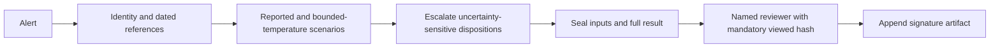
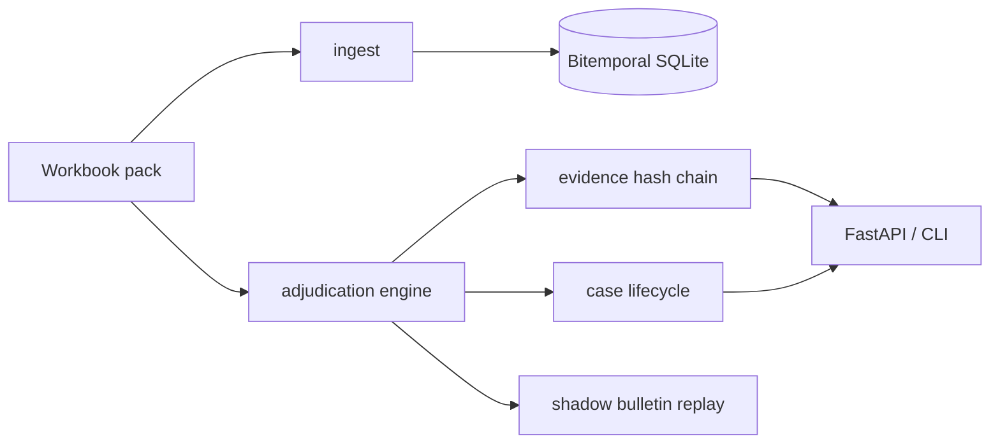
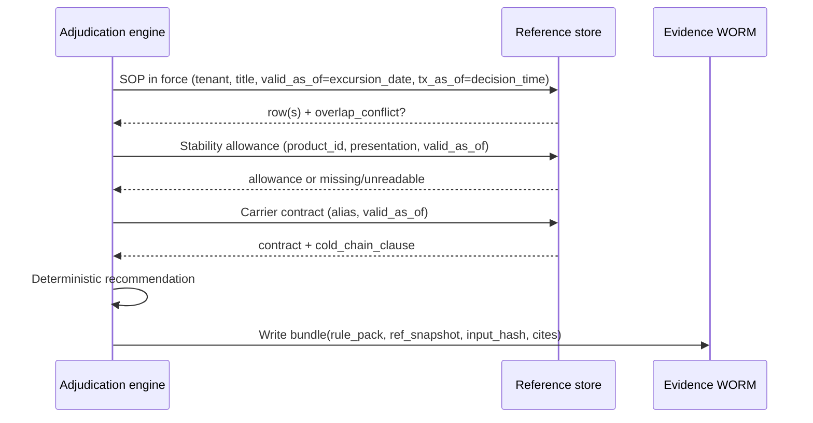
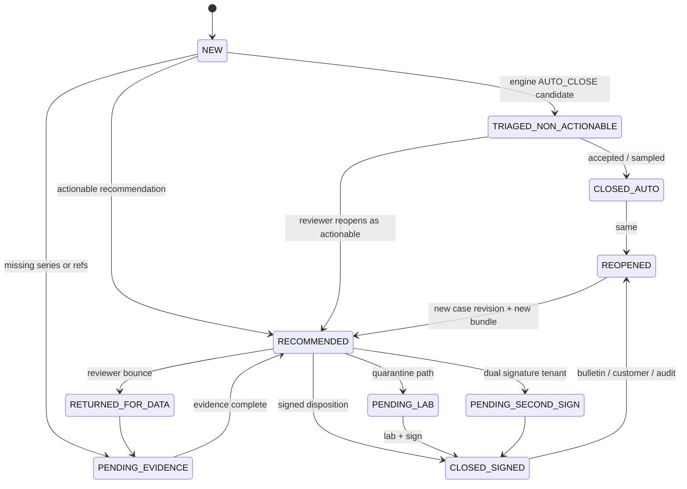
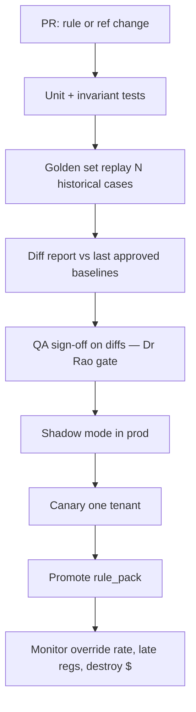

> Current implementation note (7 Nov 2026 CET): the focused correctness-review fixes are rule/code 0.4.1 on a separate unmerged branch. Current sample results and limitations are in [the executed report](validation/correctness-review/report.md). Design/phase tables below describe intentions, not additional implemented integrations.

# Case study: The Adjudication Problem

Case-study submission by **Zulfiqar Ali Ahmed**. Revised after reviewer fact-check, 7 Nov 2026 (CET).

> `production` is a deterministic modular prototype, not a certified/production-ready system. `main` keeps the earlier single-file version; packaging was a choice, not a one-/two-file rule in the brief. Reviewer fixes intentionally change outcomes.

<!-- TODO: candidate must confirm actual focused effort before submission; do not infer from bot wall time. -->
**Covering note:** Actual focused effort must be confirmed by the candidate before submission. Grok Bot assisted design critique, implementation and verification; no LLM runs in adjudication. Stack: Python, openpyxl, SQLite, unittest/pytest, FastAPI, Pydantic, uvicorn, ruff and GitHub CI.

## Start here

The workbook contains a deliberately stratified evidence sample of 420 alerts; Kestrel raised about 11,400 alerts last month. For each alert: was the medicine harmed, what should happen to it, and is a regulator notification due? Reviewers must assemble dated identity, stability, SOP, carrier and temperature evidence. The brief invites a justified design position and asks for heavy AI use in the working process; it does not require an AI decision engine.

The prototype resolves tenant-filtered products/studies and effective-date references, runs explicit deterministic rules, seals inputs/results and requires named hash-bound sign-off for fate recommendations. It does **not** prove the full March-audit basis or clinical correctness.



## Reproduce the current sample

```bash
python -m venv .venv && source .venv/bin/activate
pip install -e ".[api,dev]"
make test                  # 123 tests; runtime varies
make lint
kestrel run-all --out results.csv
kestrel adjudicate --event EXC-107133
kestrel adjudicate --event EXC-112289
kestrel shadow-bulletin --out shadow.json
kestrel agreement
kestrel serve              # /ui and /docs
```

## Current results (not platform KPIs)

Persisted run-all, 7 Nov 2026 (CET), rule/code version 0.4.1:

| Output | Count |
|---|---:|
| AUTO_CLOSE | 111 |
| ESCALATED_TO_SENIOR_QA | 309 |
| RELEASE_WITH_NOTE | 0 |
| QUARANTINE_PENDING_LAB | 0 |
| DESTROY | 0 |
| Total | 420 |

Exclusive strata are 61 bulletin re-adjudications + 24 written overrides + 13 further late-window cases + 57 further storm records + 1 narrative case + 264 random-rest records. Do not double-count the overlaps or treat sample ratios as population ratios. The 78% non-actionable closure, ~64% all-alert closure, 82% non-actionable and 23% assistant-overrule values are **source baselines**, not improvements achieved here.

**Shadow:** 91 affected-firmware candidates, 91 scenario/evidence diffs, **0 disposition flips** when adding bound-aware analysis to as-reported-only decisions. This is not the historical 61/214 re-adjudication incident. Shadow does not reopen cases or handle invoices automatically.

**Agreement:** historical finals 4/200 = 2%; assistant drafts 111/420 = 26.43%. There are 196 historical-final disagreements. Dr Rao asked for explained differences, not maximised agreement; low agreement does not itself prove safety or failure. Case-level QA review is mandatory before promotion.

## EXC examples: outcome is not the same as evidence correctness

- **EXC-107133 → ESCALATED_TO_SENIOR_QA**, confidence 0, human required. Reported 5.4–11.2°C over 15 min remains unchanged. STB-3584 does not establish product/presentation/excursion-type applicability; master cumulative text is not used as a substitute. No uncited pen study is assumed correct. SOP-KAV-9392 Rev03 remains an overlapping index candidate, not resolved governing site authority. No prior batch history is available.
- **EXC-112289 → ESCALATED_TO_SENIOR_QA**. Reported peak 18.0°C remains unchanged; upper scenario 19.8°C. In 0.4.1 unresolved study product/presentation applicability stops both scenarios earlier than the old qualified-cap parser check. Historical final QUARANTINE_PENDING_LAB remains a disagreement, not ground truth.
- **EXC-112198 → AUTO_CLOSE** based on historical duplicate triage before identity; no independently implemented live deduplication proof.

Detailed execution: [code-walkthrough.md](code-walkthrough.md). Rule ordering/thresholds: [decision-rules.md](decision-rules.md). Architecture: [architecture.md](architecture.md).

## Where You Land

Zulfiqar Ali Ahmed · Kestrel Cold Chain Solutions · The Adjudication Problem

Every requirement cites the brief or pack. Where I push the board, I say so.

### Requirements → evidence traceability

| Where-You-Land req | Prototype implementation / boundary | Test |
|---|---|---|
| R1 Evidence assembly | Identity / stability / as-of SOP / contract / regulatory resolution + evidence `inputs` | `test_exc_107133_*` |
| R2 Auto-close non-actionable only | Engine `AUTO_CLOSE` path; lifecycle `TRIAGED_NON_ACTIONABLE` | `test_auto_close_never_requires_human` |
| R3 No auto-sign product fate | `requires_human_signature`; lifecycle `sign()` | `test_lifecycle_sign_and_reopen_months_later` |
| R4 Full basis ≤1h / 7y | Local captured-basis retrieval + retention metadata only; archival completeness/durability not established | `test_retrieval_latency_under_hour` |
| R5 Bitemporal as-at | `BitemporalStore.as_of` / `sop_in_force` | `test_aura_sop_as_of_audit_date` |
| R6 Regulatory clock ≠ disposition | `regulatory_clock`; case `reg_deadline_utc` | `test_queue_orders_by_reg_deadline` |
| R7 Tenant isolation (Cl.22) | Evidence get and product/study lookup tenant-filtered; full derived-data controls remain unfinished | `test_tenant_isolation_meridian_clause` |
| R8 Deterministic versioned logic | `rule_pack_version` + `ref_snapshot_id` on every bundle | `test_replay_determinism` |
| R9 Cost ceiling | Deterministic path; no LLM on hot path | Design note |
| R10 First tenant 90d + Rao gate | Proposed Aura-first rollout; shadow diff demo, not enforced approval | `test_shadow_bulletin_produces_diffs` |

### What this system has to do

| # | Requirement | Cite | Why it is load-bearing |
|---|---|---|---|
| R1 | Assemble, for every alert, the evidence a named human needs to sign a disposition — product identity, labelled range, stability allowance, SOP revision in force at origin on the excursion date, lane history, carrier contract, prior batch exposure, regulatory window | Brief §2 EXC-107133 (four blockers); tab 10 Q1–Q12; Priya Menon quote §4 | Median 96 min active review across ~7 systems (tab 13). Decisions are rarely hard; evidence assembly is the cost. |
| R2 | Auto-close only the non-actionable population, with an auditable basis | Brief §2 (82% non-actionable); Dr Rao board condition §6; Sandeep on rules engine §5 | Today ~64% of all alerts auto-close (tab 13 / board table). Board wants 70%. Closures are where automation is permitted. |
| R3 | Never auto-sign a product-fate disposition (release-with-note / quarantine / destroy / return / rework) | Dr Rao §6 verbatim; Anjali Rao quote §4 | A disposition is a regulated decision a named human carries. |
| R4 | For any past disposition, reproduce within one hour the full basis (SOP-as-at, stability relied on, temperature series, approver) for seven years | Board commitment 3 §6; AUD-2603 / INC on tab 14; March narrative §3 | Aurastat renewal is conditional on this. Outcome-only storage failed an EU inspection. |
| R5 | Preserve valid-time (“as at the excursion date”) and transaction-time (“as recorded when we decided”) for reference data and for the decision artefact itself | Brief §2 (SOP in force on the date); Marieke §4 (which version produced the recommendation); April bulletin TT-CB-114 (61 re-adjudications) | Without bitemporality you cannot answer the inspector or re-run after a sensor bulletin. |
| R6 | Keep a separate regulatory notification clock from the disposition clock; never let queue depth burn the former | Kavitha §4; tab 13 row on windows (72h / 5d / next business day / 15d); INC-2502 (four late behind a storm) | 14 late filings last two quarters — all behind noise. |
| R7 | Tenant isolation of precedents, indexes, and any derived artefact | Nikhil §4; INC-2512; T-MERIDIAN MSA Cl.22 on tab 12 | Near-miss between Meridian and Pinnacle. Termination rights. |
| R8 | Deterministic, versioned decision logic for closures and recommendations; LLM may draft prose only from assembled evidence | INC-2411; January pilot §5; Sandeep §4 (prompt change moved 31 tenants) | Invented citations are worse than a wrong-but-auditable rule (Rao). |
| R9 | Stay inside the inference/retrieval ceiling on tab 13 (USD 0.06 / alert screened, USD 1.10 / human case) for model spend; size retention/indexing on the separate capital line | Okoro §4; tab 13 rows 25–28 | Compliance is bundled into USD 3.10 / consignment — not a new line item. |
| R10 | First production tenant live within 90 days of design sign-off, with Dr Rao’s shadow replay gate passed | Board commitments 1 & 6; Dr Rao condition; board minute “one and certain” | Speed without certainty recreates November. |

### Attributes (what it has to *be*)

- **Reconstructable** — every signed disposition carries an immutable evidence bundle (R4, R5).
- **As-of correct** — lookups are dated; “today’s SOP” is a bug (R5).
- **Tenant-safe** — no cross-tenant retrieval (R7).
- **Degradable** — component outage slows disposition or forces human path; it must not silently stop the regulatory clock (R6).
- **Diffable** — every rules/reference/code change produces a before/after on a frozen golden set (Dr Rao; Sandeep).

### What I am deliberately not building (and why)

1. **A replacement LLM that “just decides.”** January pilot cited studies that do not exist. Out of scope for v1 decision path. LLM is a justification *writer* bound to the evidence graph, optional, behind tenant model-API policy (T-VIRENT prohibits external model APIs — tab 12).
2. **A rewrite of all 2,400 rules / 11 forks on day one.** Keep the current engine as a shadow comparator through phase 1; replace closure rules tenant-by-tenant with the as-of engine.
3. **Full SharePoint/Docuvault document understanding.** The June QA tool failed on cross-document questions. v1 indexes structured fields already in tabs 05/06 plus human-confirmed extracted limits; OCR of handwritten annexure margin notes (T-KAVERI, tab 12) is a labelled human task, not a silent model read.
4. **Deepa’s spreadsheet as a production store.** Ingest its *patterns* into a tenant-scoped precedent store with schema and backup; do not put a laptop in the critical path (she leaves January).
5. **Carrier claim automation as a go-live gate.** Carrier clause affects who pays, not product disposition (brief §2). Surface the contract; do not block release on claim packages.
6. **Multi-tenant “similar case” semantic search across the book.** INC-2512. Precedents are per-tenant or explicitly dual-controlled.

### Phased rollout (proposed, not implemented/achieved)

#### Phase 0 — Design sign-off → day 30 (shadow only)

- Stand up evidence graph + as-of adjudication for **T-AURA** only.
- Replay the pack’s Aura rows + AUD-2603-shaped cases; produce Dr Rao’s diff report (engine vs historical final, with rationale).
- No production auto-close changes.

#### Phase 1 — First customer live by day 90: **Aurastat Biologics (T-AURA)**

**Candidate risk-based choice, not a board-mandated tenant. Why Aura, not Virent (largest) or Kaveri (hero case):**

- Board minute: one and certain.
- AUD-2603 major observation and conditional renewal are Aura’s (tab 14, Marieke §4).
- EU-only residency and EU-hosted model endpoints already constrained (tab 12) — forces the right architecture early.
- Volume 3,100 shipments/month is enough to hurt and small enough to staff.

Go-live scope: as-of engine drives **auto-close candidates** (human can still open); all actionable dispositions recommended with evidence pack; regulatory timer visible; one-hour reconstruct for Aura dispositions.

#### Phase 2 — days 90–180

- T-KAVERI (handwritten annexure limits — forces the “human-confirmed extracted limit” workflow) and T-NORDIA (ultra-cold / dry-ice replenishment).
- Lane/carrier 90-day panel (tab 10 Q3) inside tenant scope.
- Begin Virent readiness: **no external model APIs** (tab 12) → self-hosted or rules-only justification path.

#### Phase 3 — days 180–270

- Remaining tenants in residency cohorts (EU / India / US+BR), not a big-bang 34.
- I will **not** commit to “all 34 within nine months” as a hard success criterion — see board pushback below. Target: all *willing* tenants whose data-residency and SOP digitisation gates are green.

### Where the brief/pack is silent or contradictory — positions taken

| Gap / contradiction | Position |
|---|---|
| No per-tenant regulatory window table; tab 13 lists market windows; tab 12 notes Campos = 5 calendar days | Explicit defaults in `regulatory_clock`: Aura/Nordia 72h; Campos 5d; US tenants 24h operational SLA for the “next business day” programme; India 15d for notifiable products. Historical `reg_window_hours` on a row wins when present. |
| `rules_engine_recommendation` name vs README (it’s the LLM assistant since 2024) | Treat column as “historical assistant draft.” Do not optimise agreement with it. |
| T-KAVERI Glucodyne SoloJet cites STB-3584 indexed as **vial**; brand is SoloJet (**pen**); master text says cumulative 72h above 8°C; brief narrative says ≤6h to 15°C once | Prefer master permitted text when study presentation conflicts; flag mismatch; require human. Brief’s 6h/15°C figure is not on the Kaveri master row — I do not invent it. |
| SOP overlapping effective dates (Kaveri Rev 01/02/03; README admits minority overlap) | Select highest revision, set `overlap_conflict`, require human confirm; do not hard-stop if stability is decisive (outcome match only, not proof the governing Annexure 2 limit is resolved). |
| Tab 01 stratified ≠ population | Never quote tab 01 percentages as platform rates; use tab 13. |
| Facility timezone wrong for two sites (README) | Store clocks in UTC; facility-timezone verification and market-local cut-offs remain unfinished. |
| 06_Stability_Index ~60% coverage; some master refs missing; readable=N | Unreadable study reaching its guard quarantines; missing study can fall back to master and mild no-allowance fallback can recommend release-with-note. This is not a universal missing-evidence guard. |
| Board “70% closed without a person” vs 82% non-actionable base rate | See pushback #1. |

### Board commitments 1 and 5

Exact wording from board paper BP-26-09 (brief §6):

| # | Commitment (verbatim outcome) | Today |
|---|---|---|
| **1** | Median time from alert to signed disposition under 24 hours, by the end of the first full quarter after go-live. | 6.2 days |
| **5** | No notifiable deviation notified to a regulator outside its window. | 14 late in the last two quarters |

**Proposed approach and what the prototype cannot guarantee**

- **Commitment 1 (24h median disposition).** The source population median active human review is 96 minutes (tab 13), not a measured saving here. Historical disposition median is 6.2 days in the population; the 200 opened sample cases have median about 6.06 days (mean 6.60). Evidence assembly may help, but lab/dual-sign/Annexure waits and weekend staffing must be measured. Propose a time-to-bundle metric separately from alert-to-signed disposition; do not claim engine runtime proves either SLA. AUTO_CLOSE candidates remain TRIAGED_NON_ACTIONABLE rather than terminal CLOSED_AUTO.

### Board items I believe are wrong (with counterarguments)

#### 1. Commitment 2 — “≥70% of alerts closed without reaching a person”

**Counterargument.** With 82% non-actionable alerts, closing 70% of all alerts would require about 85.4% of the non-actionable population, versus today's 78%. That is an improvement target, not a mathematical requirement to automate product fate. Validate safe closure coverage separately from evidence quality, and never auto-sign product-fate decisions.

**What I would commit to instead:** preserve the current 78% non-actionable closure baseline while measuring safe improvement; never auto-sign product fate; measure whether complete evidence reduces the 23% assistant-overrule baseline on an audited, representative cohort. The stratified pack is not a production KPI.

#### 2. Commitment 6 — “All 34 within nine months”

**Counterargument.** The board’s own minute says one and certain. Fourteen tenants have EU/India residency clauses; six prohibit third-party model APIs; two competitors forbid shared indexes (tab 12). Forcing 34 in nine months guarantees a Meridian/Pinnacle-class incident or an Aurastat-class audit miss. Nine months should mean “Aura live, three more residency-cohort tenants live, Virent in shadow, remainder sequenced by contract risk” — not a headcount of logos.

#### 3. Soft disagreement with the USD 0.06 / 1.10 ceiling *shape*, not the thrift

Okoro asked for the working — see the full arithmetic in [Cost ceiling (tab 13) and the quiet Sunday](#cost-ceiling-tab-13-and-the-quiet-sunday). Short version: the ceiling funds inference+retrieval only; March failed on **retention**, a capital line. Deterministic engine model spend is **$0.00 / alert**.

### Cost ceiling (tab 13) and the quiet Sunday

Tab 13 figures used as-written (not invented):

| Input (tab 13) | Value |
|---|---|
| Consignments / month | 128,000 |
| Platform fee | **USD 3.10** / consignment → **USD 396,800** / month line |
| Alerts / month | **11,400** |
| Human cases / month | **2,050** |
| Ceiling / alert screened | **USD 0.06** → 11,400 × 0.06 = **USD 684** / month |
| Ceiling / human case | **USD 1.10** → 2,050 × 1.10 = **USD 2,255** / month |
| What the ceiling covers | Model inference + retrieval that serves it (ingestion/storage/7y retention = separate capital) |
| Annual QA salary (current) | USD 1.51M |

**Decision-path cost boundary:** the deterministic engine makes no model API calls. This does not establish total inference-plus-retrieval cost, capital retention cost, residency cost or weekend staffing cost. Benchmark loaded-engine runtime separately from ingest, persistence and archive retrieval, with a dated reproducible script rather than a fixed historical timing.

**Quiet Sunday (Daniel Okoro, CFO, brief §4):** the fixed bill matters even without an incident. Size always-on compute, ingestion/indexing, residency, replicas, archive restores, on-call and QA coverage separately from model API spend. No standby-roster capacity or CPU price is established here. At constant 11,400 alerts/month, seven years implies 957,600 base alert bundles before versions, documents, raw series, replicas and legal holds. Measure bytes and price those assumptions before quoting a total. The per-alert and per-human ceilings are source envelopes, not necessarily additive billing tiers.

---

## The Design

Audiences: a team of six building it, and a reviewer trying to break it.

### Architecture & code structure

The earlier main-branch prototype used one file as a packaging choice, not a rule in the brief. Production separates these responsibilities into modules; section 8 requires explicit data, interface, state, ordering, failure and recovery contracts.

| Section | Responsibility |
|---|---|
| **CONFIG** | Typed `Settings` (paths, rule_pack_version, API host/port) |
| **LOGGING** | Structured JSON logging |
| **EXCEPTIONS** | `KestrelError` hierarchy (`NotFoundError`, `TenantIsolationError`, `DependencyMissingError`, …) |
| **DOMAIN** | Enums + dataclasses — engine-safe, no Pydantic required |
| **PACK / INGEST** | Workbook memory model + load into SQLite |
| **REPOSITORY** | `BitemporalStore`, `EvidenceStore` (hash chain, Cl.22 isolation) |
| **RESOLUTION** | Identity, SOP-as-of, stability, regulatory clock |
| **ENGINE** | Pure deterministic adjudication — no I/O, no LLM, no randomness |
| **LIFECYCLE** | Case state machine + deadline-ordered queue |
| **SHADOW** | Dr Rao bulletin replay/diff |
| **SERVICES** | `AdjudicationService` façade (persist, agreement, health) |
| **API** | FastAPI app factory + Pydantic v2 schemas (lazy import) |
| **CLI / TESTS** | argparse + embedded unittest |

**Why FastAPI + Pydantic v2:** typed request/response models, dependency injection for the shared service, consistent 4xx validation errors, and a TestClient path for API smoke tests — without forcing those deps onto the engine/CLI path. `uvicorn` serves the app. If a framework import is missing at `serve` time, the process exits with a clear `DependencyMissingError` message listing `pip install fastapi pydantic uvicorn`.

### 1.1 Target shape & component map (production design, not current wiring)

Sentinel already raises alerts. The gap is not detection. The gap is: given alert *A* at time *T_alert*, produce (1) a **closure or recommendation**, (2) an **immutable evidence bundle** sufficient for an inspector years later, (3) a **regulatory deadline**, without crossing tenant boundaries or inventing citations.




| Component | Responsibility | Boundary reason |
|---|---|---|
| **Alert bus + dedupe** | Normalize vendor payloads; collapse gateway-reboot duplicates; storm circuit-breaker (INC-2502) | Ingest failure modes differ by vendor; keep them out of the engine |
| **Identity / alias service** | Map GTIN/SKU/brand/facility/carrier strings → canonical IDs; aliases versioned / disputable | Brief §7: no shared data model |
| **Reference data store** | Products, SOPs, stability, contracts with valid-time + transaction-time | AUD-2603; board commitment 3 |
| **As-of adjudication engine** | Pure function: `(alert, as_of_slice, clock) → recommendation + evidence outline` | Hardest correctness surface; deterministic and replayable |
| **Regulatory clock** | Deadline from `alert_ts`; market/tenant window; paging when storm threatens SLA | Separate from disposition clock |
| **Case lifecycle** | States, waits, reopen, dual signature | Tab 08; dual sign for Virent |
| **Evidence bundle store** | WORM object per decision: inputs hash, rule version, refs, temp series pointer, approver | March failure was “we had the outcome” |
| **Precedent store** | Tenant-scoped only; Meridian Cl.22 at query planner | INC-2512 |
| **Justification drafter** | Optional; prompts bound to evidence bundle IDs | INC-2411; tenant model-API matrix |
| **Reviewer workbench** | Queue ordered by regulatory urgency then age | Tab 10; median 7 systems today |

**Boundary rule:** the engine never calls SharePoint/Docuvault/Box. Current live decisions use DataPack effective-date rows, not a transaction-time SQLite slice. Replay uses the typed tenant-filtered inputs/references sealed in the bundle. The target architecture must wire valid+transaction-time reconstruction end to end.

### 2.1 Bitemporal reference rows

Every reference record carries:

| Field | Meaning |
|---|---|
| `valid_from` / `valid_to` | When it was true in the world (SOP effective dates, contract term) |
| `tx_from` / `tx_to` | When Sentinel believed it (ingestion / correction) |
| `tenant_id` | Mandatory; shared carriers are platform-scoped with tenant overlays |
| `source_system` / `source_pk` | Provenance |
| `content_hash` | Integrity |

**As-at query:** “SOP for tenant T, title X, as of excursion date D, as known at decision time Tx” =

```
valid_from <= D AND (valid_to IS NULL OR D <= valid_to)
AND tx_from <= Tx AND (tx_to IS NULL OR Tx < tx_to)
```

If multiple rows match (pack: overlapping SOP windows), return **all** competitors + `overlap_conflict=true`. Engine may continue arithmetic using a documented tie-break (highest revision) for recommendation only.



TT-CB-114 is under-reporting **up to** 1.8°C, not a calibrated correction. Affected firmware is evaluated at reported and upper-bound min/max/mean summary scenarios, recorded separately; disposition-sensitive cases escalate. Observations never become reported+1.8 truth. Two endpoints/common-offset summaries do not prove all possible raw series; per-device/date applicability and automatic linked re-adjudication workflows remain unfinished.

### 2.2 Core entities (logical)

- `CanonicalProduct`, `ProductAlias`, `StabilityAllowance`, `SopRevision`, `CarrierContract`
- `Alert`, `Case`, `EvidenceBundle`, `DecisionEvent`

The bundle currently retains alert summaries and a workbook-row pointer, **not a copied raw series** or complete source SOP/Annexure bytes. Raw series/source documents must be captured with hashes and qualified restores before the March-audit/7-year requirement is met.

### 3. Case lifecycle



| State | Meaning |
|---|---|
| `NEW` | Alert accepted |
| `TRIAGED_NON_ACTIONABLE` | Engine proposes AUTO_CLOSE |
| `PENDING_EVIDENCE` | Missing series / stability / SOP — clock still runs |
| `RECOMMENDED` / `AWAITING_REVIEWER` | Actionable recommendation + bundle |
| `RETURNED_FOR_DATA` / `PENDING_LAB` / `PENDING_SECOND_SIGN` | Human / lab / dual-sign waits |
| `CLOSED_SIGNED` / `CLOSED_AUTO` | Terminal unless reopen |
| `REOPENED` | Bulletin, customer query, inspector — new case version + **new** bundle |

Actual queue order is null deadlines last, earliest deadline, priority_score descending, updated_at ascending. Deadlines also exist on nonreportable rows. Reopen carries the deadline/reportability forward; ordering is not proof of storm safety.

### 4. Required degradation contracts (target, not tested live integrations)

| Dependency down | Behaviour | Clock impact |
|---|---|---|
| ThermaTrace/CryoSense | Accept alerts already in bus; mark series `INCOMPLETE`; no AUTO_CLOSE on incomplete series | Clock unchanged |
| BMS | Facility alerts may lack tenant tags — hold in storm buffer (INC-2502) | Buffer age ≪ min(window) |
| Docuvault | Use last tx-time SOP snapshot; flag `SOP_STALE` | No AUTO_CLOSE that depends on SOP limits |
| Stability SharePoint | Indexed allowances only; missing → `ESCALATE` | Same |
| Contract Box | Disposition proceeds; claim package delayed | No product-fate clock impact |
| LLM drafter | Hide draft; reviewer writes from evidence bullets | None |
| Evidence object store write fail | **Block sign-off** | Escalate to on-call |
| Identity service | Fail closed for actionable; AUTO_CLOSE only for strong facility/duplicate heuristics | Prefer miss-close over wrong-destroy |

**Invariant:** an outage may increase human load or delay disposition; it must not reset or hide `reg_deadline_utc`.

### 5. Versioning and proposed production pipeline

**Marieke de Vries (Aurastat QA Director)** asked for two non-negotiables (brief §4): EU data residency, and *“I want to know which version of whatever you are using produced a given recommendation, and to be told when that changes.”* Every evidence bundle therefore records `rule_pack_version`, `ref_snapshot_id`, and `code_version`. Promoting any should require a Dr Rao diff approval; Aurastat belongs on the proposed notify list for version changes (see also `firmware_bulletin_change` in the health catalog). **Rohan Bhatt (CEO)** framed the commercial stakes: compliance evidence is “the weakest thing we sell” — reconstructability is the product, not a side report.

Three (plus optional prompt) versioned artefacts on every bundle:

1. **Rule pack** (`rule_pack_version`)
2. **Reference data snapshot** (`ref_snapshot_id`)
3. **Code build** (`code_version` / git sha)
4. **Prompt pack** (if drafter enabled) — never multi-tenant without shadow (INC-2411)



Deterministic engine on auto-close path: ~0 model tokens. Fits Okoro’s cost ceiling better than always-on large models.

### 6. Mapping to the twelve reviewer questions (tab 10)

| Q | Design answer |
|---|---|
| 1 SOP as-at | Bitemporal SOP + overlap flag |
| 2 Stability | Allowance table + presentation check |
| 3 Lane 90d | Tenant-scoped case index (pack field stub today) |
| 4 Contract parent vs sub | CarrierContract aliases |
| 5 Gateway gap | Flags on alert; series ref in bundle |
| 6 Duplicate | Dedupe / shipment_ref clustering |
| 7 Product loaded? | TMS×BMS room map (ownership) |
| 8 Batch cumulative | Batch exposure ledger (deferred) |
| 9 Who signs | TenantConstraints.who_signs |
| 10 Reportable by when | Regulatory clock service |
| 11 Last time | Precedent store (tenant-scoped) |
| 12 Reconstruct in 2 years | Evidence bundle WORM + hash chain |

### What is actually built (modular prototype)

| Design element | In `src/kestrel/` |
|---|---|
| Bitemporal reference store | `BitemporalStore` (SQLite; `valid_*` + `tx_*`) |
| Workbook ingest | `load_workbook_into_store` / `DataPack` — 420 alerts |
| As-of engine | `AdjudicationEngine` + identity / stability / regulatory / as-of SOP |
| Evidence hash chain (not WORM) | `EvidenceStore` — tenant-guarded local JSON, tamper verification, signature artifact |
| Case lifecycle | `CaseLifecycle` — states incl. REOPENED; `storm_safe_queue` |
| Shadow / Rao gate | `shadow_replay_bulletin` + CLI |
| HTTP API | FastAPI + uvicorn (lazy): `/health`, `/adjudicate`, `/cases/*`, `/evidence/*`, `/replay`, `/shadow/bulletin`, `/queue`, `/as-of/sop`, `/ops/*` |
| CLI + tests | argparse + 123 discovered tests, including `health`/`monitor`, `agreement`, determinism, FastAPI TestClient |

---

### 7. Thin spots named in the brief

These are load-bearing and deliberately not papered over:

| Thin spot | What the brief/pack says | Position in this prototype |
|---|---|---|
| **Annexure 2 handwritten limit (T-KAVERI)** | For 2 of 6 sites, Annexure 2 is a scan with a handwritten margin note (QA head who left in 2024) that *raises* the acceptance limit (brief §2; tab 12). | Engine records unresolved SOP/site authority and blocks release recommendations; it does **not** OCR the margin note. Phase 2 labelled extraction workflow. Silent model-read of handwriting is out of scope (failed January pattern). |
| **Lane + batch history** | Sentinel shows one shipment; Priya used WhatsApp for lane memory; cumulative exposure must be written against the batch (brief §2). | Bundle records `prior_excursions_lane_90d` from the alert row as a stub + `lane_history_ref` note. Cumulative excursion assessment now routes to QA; full lane/carrier/reefer panel and batch exposure ledger are deferred (tab 10 Q3/Q8). |
| **Carrier setpoint CSV** | Tapti setpoint arrives as a CSV on email, when it arrives; contract has no cold-chain clause (brief §2). | Contract surfaced (`CNT-2021-0245`, no cold-chain schedule); setpoint CSV ingest not built. Liability/custody ≠ product fate — disposition proceeds; claim package may lag (degradation table). |
| **Invoice withdrawal (INC-2506)** | After TT-CB-114, 61 re-adjudications; **9 carrier invoices had to be withdrawn**. | Shadow computes a sensitivity diff only; reopen is a separate operation preserving clock/signature history. It does not automatically re-adjudicate, create a linked replacement bundle or withdraw invoices. Finance hooks and idempotent invoice follow-up are unimplemented. |

### 8. Monitoring and operations (3 am, six months later)

Brief §8.C asks how failure is detected at three in the morning. The following is a target paging/runbook catalogue. `kestrel health` / `monitor` implements on-demand historical checks and alert dictionaries, not live independent pages.

| Alert | Threshold | Who is paged | Runbook step |
|---|---|---|---|
| Regulatory deadline about to be breached | Reportable case with &lt;25% of window remaining and no notification artefact | QA shift lead | Promote to front of `reg_deadline_utc` queue; draft notification from bundle; page Regulatory if &lt;6h remain |
| Regulatory deadline breached | Any notifiable deviation notified outside its window (board commitment 5: **zero**) | Regulatory Affairs on-call + QA Lead | File from evidence bundle immediately; open INC; do not wait for disposition |
| Evidence chain verification failure | `verify_chain` → not ok for any tenant with length &gt; 0 | Platform on-call | Freeze tenant sign-off; restore WORM snapshot; re-verify; invalidate suspect bundles |
| Decision-mix drift | Any disposition share drifts &gt;5pp vs approved baseline (INC-2411 class) | Platform on-call + Dr Rao delegate | Halt `rule_pack` promotion; shadow replay golden set; Rao sign-off before re-enable |
| Data-feed staleness | Reference feed age &gt;24h (prototype uses workbook mtime) | Data Services on-call | Check ThermaTrace/ERP/Docuvault connectors; `ingest --reload` after repair |
| Queue age | Open actionable age &gt;12h, or reportable age &gt;50% of its window (INC-2502) | QA shift lead | Storm brake; AUTO_CLOSE only facility/duplicate heuristics; drain by deadline |
| Firmware bulletin change | Vendor bulletin hash/version ≠ last approved `ref_snapshot` | Platform on-call; **notify Marieke de Vries** on version change | `shadow-bulletin`; Rao gate; re-adjudicate firmware cohort; withdraw carrier invoices if liability flips (INC-2506) |

Rerun 7 Nov 2026 (CET): sample regression mix is 111 AUTO_CLOSE / 309 escalation / 0 release-with-note / 0 quarantine / 0 destroy. This is not a QA-approved production baseline. The health helper still reports 14 historically late rows and workbook-mtime staleness; its firmware-change hook is not live bulletin detection, and its alert dictionaries do not send pages.


## Validation and review-driven changes

123 tests pass, including the original 19 regressions in `tests/test_review_regressions.py` and 56 parametrized correctness-review cases; ruff check and format are clean. These tests establish software contracts on fixtures/sample data, not clinical validation.

| Finding | Fix / regression evidence |
|---|---|
| Fixed +1.8 as truth | Reported and upper-bound min/max/mean scenarios retained separately; sensitive dispositions escalate; tests for crossing, freezing, same-outcome flag, unaffected firmware |
| Qualified prohibition discarded | Cap parsed separately; missing duration/authority escalates; exact-text/unqualified/boundary regressions |
| Unknown tenant cross-fallback | Tenant-only product pool; multiple exact/alias candidates ambiguous; study key tenant+ref; unknown/duplicate/shared-GTIN/study-scope tests |
| Optional viewed hash/stale UNSIGNED basis | Required hash, actual content verification, append SIGNED artifact with exact prior hash and case id; missing/stale/tampered hash and generic-transition bypass tests |
| Replay from current workbook | Typed immutable event/reference snapshot and full expected result; verify and reject mismatched versions; replay with live pack removed, twice without persistence |
| Reopen lost deadline | Carry deadline/reportability/evidence reference; original signature artifact remains; reopen regression |

The old blanket-bias/parser baseline is superseded; no byte-identical-to-main claim remains. All sample outcome changes require QA explanation/approval before a production rollout. Current labels are rule/code0.4.1, not a retained archive of historical executable builds.

## Evidence retrieval versus the March audit

Per-tenant hash chains detect stored edits; local JSON/SQLite retrieval with retention metadata is not proof of seven-year archival completeness/durability. The bundle now includes typed replay inputs and references, full expected output, reasoning and version labels. A signature appends a new bundle with signer, time, final decision, reason and exact original viewed hash; the immutable pre-sign snapshot remains UNSIGNED. `basis` returns the latest signed artifact.

Replay verifies the bundle, refuses unavailable code/rule versions or legacy bundles lacking inputs, restores event/reference types and compares the complete result. It does not consult the current workbook. Pinned executable storage, raw temperature series, original source PDFs/Annexure bytes, content provenance, independent chain anchoring and qualified remote restores remain missing. A fast local lookup is not the March audit. No fixed historical engine/retrieval timing is claimed.

## Deferred items and honest limits

- **Taxonomy:** shortened-expiry disposition/expiry fields are missing; RELEASE_WITH_NOTE is not equivalent. ESCALATED_TO_SENIOR_QA is review routing still in the fate enum. RELEASE/RETURN/REWORK have no current emitting rule. AUTO_CLOSE proposes TRIAGED_NON_ACTIONABLE, not a terminal closed state.
- **Evidence gating:** 0.4.1 blocks engine release/allowance closure on missing SOP/site authority, overlap or unresolved study applicability. A human can still manually sign a different disposition; signing does not independently enforce Annexure2 clearance. Aliases lack tenant ownership, negative/conflicting-edge adjudication and validated trust. Tenant-filtered matches are not complete clause22 governance over every model/index/derived artefact.
- **Temperature scope:** endpoints/common-offset min/max/mean summaries do not prove all possible per-reading histories. Bulletin applicability is firmware-only, without calibrated device/date mapping or automatic historical-signature/invoice follow-up.
- **Human approval:** typed name is not authentication, role validation, dual-signature or a qualified electronic signature. File+SQLite operations are not cross-resource atomic; parallel writers require transaction/concurrency hardening.
- **Batch/lane:** no tenant+presentation+batch exposure ledger, atomic accumulation/idempotency or full lane history panel; unknown prior exposure is not proven zero.
- **Clocks:** US next-business-day approximated24h; Brazil five calendar days approximated120h UTC. These are not verified legal cut-offs; Friday+24h can be early, not necessarily late. India15 days is sourced from tab13 for notifiable products only. Maintain jurisdiction calendars, applicability and notification state explicitly.
- **Storm/outage:** no live incident collapse, bounded durable admission, tenant fairness or independent regulatory pager. The1,912-alert/38min incident is source history, not a reproduced load test. Queue sorting alone cannot guarantee no starvation.
- **Archive/cost:** SQLite/local files are writable and often temporary. Need tenant/region object-lock, legal holds, independent anchoring and restore qualification. No model API calls is not a zero total platform bill; bytes/replicas/retrieval/residency/on-call costs remain to be measured.

## Working log (verified review pass, 7 Nov 2026 CET)

Reviewer fact-check identified unsupported wording and safety bugs. This pass separated uncertainty from measurement, fixed qualified parsing and tenant fallback/ambiguity, required verified hash-bound signing with a visible append artifact, sealed replay inputs and preserved reopened clocks. New regression tests and a persisted420-row rerun replaced stale counts. Historical timing distributions and inferred personal-effort claims were removed rather than recycled as current evidence. Prior single-file packaging was not a brief requirement.

## Time spent / covering note

Actual focused effort must be confirmed by the candidate before submission.
<!-- TODO: Zulfiqar to supply real focused hours; never infer or invent a duration. -->
