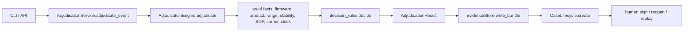

# Code walkthrough: one alert, start to finish

This page follows a real alert through the code in the order the code runs. Every file and function named here exists in `src/kestrel/`, and every output shown comes from a real run on the bundled data pack.

**Thirty-second version.** An excursion alert comes in through the CLI or the HTTP API. `AdjudicationService` hands it to `AdjudicationEngine`, which resolves the facts that applied *on the excursion date*: the firmware correction, the product, the labelled range, the stability allowance, the SOP revision, the carrier contract and the regulatory clock. Those facts become an `ExcursionFacts` object. `decision_rules.decide()` walks 15 ordered rules, and the first rule that returns a verdict wins; a 16th, conservative fallback runs only if none do. The result is sealed into a hash-chained evidence bundle for that tenant and opens a case. Only non-actionable `AUTO_CLOSE` results close without a person; every product-fate decision waits for a named human signature bound to the evidence hash they saw. No LLM is involved anywhere in the decision.



---

## The hero case: EXC-107133

```bash
kestrel adjudicate --event EXC-107133
```

| Field | Value |
|---|---|
| Tenant | `T-KAVERI` |
| Reading | max 11.2 °C, min 5.4 °C, 15 minutes, firmware `TT-2.15.0` |
| Labelled range | `2-8C (protect from light)`, parsed to 2.0 to 8.0 °C |
| Product match | `gtin_exact` on `08901234500035` |
| Allowance used | "Cumulative 72 h above 8 °C permitted across shelf life", from the product master |
| SOP | `SOP-KAV-9392` `Rev 03`, with an overlap conflict flagged |
| **Recommendation** | **`RELEASE_WITH_NOTE`**, confidence 0.8, human signature required |
| Historical final decision | `RELEASE_WITH_NOTE` (agrees) |

The rationale the reviewer sees, verbatim:

```text
- stability study has blank permitted_excursion_text (long-term/accelerated studies do not answer excursion question — README)
- cited study presentation conflicts with brand; preferring product-master permitted_excursion_text over mismatched study row
- SOP overlap: 2 revisions of SOP-KAV-9392 effective on 2026-07-28; selected Rev 03 (highest rev). Human must confirm (override EXC-110490 pattern).
- Carrier contract CNT-2021-0245 has no cold-chain schedule (Tapti/Ganga pattern) — liability/custody weak; does not alone change product disposition
- Presentation mismatch on cited study — using master allowance with reduced confidence
- SOP revision overlap on excursion date — human must confirm which acceptance limit governed; proceeding with stability arithmetic
- Cumulative-above-label check: 0.25h above ~8.0°C vs budget ≤72.0h; peak 11.2°C (source=product_master_over_mismatched_study)
- Within single-event allowance but exposure is cumulative across shelf life — release with batch note
```

Each line maps to one step below.

---

## Step 1. Entry: CLI or HTTP

**Files:** `src/kestrel/cli.py`, `src/kestrel/api/app.py`

- `cli.build_parser()` defines every subcommand. `cli.main()` looks the command up in the `_COMMANDS` dict and calls one `_cmd_*` handler; `adjudicate` goes to `_cmd_adjudicate`.
- `api.app.create_app()` builds the FastAPI app. `POST /adjudicate` takes `{"event_id": "EXC-107133"}`.
- Both transports call the same `AdjudicationService.adjudicate_event()`. Neither contains decision logic.

**Why:** with one service behind two thin transports, the CLI and the API can't disagree. Transport code only parses input and maps errors to exit codes or HTTP statuses (`TenantIsolationError` becomes 403, an unknown entity 404, a blank signer 422, stale evidence 409).

## Step 2. Configuration and bootstrap

**Files:** `src/kestrel/config.py`, `src/kestrel/service.py`

- `config.Settings` holds the pack path, SQLite path, evidence folder, log level, API host and port, and rule-pack version. `KESTREL_DATA_PACK`, `KESTREL_DB_PATH`, `KESTREL_EVIDENCE_DIR`, `KESTREL_LOG_LEVEL`, `KESTREL_API_HOST` and `KESTREL_API_PORT` override them. No third-party settings library is used.
- `AdjudicationService.bootstrap()` calls `ingest.load_workbook_into_store()` once, then loads `ingest.DataPack` and builds the `AdjudicationEngine`.

**Why:** deployments change by environment variable, not code edits. Bootstrap happens once per process, not once per alert.

## Step 3. Ingest into a bitemporal store

**Files:** `src/kestrel/ingest.py`, `src/kestrel/storage/bitemporal.py`

- `load_workbook_into_store()` reads the workbook sheets (product master, SOP index, and so on) and writes each reference row through `BitemporalStore.insert_ref()` into the `ref_record` table, with a snapshot id such as `snap-01fa38821116`.
- Each row carries two time ranges. `valid_from` and `valid_to` say when the fact was true in the business; for SOPs these are the revision's effective dates. `tx_from` and `tx_to` say when the system learned it.
- `BitemporalStore.as_of(valid_as_of=..., tx_as_of=...)` answers "what was true on date X, as we knew it on date Y". `BitemporalStore.sop_in_force()` serves `kestrel as-of-sop` and `GET /as-of/sop`.

**Why:** a QA decision has to be defensible later. If a SOP is corrected next month, we can still show which revision we believed was in force on the day we decided. The cost is more complex queries and a larger store. For speed, the engine reads the same reference data from the in-memory `DataPack`, and the store backs as-of lookups, cases, alerts and the evidence index.

## Step 4. Firmware correction (TT-CB-114)

**File:** `src/kestrel/engine.py`, at the top of `AdjudicationEngine.adjudicate()`

```python
bulletin = str(event.get("logger_fw") or "") == BULLETIN_FW
corrected_max = max_temp
if bulletin and max_temp is not None:
    corrected_max = max_temp + BULLETIN_BIAS_C
```

The correction applies only to loggers on firmware `TT-2.14.3`. EXC-107133 runs `TT-2.15.0`, so its max stays 11.2 °C. Every evidence bundle records both `max_reported` and `max_corrected`.

**Why:** a raw reading and the reading used for the decision have to be separable in the evidence, so nobody sees two identical raw readings get different outcomes without an explanation.

## Step 5. Product identity

**File:** `src/kestrel/rules/identity.py`

`IdentityResolver.resolve_product(tenant, product_ref)` returns a `ResolvedProduct` with `match_method`, `confidence`, SKU, brand, GTIN and the cited stability study. EXC-107133 matched on `gtin_exact`. Weaker matches such as an alias chain carry lower confidence, and a blank reference comes back `unresolved`.

**Why:** customer product references are messy. Instead of guessing, the resolver records *how* it matched and how sure it is, and `rule_unresolved_identity` escalates when confidence is below `MIN_PRODUCT_CONFIDENCE = 0.5`.

## Step 6. Labelled range and stability allowance

**Files:** `src/kestrel/rules/as_of.py` (`parse_storage_range`), `src/kestrel/rules/stability.py`

- `parse_storage_range("2-8C (protect from light)")` returns `(2.0, 8.0)`.
- `StabilityResolver.resolve(product)` returns a `StabilityPosition` with the permitted-excursion text, the parsed limits, flags such as `cumulative_above_label` and `no_excursion`, the source it used, and notes.
- For EXC-107133 the cited study `STB-3584` has a blank permitted-excursion text and a presentation that conflicts with the brand, so the resolver falls back to the product master's text. That's why the trace says `source=product_master_over_mismatched_study`.

**Why:** the stability source is the most argued-about input in a QA review, so the resolver writes down which source it chose and why. It never silently picks one.

## Step 7. SOP in force on the excursion date

**File:** `src/kestrel/rules/as_of.py`

`sop_in_force(sops, tenant, "Temperature Excursion Management", as_of)` finds every revision effective on the excursion date. When two overlap, it picks the highest revision and sets `overlap_conflict=True`:

```python
candidates.sort(key=lambda sop: revision_number(sop.get("revision")), reverse=True)
return AsOfHit(record=candidates[0], overlap_conflict=len(candidates) > 1, competing=candidates)
```

For EXC-107133, two revisions of `SOP-KAV-9392` were effective on 2026-07-28. The engine picks `Rev 03` and tells the human to confirm.

**Why:** the policy that counts is the one in force when the excursion happened, not today's. Overlap is a data-quality problem a person must resolve, so the engine flags it instead of hiding it.

## Step 8. Carrier contract and regulatory clock

**Files:** `src/kestrel/rules/identity.py` (`resolve_carrier_contract`), `src/kestrel/rules/regulatory.py`

- The carrier contract is resolved as of the excursion date. A contract with no cold-chain clause (EXC-107133 has `CNT-2021-0245`) is noted for liability but, by design, does not change the product disposition.
- `regulatory_clock()` computes the notification window and deadline in a fixed order: the pack's own `reg_window_hours` if present, then the tenant default, then the region default, then 72 hours. It records which of these it used in `basis`.

**Why:** the deadline is an *operational* output that drives queue order. It's kept separate from the disposition so urgent cases are never buried under alert volume.

## Step 9. Facts and the ordered rules

**Files:** `src/kestrel/engine.py` (`_decide`), `src/kestrel/decision_rules.py`

`_decide()` packs everything above into one `ExcursionFacts` and calls `decide()`:

```python
def decide(facts: ExcursionFacts) -> tuple[Verdict, list[str]]:
    trace: list[str] = []
    for rule in DECISION_RULES:
        verdict = rule(facts, trace)
        if verdict is not None:
            return verdict, trace
    return rule_no_parseable_allowance(facts, trace), trace
```

`DECISION_RULES`, in order:

| # | Rule | What it catches |
|---|---|---|
| 1 | `rule_facility_equipment_event` | Facility alarm with no product loaded: `AUTO_CLOSE` |
| 2 | `rule_duplicate_alert` | Duplicate of an earlier alert: `AUTO_CLOSE` |
| 3 | `rule_gateway_gap` | Interpolated readings across a long gateway gap are not evidence |
| 4 | `rule_unresolved_identity` | Product confidence below 0.5: escalate |
| 5 | `rule_presentation_mismatch` | Stability study may be for the wrong presentation |
| 6 | `rule_sop_overlap` | Adds a trace line only and never decides |
| 7 | `rule_allowance_refer_qa` | Study itself says "Refer QA": a person decides |
| 8 | `rule_unreadable_stability` | Cited study can't be read: send to the lab, never guess |
| 9 | `rule_sensor_artefact` | Spike within sensor tolerance |
| 10 | `rule_dock_door` | Short dock-door opening |
| 11 | `rule_within_label_range` | Never actually left the labelled range |
| 12 | `rule_freeze_damage` | Below 0 °C on a 2–8 °C product: `DESTROY` |
| 13 | `rule_ultra_cold` | Ultra-cold product handling |
| 14 | `rule_no_excursion_permitted` | Product allows no excursion |
| 15 | `rule_stability_allowance` | Duration and temperature against the allowance |
| fallback | `rule_no_parseable_allowance` | Out of range with no usable allowance: conservative outcome |

The order runs from cheap non-actionable triage, to hard escalations, to temperature arithmetic, to a conservative fallback. Every number in a rule is a named constant at the top of the file, such as `DOCK_DOOR_MAX_MINUTES = 20` and `SEVERE_BREACH_MARGIN_C = 5`.

For EXC-107133, rules 1 to 4 pass. Rule 5 adds "using master allowance with reduced confidence" and rule 6 adds the SOP line; neither decides. Rules 7 to 14 don't match. Rule 15 sees a cumulative allowance (0.25 h used against a 72 h budget) and returns `RELEASE_WITH_NOTE` with confidence 0.8 instead of 0.85, because of the presentation mismatch.

**Why:** each rule is small, named, and testable on its own (`tests/test_decision_rules.py` tests each boundary from both sides), and the order is explicit. The trade-off is that the order *is* behaviour, so moving a rule is a policy change and must go through the golden tests. [decision-rules.md](decision-rules.md) explains how to add a rule.

## Step 10. Human-in-the-loop guard

**File:** `src/kestrel/engine.py`

```python
requires_human = recommendation != AUTO_CLOSE
if recommendation in ACTIONABLE_DISPOSITIONS:
    requires_human = True
```

Only `AUTO_CLOSE` can skip a person. Even a high-confidence `RELEASE` needs a signature.

## Step 11. Evidence bundle and the per-tenant hash chain

**File:** `src/kestrel/storage/evidence.py`

`AdjudicationService._persist()` calls `EvidenceStore.write_bundle()`. That builds a document with the inputs, the resolution evidence, the recommendation, the reasoning steps, the rule-pack version, the snapshot id and the code version, and hashes it with `canonical_hash()` (sorted-key JSON, SHA-256). The bundle id comes from the hash (EXC-107133 got `EVB-a8cfb4b8bb144609`), and `prev_hash` links it to the tenant's previous bundle.

```bash
kestrel basis  --event EXC-107133 --tenant T-KAVERI
kestrel verify --tenant T-KAVERI
```

`verify_chain()` recomputes every hash and link. Editing any bundle breaks the chain from that point on.

**Why:** an auditor can rebuild exactly what we knew and why we decided, and can detect tampering. Keeping one chain per tenant keeps tenants isolated, so one customer's audit never touches another's data. The limit is that a local chain is tamper-evident, not tamper-proof; production would anchor the chain head externally.

## Step 12. The case and its state machine

**Files:** `src/kestrel/lifecycle.py`, `src/kestrel/domain.py`

`CaseLifecycle.create()` opens a case (EXC-107133 got `CASE-85da247bf50a`) linked to the bundle and the regulatory deadline. Every later change goes through `transition()`, which allows only moves listed in the `ALLOWED` dict:

```python
if new_state not in ALLOWED.get(cur, set()):
    raise TransitionError(f"{cur.value} -> {new_state.value} not allowed")
```

`storm_safe_queue()` orders open cases by regulatory deadline, so a storm of facility alarms can't starve a real case.

## Step 13. Sign, reopen, replay

**Files:** `src/kestrel/lifecycle.py`, `src/kestrel/service.py`, `src/kestrel/api/app.py`

- **Sign:** `CaseLifecycle.sign()` rejects a blank signer (422 over HTTP). If the reviewer sends the `bundle_hash` they viewed and it no longer matches the sealed one, signing raises `StaleEvidenceError` (409). Signing an already-closed case is an invalid transition (409).
- **Reopen:** `reopen()` moves the old case to `REOPENED` and creates a new case linked by `reopened_from`. The old record is never overwritten.
- **Replay:** `AdjudicationService.replay_from_bundle()` re-runs the engine on the bundled event and returns `identical: true/false`, with both reasoning traces and the versions used.

## Step 14. Shadow replay and operations

**Files:** `src/kestrel/shadow.py`, `src/kestrel/service.py`

- `shadow_replay_bulletin()` takes every event on the affected firmware and adjudicates it twice, with and without the TT-CB-114 correction, then reports which outcomes would change. You can see a policy change's impact before it goes live.
- `AdjudicationService.health_report()` (`kestrel health`, `GET /ops/health-report`) raises these signals: `regulatory_deadline_breached`, `regulatory_deadline_at_risk`, `evidence_chain_verification_failure`, `decision_mix_drift`, `data_feed_staleness`, `queue_age` and `firmware_bulletin_change`. See [operations.md](operations.md).

---

## Two contrasting cases

**EXC-112289: `DESTROY`.** Tenant `T-CAMPOS`, firmware `TT-2.14.3`, so TT-CB-114 applies and the max is corrected from 18.0 to 19.8 °C. The product was matched by `alias_chain` from "ravlizumab arx 40", and the master says "No excursion permitted". Rule 14, `rule_no_excursion_permitted`, fires. The excursion lasted 9 minutes, under the 0.25 h brief-breach window, but 19.8 °C is above 8 + 2 °C, so the brief-breach lab path doesn't apply and the result is `DESTROY`. The historical final decision was `QUARANTINE_PENDING_LAB`. This is a real disagreement, and `kestrel agreement` surfaces it for QA calibration rather than hiding it. A person still signs before anything is destroyed.

**EXC-112198: `AUTO_CLOSE`.** Tenant `T-AURA`. The product reference is blank, but the alert's triage says it duplicates an earlier alert, so rule 2, `rule_duplicate_alert`, closes it before identity is even considered. It's non-actionable and needs no signature.

---

## Read the code in this order

1. `domain.py`: the vocabulary (`Disposition`, `CaseState`, `Alert`, `Case`).
2. `decision_rules.py`: the whole policy on one screen.
3. `engine.py`: how facts are gathered for the rules.
4. `rules/`: `identity.py`, `stability.py`, `as_of.py`, `regulatory.py`.
5. `service.py`: orchestration, persistence, replay, health.
6. `storage/`: `bitemporal.py` (SQLite) and `evidence.py` (hash chain).
7. `lifecycle.py`: the case state machine and signing.
8. `cli.py` and `api/app.py`: the two thin transports.
9. `tests/`: `test_golden.py` and `test_determinism.py` pin behaviour; `test_decision_rules.py` pins each threshold.

## Reproduce everything above

```bash
git clone -b production https://github.com/Zulfiqar7862/kestrel-adjudication-case-study.git
cd kestrel-adjudication-case-study
make install && make test
kestrel run-all                        # 224 / 80 / 54 / 31 / 31 over 420 alerts
kestrel adjudicate --event EXC-107133
kestrel adjudicate --event EXC-112289
kestrel shadow-bulletin
make serve                             # then open http://localhost:8080/ui
```
