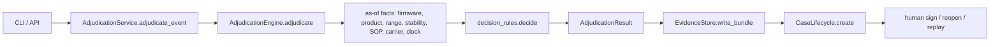

# Code walkthrough: one alert, start to finish

This page follows a real alert through the code in the order the code runs. Every file and function named here exists in `src/kestrel/`, and outputs are from the 7 Nov 2026 (CET) sample rerun unless explicitly labelled illustrative metadata.

**Thirty-second version.** An excursion alert comes in through the CLI or the HTTP API. `AdjudicationService` hands it to `AdjudicationEngine`, which resolves the facts that applied *on the excursion date*: the firmware uncertainty bound, the product, the labelled range, the stability allowance, the SOP revision, the carrier contract and the regulatory clock. Those facts become an `ExcursionFacts` object. `decision_rules.decide()` walks 16 ordered rules, and the first rule that returns a verdict wins; a separate conservative fallback runs only if none do. The result is sealed into a hash-chained evidence bundle for that tenant and opens a case. Only non-actionable `AUTO_CLOSE` results close without a person; every product-fate decision waits for a named human signature bound to the evidence hash they saw. No LLM is involved anywhere in the decision.



---

## Outcome-match/conflict demo: EXC-107133

```bash
kestrel adjudicate --event EXC-107133
```

| Field | Value |
|---|---|
| Tenant | `T-KAVERI` |
| Reading | max 11.2 °C, min 5.4 °C, 15 minutes, firmware `TT-2.15.0` |
| Labelled range | `2-8C (protect from light)`, parsed to 2.0 to 8.0 °C |
| Product match | `gtin_exact` on `08901234500035` |
| Allowance used | "Cumulative 72 h above 8 °C permitted across shelf life", from the product master |
| SOP | `SOP-KAV-9392` `Rev 03`, with an overlap conflict flagged |
| **Recommendation** | **`RELEASE_WITH_NOTE`**, confidence 0.8, human signature required |
| Historical final decision | `RELEASE_WITH_NOTE` (agrees) |

The rationale the reviewer sees, verbatim:

```text
- stability study has blank permitted_excursion_text (long-term/accelerated studies do not answer excursion question — README)
- cited study presentation conflicts with brand; preferring product-master permitted_excursion_text over mismatched study row
- SOP overlap: 2 revisions of SOP-KAV-9392 effective on 2026-07-28; selected Rev 03 (highest rev). Human must confirm (override EXC-110490 pattern).
- Carrier contract CNT-2021-0245 has no cold-chain schedule (Tapti/Ganga pattern) — liability/custody weak; does not alone change product disposition
- Presentation mismatch on cited study — using master allowance with reduced confidence
- SOP revision overlap on excursion date — human must confirm which acceptance limit governed; proceeding with stability arithmetic
- Cumulative-above-label check: 0.25h above ~8.0°C vs budget ≤72.0h; peak 11.2°C (source=product_master_over_mismatched_study)
- Within single-event allowance but exposure is cumulative across shelf life — release with batch note
```

Each line maps to one step below. This matches the narrative's outcome only, not Priya's evidence basis: the brief uses the pen's six-hour/15°C study, whereas this prototype uses the conflicting master cumulative allowance. No batch exposure ledger is written.

---

## Step 1. Entry: CLI or HTTP

**Files:** `src/kestrel/cli.py`, `src/kestrel/api/app.py`

- `cli.build_parser()` defines every subcommand. `cli.main()` looks the command up in the `_COMMANDS` dict and calls one `_cmd_*` handler; `adjudicate` goes to `_cmd_adjudicate`.
- `api.app.create_app()` builds the FastAPI app. `POST /adjudicate` takes `{"event_id": "EXC-107133"}`.
- Both transports call the same `AdjudicationService.adjudicate_event()`. Neither contains decision logic.

**Why:** with one service behind two thin transports, the CLI and the API can't disagree. Transport code only parses input and maps errors to exit codes or HTTP statuses (`TenantIsolationError` becomes 403, an unknown entity 404, a blank signer 422, stale evidence 409).

## Step 2. Configuration and bootstrap

**Files:** `src/kestrel/config.py`, `src/kestrel/service.py`

- `config.Settings` holds the pack path, SQLite path, evidence folder, log level, API host and port, and rule-pack version. `KESTREL_DATA_PACK`, `KESTREL_DB_PATH`, `KESTREL_EVIDENCE_DIR`, `KESTREL_LOG_LEVEL`, `KESTREL_API_HOST` and `KESTREL_API_PORT` override them. No third-party settings library is used.
- `AdjudicationService.bootstrap()` calls `ingest.load_workbook_into_store()` once, then loads `ingest.DataPack` and builds the `AdjudicationEngine`.

**Why:** deployments change by environment variable, not code edits. Bootstrap happens once per process, not once per alert.

## Step 3. Ingest into a bitemporal store

**Files:** `src/kestrel/ingest.py`, `src/kestrel/storage/bitemporal.py`

- `load_workbook_into_store()` reads the workbook sheets (product master, SOP index, and so on) and writes each reference row through `BitemporalStore.insert_ref()` into the `ref_record` table, with a snapshot id such as `snap-01fa38821116`.
- Each row carries two time ranges. `valid_from` and `valid_to` say when the fact was true in the business; for SOPs these are the revision's effective dates. `tx_from` and `tx_to` say when the system learned it.
- `BitemporalStore.as_of(valid_as_of=..., tx_as_of=...)` answers "what was true on date X, as we knew it on date Y". `BitemporalStore.sop_in_force()` serves `kestrel as-of-sop` and `GET /as-of/sop`.

**Why:** a QA decision has to be defensible later. If a SOP is corrected next month, we can still show which revision we believed was in force on the day we decided. The cost is more complex queries and a larger store. For speed, the engine reads the same reference data from the in-memory `DataPack`, and the store backs as-of lookups, cases, alerts and the evidence index.

## Step 4. Firmware uncertainty bound (TT-CB-114)

**File:** `src/kestrel/engine.py`, `AdjudicationEngine.adjudicate()`

A firmware match to `TT-2.14.3` sets `bulletin_applied=True` (flag means assessed, not corrected). The engine runs `_decide()` at reported summaries and again with min/max/mean shifted up by the 1.8°C bound. Both scenario readings, dispositions and traces are recorded under `evidence.temps.uncertainty`; reported observations and the input event are unchanged. Different dispositions force `ESCALATED_TO_SENIOR_QA` and a human signature flag. Even identical outcomes retain the bulletin flag.

This is two-endpoint sensitivity analysis with a common-offset summary assumption, not calibrated truth or proof over every raw series. Firmware-only applicability lacks device/effective-date validation. EXC-107133 runs `TT-2.15.0`: its reported maximum remains 11.2°C, with no bound scenario. The external field is `reported_max_temp_c`; there is no `max_corrected` truth field.

## Step 5. Product identity

**File:** `src/kestrel/rules/identity.py`

`IdentityResolver.resolve_product(tenant, product_ref)` returns a `ResolvedProduct` with `match_method`, `confidence`, SKU, brand, GTIN and the cited stability study. EXC-107133 matched on `gtin_exact`. Weaker matches such as an alias chain carry lower confidence, and a blank reference comes back `unresolved`.

Product and exact/alias candidate matches are restricted to the tenant; no product rows means unresolved escalation, never another tenant's product. Multiple exact or alias candidates return ambiguity instead of first-row selection. Study lookup uses `(tenant_code, study_ref)`. Alias observations lack tenant ownership and verified trust; this is still a prototype limitation.

**Why:** customer product references are messy. Instead of guessing, the resolver records *how* it matched and how sure it is, and `rule_unresolved_identity` escalates when confidence is below `MIN_PRODUCT_CONFIDENCE = 0.5`.

## Step 6. Labelled range and stability allowance

**Files:** `src/kestrel/rules/as_of.py` (`parse_storage_range`), `src/kestrel/rules/stability.py`

- `parse_storage_range("2-8C (protect from light)")` returns `(2.0, 8.0)`.
- Qualified "No excursion above 25 °C permitted" is a 25°C cap, not an unconditional ban. A missing duration/disposition authority escalates; unqualified "No excursion permitted" remains a ban.
- `StabilityResolver.resolve(product)` returns a `StabilityPosition` with the permitted-excursion text, the parsed limits, flags such as `cumulative_above_label` and `no_excursion`, the source it used, and notes.
- For EXC-107133 the cited study `STB-3584` has a blank permitted-excursion text and a presentation that conflicts with the brand, so the resolver falls back to the product master's text. That's why the trace says `source=product_master_over_mismatched_study`.

**Why:** the stability source is the most argued-about input in a QA review, so the resolver writes down which source it chose and why. It never silently picks one.

## Step 7. SOP in force on the excursion date

**File:** `src/kestrel/rules/as_of.py`

`sop_in_force(sops, tenant, "Temperature Excursion Management", as_of)` finds every revision effective on the excursion date. When two overlap, it picks the highest revision and sets `overlap_conflict=True`:

```python
candidates.sort(key=lambda sop: revision_number(sop.get("revision")), reverse=True)
return AsOfHit(record=candidates[0], overlap_conflict=len(candidates) > 1, competing=candidates)
```

For EXC-107133, two revisions of `SOP-KAV-9392` were effective on 2026-07-28. The engine picks `Rev 03` and tells the human to confirm.

**Why:** the policy that counts is the one in force when the excursion happened, not today's. Overlap is a data-quality problem a person must resolve, so the engine flags it instead of hiding it.

## Step 8. Carrier contract and regulatory clock

**Files:** `src/kestrel/rules/identity.py` (`resolve_carrier_contract`), `src/kestrel/rules/regulatory.py`

- The carrier contract is resolved as of the excursion date. A contract with no cold-chain clause (EXC-107133 has `CNT-2021-0245`) is noted for liability but, by design, does not change the product disposition.
- `regulatory_clock()` computes the notification window and deadline in a fixed order: the pack's own `reg_window_hours` if present, then the tenant default, then the region default, then 72 hours. It records which of these it used in `basis`.

**Why:** the deadline is an *operational* output that drives queue order. It's kept separate from the disposition to help prioritise stored cases; this is not a fairness, live-admission or independent-paging guarantee.

## Step 9. Facts and the ordered rules

**Files:** `src/kestrel/engine.py` (`_decide`), `src/kestrel/decision_rules.py`

`_decide()` packs everything above into one `ExcursionFacts` and calls `decide()`:

```python
def decide(facts: ExcursionFacts) -> tuple[Verdict, list[str]]:
    trace: list[str] = []
    for rule in DECISION_RULES:
        verdict = rule(facts, trace)
        if verdict is not None:
            return verdict, trace
    return rule_no_parseable_allowance(facts, trace), trace
```

`DECISION_RULES`, in order:

| # | Rule | What it catches |
|---|---|---|
| 1 | `rule_facility_equipment_event` | Facility alarm with no product loaded: `AUTO_CLOSE` |
| 2 | `rule_duplicate_alert` | Duplicate of an earlier alert: `AUTO_CLOSE` |
| 3 | `rule_gateway_gap` | Interpolated readings across a long gateway gap are not evidence |
| 4 | `rule_unresolved_identity` | Product confidence below 0.5: escalate |
| 5 | `rule_presentation_mismatch` | Stability study may be for the wrong presentation |
| 6 | `rule_sop_overlap` | Adds a trace line only and never decides |
| 7 | `rule_allowance_refer_qa` | Study itself says "Refer QA": a person decides |
| 8 | `rule_unreadable_stability` | Cited study can't be read: send to the lab, never guess |
| 9 | `rule_sensor_artefact` | Spike within sensor tolerance |
| 10 | `rule_dock_door` | Short dock-door opening |
| 11 | `rule_within_label_range` | Never actually left the labelled range |
| 12 | `rule_freeze_damage` | Below 0 °C on a 2–8 °C product: `DESTROY` |
| 13 | `rule_ultra_cold` | Ultra-cold product handling |
| 14 | `rule_qualified_temperature_cap` | Cap with missing duration/authority: QA review |
| 15 | `rule_no_excursion_permitted` | Product allows no excursion |
| 16 | `rule_stability_allowance` | Duration and temperature against the allowance |
| fallback | `rule_no_parseable_allowance` | Out of range with no usable allowance: conservative outcome |

The order runs from cheap non-actionable triage, to hard escalations, to temperature arithmetic, to a conservative fallback. Every number in a rule is a named constant at the top of the file, such as `DOCK_DOOR_MAX_MINUTES = 20` and `SEVERE_BREACH_MARGIN_C = 5`.

For EXC-107133, rules 1 to 4 pass. Rule 5 adds "using master allowance with reduced confidence" and rule 6 adds the SOP line; neither decides. Rules 7 to 15 don't match. Rule 16 sees a cumulative allowance (0.25 h used against a 72 h budget) and returns `RELEASE_WITH_NOTE` with confidence 0.8 instead of 0.85, because of the presentation mismatch.

**Why:** each rule is small, named, and testable on its own (tests cover selected boundaries, not all clinical interactions), and the order is explicit. The trade-off is that the order *is* behaviour, so moving a rule is a policy change and must go through the golden tests. [decision-rules.md](decision-rules.md) explains how to add a rule.

## Step 10. Human-in-the-loop guard

**File:** `src/kestrel/engine.py`

```python
requires_human = recommendation != AUTO_CLOSE
if recommendation in ACTIONABLE_DISPOSITIONS:
    requires_human = True
```

Only `AUTO_CLOSE` can skip a person. Even a high-confidence `RELEASE` needs a signature.

## Step 11. Evidence bundle and the per-tenant hash chain

**File:** `src/kestrel/storage/evidence.py`

`AdjudicationService._persist()` calls `EvidenceStore.write_bundle()`. That builds a document with the inputs, the resolution evidence, the recommendation, the reasoning steps, the rule-pack version, the snapshot id and the code version, including typed event/reference replay inputs and the full expected result, and hashes it with `canonical_hash()` (sorted-key JSON, SHA-256). The bundle id comes from the hash (ids depend on creation metadata; do not assert a stable example id), and `prev_hash` links it to the tenant's previous bundle.

```bash
kestrel basis  --event EXC-107133 --tenant T-KAVERI
kestrel verify --tenant T-KAVERI
```

`verify_chain()` recomputes every hash and link. Editing any bundle breaks the chain from that point on.

**Why:** an auditor can inspect captured summaries/references/reasoning and detect stored edits. This is not the complete March basis: raw series, original SOP PDFs and Annexure 2 content are not archived. Evidence reads are tenant-guarded; complete clause 22 enforcement over all derived data remains a production requirement. The limit is that a local chain is tamper-evident, not tamper-proof; production would anchor the chain head externally.

## Step 12. The case and its state machine

**Files:** `src/kestrel/lifecycle.py`, `src/kestrel/domain.py`

`CaseLifecycle.create()` opens a case (random case id) linked to the bundle and the regulatory deadline. Ordinary changes go through `transition()`; CLOSED_SIGNED is reserved for verified `sign()`. Allowed lifecycle moves are listed in `ALLOWED`:

```python
if new_state not in ALLOWED.get(cur, set()):
    raise TransitionError(f"{cur.value} -> {new_state.value} not allowed")
```

`storm_safe_queue()` orders stored cases by deadline; it does not implement storm admission, event collapse, fairness or independent paging, so it does not prove no starvation.

## Step 13. Sign, reopen, replay

**Files:** `src/kestrel/lifecycle.py`, `src/kestrel/service.py`, `src/kestrel/api/app.py`

- **Sign:** `sign()` requires a nonblank signer and viewed hash (HTTP missing hash: 422; stale/tampered hash: 409). It reads and verifies the actual bundle, not a caller-asserted current hash, then appends a SIGNED bundle with case id, signer, time, final disposition, reason and original evidence hash. Latest basis returns this artifact; the original pre-sign snapshot remains immutable/UNSIGNED. Generic transition cannot bypass signing. SSO/roles/dual-sign and atomic file+DB transactions are not implemented.
- **Reopen:** prior case state becomes REOPENED; a linked new case inherits deadline, reportability and evidence reference. Prior signature fields and artifacts remain; no assumption is made that notification was handled.
- **Replay:** verifies the bundle, restores tagged date/datetime event/reference inputs from it, and compares the full result including rationale/evidence. The live workbook/engine is not read. Missing replay inputs or mismatching pinned code/rule versions fail explicitly; old executable builds are not archived by this helper. Replay creates no bundles or cases.

## Step 14. Shadow replay and operations

**Files:** `src/kestrel/shadow.py`, `src/kestrel/service.py`

- `shadow_replay_bulletin()` takes every event on the affected firmware and adjudicates it twice, with and without bound-aware TT-CB-114 analysis, then reports which outcomes would change. The rerun has 91 candidates, 91 scenario/evidence diffs and 4 disposition flips; this is not reconstruction of the historical 61 flips.
- `AdjudicationService.health_report()` (`kestrel health`, `GET /ops/health-report`) returns on-demand alert dictionaries (not live independent pages) for: `regulatory_deadline_breached`, `regulatory_deadline_at_risk`, `evidence_chain_verification_failure`, `decision_mix_drift`, `data_feed_staleness`, `queue_age` and `firmware_bulletin_change`. See [operations.md](operations.md).

---

## Two contrasting cases

**EXC-112289: `ESCALATED_TO_SENIOR_QA` (previously DESTROY).** Tenant `T-CAMPOS`, firmware `TT-2.14.3`, alias match from "ravlizumab arx 40". Reported maximum stays 18.0°C; upper-bound scenario is 19.8°C, not a correction. The selected study supplies "No excursion above 25 °C permitted" (master text differs). The fixed parser does not reinterpret that as a ban outside 2–8°C; both scenarios reach rule 14 and escalate for missing duration/disposition authority. Historical final is QUARANTINE_PENDING_LAB. This is an explained disagreement needing QA review, not a claim to have found the right clinical disposition.

**EXC-112198: `AUTO_CLOSE`.** Tenant `T-AURA`. The product reference is blank, but the alert's triage says it duplicates an earlier alert, so rule 2, `rule_duplicate_alert`, closes it before identity is even considered. It's non-actionable and needs no signature.

---

## Read the code in this order

1. `domain.py`: the vocabulary (`Disposition`, `CaseState`, `Alert`, `Case`).
2. `decision_rules.py`: the whole policy on one screen.
3. `engine.py`: how facts are gathered for the rules.
4. `rules/`: `identity.py`, `stability.py`, `as_of.py`, `regulatory.py`.
5. `service.py`: orchestration, persistence, replay, health.
6. `storage/`: `bitemporal.py` (SQLite) and `evidence.py` (hash chain).
7. `lifecycle.py`: the case state machine and signing.
8. `cli.py` and `api/app.py`: the two thin transports.
9. `tests/`: `test_golden.py` and `test_determinism.py` pin behaviour; `test_decision_rules.py` covers selected thresholds.

## Reproduce everything above

```bash
git clone -b production https://github.com/Zulfiqar7862/kestrel-adjudication-case-study.git
cd kestrel-adjudication-case-study
make install && make test
kestrel run-all                        # 224 / 106 / 53 / 26 / 11 over the 420-alert stratified sample
kestrel adjudicate --event EXC-107133
kestrel adjudicate --event EXC-112289
kestrel shadow-bulletin
make serve                             # then open http://localhost:8080/ui
```

## Honest limits to explain

Cumulative allowance checks only this event: no batch history read/write. Shortened expiry is absent; release-with-note is not its substitute. Escalation is review routing still encoded in the disposition enum. SOP highest-revision is a flagged candidate tie-break, not proof Annexure 2 was resolved; signing does not enforce conflict clearance. Regulatory windows are approximations (US 24h, Brazil 120h UTC; India tab13 15 days applies only to notifiable products). Hashes and retention dates do not prove seven-year durability, source authenticity or audit completeness.
